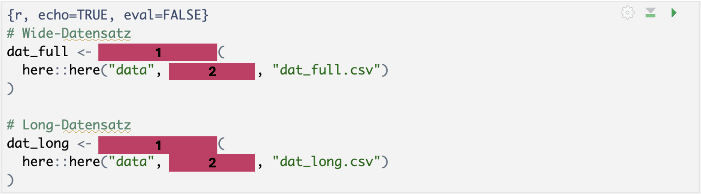
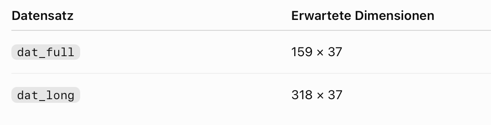
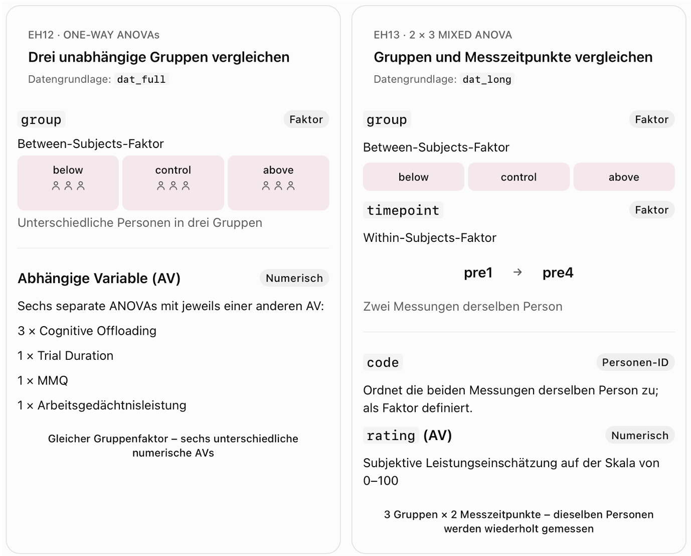
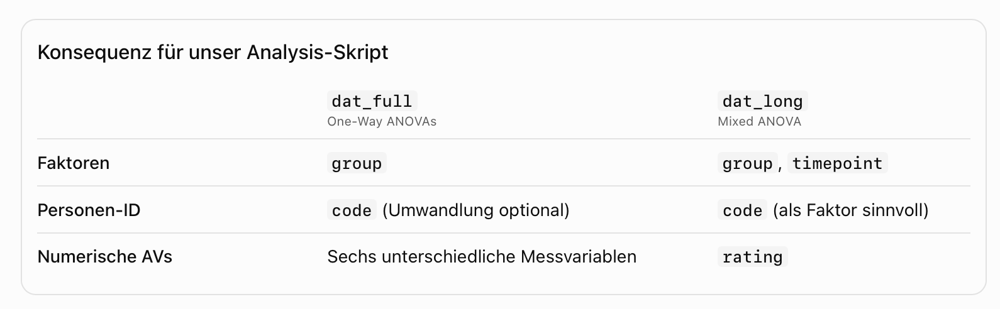
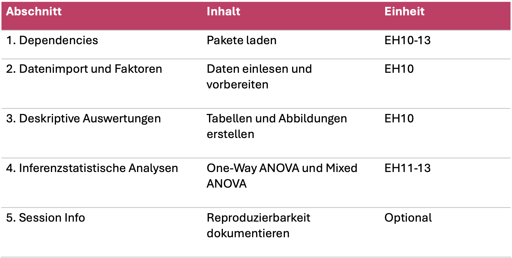
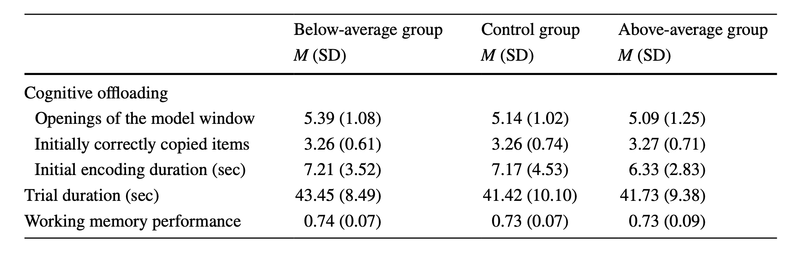
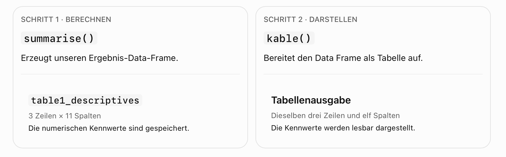
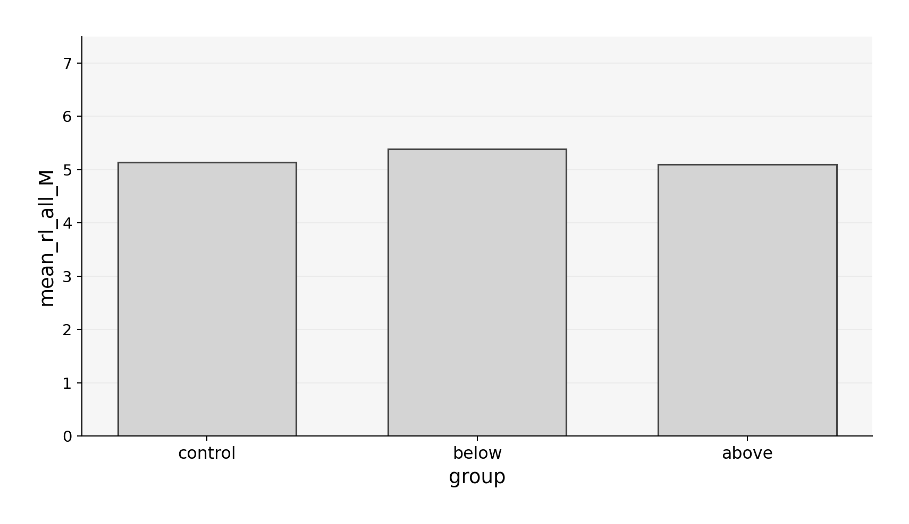
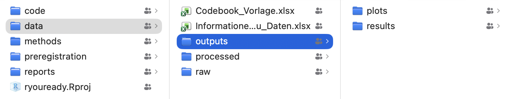

```{r, echo = FALSE, message=FALSE, warning=FALSE}
library(tidyverse)
library(ggplot2)

dat_full <- read_csv("raw/dat_full.csv")
dat_full <- dat_full |>
  rename(group = group_all,
         cvstm_sum = csvtm_sum) |>
  mutate(
    across(
      c(pre1, pre2, pre3, pre4, post),
      ~ .x * 10
    ),
    mmq_mean = rowMeans(across(question1:question18))
  )

dat_long <- dat_full |>
      pivot_longer(
        cols = c(pre1, pre4),
        names_to = "timepoint",
        values_to = "rating"
      )
```

## R u Ready? Reproduzierbare Datenaufbereitung und -analyse mit R

HS 2026<br><br><br> **Seminarleitung**: Dr. Sandra Grinschgl<br> **Leitung beider Seminargruppen:** MSc. Laura Hirt<br> **Tutor**: BSc. Jan-Pierre Pahnke<br><br><br>**10. Einheit**, 18.11.2026

{fig-align="center" width="306"}

------------------------------------------------------------------------

## Seminar am 2. Dezember: Änderung der Morgengruppe

**Der reguläre Termin von 10:15 - 12:00 Uhr entfällt, da der Raum für die BA-Informationstage benötigt wird**

<br>

{fig-align="center" width="95%"}

------------------------------------------------------------------------

##  {data-background-iframe="../../PDFs/Muddiest_Points_II.pdf#view=FitH&navpanes=0&toolbar=0" data-background-interactive=""}

------------------------------------------------------------------------

## Wo befinden wir uns?

**ANALYSIEREN: Von aufbereiteten Daten zu wissenschaftlichen Ergebnissen**

<br>

{fig-align="center" width="75%"}

<br>

**Bisher:** Wir haben unsere Forschungsdaten in `processing.qmd` aufbereitet.

**Ab heute:** Wir beschreiben, visualisieren und analysieren unsere Ergebnisse in `analysis.qmd`.

::: notes
In den vergangenen Einheiten haben wir unsere sieben Rohdatensätze zusammengeführt, Variablen dokumentiert, Daten transformiert und die benötigten Analysevariablen erstellt.

Letzte Woche haben wir die Datenaufbereitung abgeschlossen. Wir besitzen nun zwei Datensätze, die wir für unterschiedliche Auswertungen benötigen.

Heute beginnt die nächste Phase unseres Forschungsprojekts: Wir möchten herausfinden, welche Ergebnisse unsere Daten zeigen. Dabei testen wir heute noch keine Hypothesen, sondern lernen einmal, wie wir Daten deskriptiv beschreiben und visualisieren können.
:::

------------------------------------------------------------------------

## Zwei Skripte - zwei andere Aufgaben

**Von der Datenaufbereitung zur wissenschaftlichen Auswertung**

<br>

{fig-align="center" width="85%"}

<br>

**Die Verbindung:** `data/processed/` enthält die aufbereiteten Daten für unsere Analysen.

::: notes
Wir haben in den vergangenen Einheiten hauptsächlich in unserem Processing-Skript gearbeitet. Dort haben wir die sieben Rohdatensätze eingelesen, zusammengeführt und die Variablen systematisch aufbereitet.

Am Ende der letzten Woche haben wir die beiden aufbereiteten Datensätze gespeichert: dat_full im Wide-Format und dat_long im Long-Format.

Diese beiden Dateien bilden jetzt die Grundlage für unser Analyseskript. Wir beginnen also nicht nochmals mit den Rohdaten, sondern verwenden die bereits aufbereiteten Daten, um die Ergebnisse aus der Studie zu reproduzieren.

Dabei werden wir zunächst deskriptive Kennwerte berechnen und unsere Ergebnisse als Tabellen und Abbildungen darstellen. In den nächsten Einheiten folgen dann die statistischen Analysen.

Wichtig ist: Die beiden Skripte erfüllen unterschiedliche Aufgaben, gehören aber zum selben reproduzierbaren Forschungsprojekt.
:::

------------------------------------------------------------------------

## Wir beginnen mit den aufbereiteten Daten

**Im Analysis-Skript lesen wir die Ergebnisse unserer Datenaufbereitung ein**

<br>

{fig-align="center" width="95%"}

<br>

-   **Welche Funktion zum Einlesen der Daten kommt bei `1`?**

-   **Was muss bei `2` stehen?**

------------------------------------------------------------------------

## Wir beginnen mit den aufbereiteten Daten

**Im Analysis-Skript lesen wir die Ergebnisse unserer Datenaufbereitung ein**

<br>

::::: columns
::: {.column width="50%"}
**Codeblock**

```{r, echo=TRUE, eval=FALSE}
# Wide-Datensatz
dat_full <- readr::read_csv(
  here::here("data", "processed", "dat_full.csv")
)

# Long-Datensatz
dat_long <- readr::read_csv(
  here::here("data", "processed", "dat_long.csv")
)
```
:::

::: {.column width="50%"}
**Kontrolle**

Bspw. mit der Funktion `dim()`

{fig-align="center" width="95%"}
:::
:::::

<br>

**Wir arbeiten direkt mit den aufbereiteten Dateien aus `data/processed/`.**

::: notes
In den vergangenen Einheiten haben wir unsere Daten in `processing.qmd` aufbereitet und anschliessend als zwei Dateien gespeichert.

Genau diese beiden Dateien lesen wir nun im `analysis.qmd` wieder ein.

Das ist ein wichtiger Unterschied zu den ersten Einheiten: Wir beginnen hier nicht nochmals mit den Rohdaten, sondern arbeiten direkt mit den Ergebnissen unserer Datenaufbereitung weiter.

Die Kontrolle ist wichtig, damit wir früh merken, falls beim Speichern oder Einlesen etwas nicht stimmt.
:::

------------------------------------------------------------------------

## Welche Variablen werden zu Faktoren?

**Unsere geplanten Analysen bestimmen, wie wir die Variablen in R behandeln**

{fig-align="center" width="95%"}

::: notes
Wir haben unsere beiden aufbereiteten Datensätze nun im Analysis-Skript eingelesen. Bevor wir die Daten statistisch auswerten, müssen wir entscheiden, welche Variablen wir als Faktoren behandeln.

Dafür schauen wir uns an, welche Analysen wir in unserem Forschungsprojekt durchführen möchten.

Zunächst werden wir sechs One-Way ANOVAs berechnen. Bei allen vergleichen wir dieselben drei Feedbackgruppen miteinander. Diese Gruppenzugehörigkeit ist unser Between-Subjects-Faktor und wird deshalb in R als Faktor definiert. Was sich zwischen den sechs ANOVAs verändert, ist die abhängige Variable. Wir untersuchen verschiedene Masse des Cognitive Offloading, die Trial Duration, den MMQ und die Arbeitsgedächtnisleistung. Diese Messvariablen bleiben numerisch, weil wir ihre Mittelwerte vergleichen möchten.

Für diese Analysen verwenden wir unseren Wide-Datensatz dat_full.

Bei der Mixed ANOVA kommt nun ein zweiter Faktor hinzu. Wir vergleichen nicht nur verschiedene Feedbackgruppen, sondern untersuchen auch, wie sich die subjektiven Leistungseinschätzungen zwischen zwei Zeitpunkten verändern.

Die Gruppenzugehörigkeit ist weiterhin unser Between-Subjects-Faktor. Der Messzeitpunkt ist dagegen ein Within-Subjects-Faktor, weil dieselbe Person zu beiden Zeitpunkten eine Einschätzung abgegeben hat. Deshalb benötigen wir zusätzlich die Personenerkennung code, damit R die zwei Messungen derselben Person zuordnen kann. Wir behandeln code deswegen auch als Faktor. Die eigentliche AV rating bleibt hingegen numerisch.

Daraus ergibt sich auch, warum wir nicht einfach alle kategorialen Variablen unseres Datensatzes umwandeln. strategies ist zwar ketegorial, wir aber in unseren ANOVAs nicht als Faktor verwendet. Entscheidend ist also immer die Rolle einer Variable in der Analyse.
:::

------------------------------------------------------------------------

## Welche Variablen werden zu Faktoren?

**Konsequenz für unser Analysis-Skript**

<br>

{fig-align="center" width="95%"}

<br>

**Für unser Analysis-Skript:** Die benötigten Faktoren definieren wir einmal zentral nach dem Datenimport - die Umsetzung folgt in Hands-on 5B.

------------------------------------------------------------------------

## Wie bauen wir unser Analysis-Skript auf?

**Wir ergänzen unser Skript Schritt für Schritt bis zum Abschluss der Analysen**

<br>

{fig-align="center" width="95%"}

<br>

**Unser Ziel:** Ein vollständiges Analysis-Skript, das alle erforderlichen Auswertungen unseres Forschungsprojekts reproduzierbar durchführt.

# Deskriptivstatistik & wissenschaftliche Tabellen

**1. Kennwerte berechnen**

**2. Tabelle darstellen**

::: notes
Wichtig ist mir hier, dass ihr einmal dir grundsätzliche Funktion der Schritte versteht. Die Tabelle, die wir hier erstellen werden, sieht vom Layout her nicht identisch aus zur Tabelle in der Studie. Dies ist dann eure Aufgabe in den Übugnen.
:::

------------------------------------------------------------------------

## Was zeigt uns Tabelle 1?

**Die Studie berichtet Mittelwerte und Standardabweichungen für drei Feedbackgruppen**

<br>

{fig-align="center" width="95%"}

<br>

**Unser Ziel:** Alle Mittelwerte und Standardabweichungen aus Tabelle 1 in einem gemeinsamen Data Frame berechnen.

::: notes
Wir haben unsere beiden Datensätze eingelesen und wissen nun, wie wir sie für die späteren Analysen vorbereiten.

Bevor wir mit den statistischen Tests beginnen, möchten wir uns zunächst anschauen, welche Ergebnisse unsere Daten überhaupt zeigen.

Dafür nehmen wir einmal Tabelle 1 aus dem Originalpaper. Wir sehen hier fünf Messvariablen. Für jede dieser Variablen werden die Ergebnisse getrennt für die drei Feedbackgruppen dargestellt. Dabei werden jeweils zwei Kennwerte angegeben: der Mittelwert und die Standardabweichung. Den Mittelwert verwenden wir, um das durchschnittliche Ergebnis zu beschrieben. Die Standardabweichung zeigt uns, wie stark die individuellen Werte innerhalb einer Gruppe streuen.

Genau diese Kennwerte möchten wir nun mit unseren Originaldaten selbst berechnen und darstellen.
:::

------------------------------------------------------------------------

## Wie berechnen wir alle Kennwerte?

**Mit `group_by()`** **und** `summarise()` **fassen wir die Daten gruppenweise zusammen**

<br>

```{r, echo=TRUE, eval=TRUE}

table1_descriptives <- dat_full |>
  group_by(group) |>
  summarise(
    mean_rl_all_M = mean(mean_rl_all, na.rm = TRUE),
    mean_rl_all_SD = sd(mean_rl_all, na.rm = TRUE),
    mean_e1_all_M = mean(mean_e1_all, na.rm = TRUE),
    mean_e1_all_SD = sd(mean_e1_all, na.rm = TRUE),
    mean_d1_all_M = mean(mean_d1_all, na.rm = TRUE),
    mean_d1_all_SD = sd(mean_d1_all, na.rm = TRUE),
    mean_d_all_M = mean(mean_d_all, na.rm = TRUE),
    mean_d_all_SD = sd(mean_d_all, na.rm = TRUE),
    cvstm_propcorrect_M = mean(cvstm_propcorrect, na.rm = TRUE),
    cvstm_propcorrect_SD = sd(cvstm_propcorrect, na.rm = TRUE)
  )
```

<br>

**Wichtig:** Nur ein möglicher Code von vielen!

------------------------------------------------------------------------

## Was haben wir berechnet?

**Ein neuer Data Frame enthält alle Mittelwerte und Standardabweichungen der drei Gruppen**

<br>

```{r, echo=TRUE}
# Dimensionen
dim(table1_descriptives)
```

<br>

```{r, include=FALSE}
table1_descriptives$group <- as.factor(table1_descriptives$group)
```

```{r, echo=TRUE}
# Ausgabe
table1_descriptives
```

<br>

**Ergebnis:** Drei Gruppenzeilen und zehn Kennwertspalten - alle benötigten Werte in einem Data Frame.

::: notes
Schauen wir uns an, was unsere Berechnung erzeugt hat:

Wir erhalten einen neuen Data Frame mit drei Zeilen und elf Spalten. Jede Zeile entspricht einer Feedbackgruppe.

Zusätzlich zu group haben wir zehn weitere Spalten: Für jede unserer fünf Messvariablen wurde eine Mittelwertspalte und eine Spalte mit den SD erstellt.

Wir sehen hier nur einen Ausschnitt der Ausgane. Die restlichen Kennwerte befinden sich aber ebenfalls im selben Data Frame.

Damit haben wir alle benötigten Ergebnisse für Tabelle 1 bereits berechnet. Nun möchten wir diese Information noch übersichtlicher darstellen.
:::

------------------------------------------------------------------------

## Vom Data Frame zur Tabelle

**`kable()` stellt unsere bereits berechneten Kennwerte als Tabelle dar**

<br>

{fig-align="center" width="95%"}

<br>

```{r, echo=TRUE, eval=TRUE}
knitr::kable(table1_descriptives)
```

::: notes
Wir haben nun alle Mittelwerte und SD berechnet und in table1_descriptives gespeichert.

Für einen wissenschaftlichen Bericht möchten wir diese Ergebnisse aber als übersichtliche Tabelle darstellen.

Dafür verwenden wir die Funktion kable() aus dem Paket knitr.

Das Vorgehen ist einfach: Wir übergeben der Funktion unseren bereits erstellten Data Frame. Wichtig ist, dass kable() keine statistischen Kennwerte berechnet. Die Funktion verändert auch nicht die Werte in unserem Data Frame, sondern bereitet sie für die Darstllung auf.

Wir haben deshalb zwei unterschiedliche Arbeitsschritte: Zuerst berechnen wir die Ergebnisse, anschliessend gestalten wir ihre Darstellung.
:::

------------------------------------------------------------------------

## Wie gestalten wir unsere Tabelle?

**Mit wenigen Argumenten können wir die Darstellung unserer Ergebnisse anpassen**

<br>

```{r, echo=TRUE}
knitr::kable(
  table1_descriptives,
  digits = 2,
  caption = "Deskriptive Kennwerte nach Feedbackgruppe"
)
```

<br>

**Die Kennwerte bleiben unverändert - nur ihre Darstellung wird angepasst.**

::: notes
Unsere Tabelle ist nun erstellt. Mit verschiedenen Argumenten können wir sie noch übersichtlicher gestalten.

-   Mit digits bestimmen wir, auf wie viele Nachkommastellen die numerischen Kennwerte angezeigt werden. Da im Paper zwei Nachkommastellen verwendet werden, wählen wir hier digits = 2.

-   Mit caption können wir eine aussagekräftige Tabellenüberschrift ergänzen.

Wichtig ist, dass diese Anpassungen nur die Darstellung betreffen. Die berechneten Kennwerte bleiben unverändert.

Damit haben wir nun eine vollständige Tabelle mit allen benötigten Kennwerten aus Tabelle 1 erstellt. Sie sieht zwar noch etwas anders aus als im Paper, enthält aber dieselben Informationen.
:::

------------------------------------------------------------------------

## Tabelle 1 in der Abschlussarbeit

**Korrekte Kennwerte sind die Grundlage - eine möglichst genaue Replikation bringt die volle Punktzahl**

<br><br>

**Grundanforderung:** Die Mittelwerte und Standardabweichungen aus Tabelle 1 korrekt berechnen und als Tabelle darstellen.

<br>

**Erweiterte Anforderung:** Zusätzlich die Tabellenstruktur und Gestaltung möglichst genau an die Originalpublikation anpassen.

<br>

Für heute ist aber v.a. wichtig, dass ihr die grundlegenden Schritte verstanden habt: Kennwerte berechnen, in einem Data Frame speichern und anschliessend mit `kable()` darstellen.

# Datenvisualisierung: Abbildungen

<br>

{fig-align="center" width="4cm" height="4.5cm"}

------------------------------------------------------------------------

## Warum Ergebnisse auch visualisieren?

**Abbildungen machen Unterschiede zwischen den Feedbackgruppen schneller erkennbar**

<br>

::::: columns
::: {.column width="38%"}
**Aus Tabelle 1:** Modellfensteröffnungen

| Feedbackgruppe |    M |
|:---------------|-----:|
| Control        | 5.14 |
| Below-average  | 5.39 |
| Above-average  | 5.10 |
:::

::: {.column width="62%"}
{fig-align="center" width="100%"}
:::
:::::

**Unsere Frage:** Wie visualisieren wir die bereits berechneten Gruppenmittelwerte?

::: notes
Wir haben in Tabelle 1 die Mittelwerte und SD aller fünf Messvariablen berechnet. Eine Tabelle ist ideal, wenn wir genau Werte nachschlagen möchten.

Eine Abbildung lässt uns Muster und Unterschiede häufig schneller erkennen. Hier nehmen wir bewusst ein Beispiel, das wir gerade schon ausgewertet haben: die Modellfensteröffnungen in den drei Feedbackgruppen.

Wir brauchen dazu keine neuen Rohdaten und keine neue Berechnung. Wir verwenden die Spalte mean_rl_all_M unseres bereits erzeugten Data Frames.
:::

------------------------------------------------------------------------

## `ggplot2`: Eine Grammatik für Grafiken

**Mit `ggplot2` setzen wir eine Grafik Schritt für Schritt aus Bausteinen zusammen**

<br>

-   **Daten:** Aus welchem Objekt stammen die Daten?

    -   `ggplot(data = ...)`

-   **Aesthetic Mappings:** Welche Variablen sollen dargestellt werden?

    -   `aes(x = ..., y = ...)`

-   **Geom:** Wie sollen die Daten dargestellt werden?

    -   `geom_col()`

-   **Gestaltung:** Wie sollen die Daten sonst noch gestaltet werden?

    -   `labs()` / `theme_*()`

<br>

**Merke:** Mit `+` fügen wir der Grafik weitere Elemente (*Layer*) hinzu.

::: notes
Die grundlegende Idee von ggplot2 ähnelt einem Baukastensystem:

-   Zuerst wählen wir die Daten

-   Dann bestimmen wir mit aes, welche Variablen auf den Achsen erscheinen

-   Ein sogenannten Geom legt fest, ob wir Balken, Punkte oder Linien zeichnen

-   Danach können wir Beschriftungen, Fehlerbalken und andere Gestaltungselemente ergänzen

Die verschiedenen Bestandteile einer ggplot-Graphik werden mit einem Pluszeichen verbunden.
:::

------------------------------------------------------------------------

##  {data-background-iframe="../../PDFs/cheatsheet_ggplot2.pdf#view=FitH&navpanes=0&toolbar=0" data-background-interactive=""}

------------------------------------------------------------------------

## Schritt 1: Daten auswählen

**`ggplot` erhält einen Data Frame - zunächst entsteht eine leere Zeichenfläche**

<br>

```{r, echo=TRUE, eval=TRUE}
ggplot(
  data = table1_descriptives
)
```

<br>

`data`: Unser Data Frame mit den berechneten Kennwerten.

**Noch fehlen:** die Variablen und die Art ihrer Darstellung.

::: notes
Wir starten mit genau demselben Ergebnisobjekt, das wir im Tabellenteil erzegt haben.

Dieses enthält eine Zeile pro Feedbackgruppe und insgesamt 11 Spalten.

Mit ggplot(data = table1_descriptives) legen wir fest, aus welchem Data Frame die Grafik ihre Informationen beziehen soll.

Mehr passiert zunächst nicht. Wir haben weder eine Achse mit Variablen belegt noch bestimmt, wie die Werte dargestellt werden sollen.
:::

------------------------------------------------------------------------

## Schritt 2: Variablen zuordnen

**Mit `aes()` legen wir fest, welche Variablen auf x- und y-Achse erscheinen**

<br>

```{r, echo=TRUE}
ggplot(
  table1_descriptives,
  aes(
    x = group,
    y = mean_rl_all_M
  )
)
```

**Wichtig: `aes()`** ordnet Variablen zu - es zeichnet noch keine Balken.

::: notes
Nun legen wir über aes, kurz für aesthetic mapping, die visuellen Zuordnungen fest. Auf der x-Achse sollen unsere drei Gruppen stehen.

Auf der y-Achse möchten wir die Mittelwerte der Modellfensteröffnungen anzeigen, die wir im Tabellenteil als mean-rl_all_M berechnet haben.

Die gewählten Variablen stammen alle aus dem Data Frame, den wir ggplot übergeben haben.

Noch fehlen allerdings die grafischen Elemente. Deshalb sehen wir zwar die Achsen, aber noch keine Balken.
:::

------------------------------------------------------------------------

## Schritt 3: Die Mittelwerte darstellen

**geom\_\*() bestimmt die Darstellungsform**

<br>

`geom_col()` zeichnet unsere bereits berechneten Mittelwerte als Balken:

```{r, echo=TRUE}
ggplot(
  table1_descriptives,
  aes(
    x = group,
    y = mean_rl_all_M)
  ) +
  geom_col(fill = "grey70",
           color = "grey30"
)
```

::: notes
Erst jetzt legen wir fest, wie die Werte aussehen sollen.

Wir verwenden geom_col(), weil wir die Gruppenmittelwerte bereits berechnet haben. Die Höhe jedes Balkens entspricht dem Wert in mean_rl_all_M.

Die feste Einstellung fill = grey70 färbt alle Balken gleich, color setzt den Rand.

Das Pluszeichen verbindet den Geom mit dem bereits begonnenen Plot.
:::

------------------------------------------------------------------------

## Weitere Layer: Fehlerbalken

**Mit `geom_errorbar()` können wir zusätzlich die Streuung der Messwerte zeigen**

<br>

```{r, echo=TRUE}
ggplot(table1_descriptives,
       aes(x = group,
           y = mean_rl_all_M)) + 
  geom_col(fill = "grey70",
           color = "grey30") +
  geom_errorbar(
    aes(
      ymin = mean_rl_all_M - mean_rl_all_SD,
      ymax = mean_rl_all_M + mean_rl_all_SD
    ),
    width = 0.18
       )
```

**Hier: M ± + SD.** In Abbildung 4 des Papers sind die Fehlerbalken dagegen M ± 1 SE.

::: notes
Eine Grafik kann mehrere grafische Layer enthalten. Mit geom_errorbar ergänzen wir nun Fehlerbalken.

Dafür benötigen wir eine untere Grenze (ymin) und eine obere Grenze (ymax). In unserem Beispiel verwenden wir die bereits berechnete Standardabweichung aus Tabelle 1. So sehen wir die Streuung der individuellen Werte um den Gruppenmittelwert.
:::

------------------------------------------------------------------------

## **Feste Werte oder Variablen zuordnen?**

**Innerhalb von `aes()` wird eine Variable zugeordnet - ausserhalb legen wir einen festen Wert fest**

::::: columns
::: {.column width="49%"}
**Feste Farbe**

```{r, echo=TRUE}
ggplot(table1_descriptives,
       aes(x = group,
           y = mean_rl_all_M)) + 
  geom_col(fill = "grey70",
           color = "grey30") +
  geom_errorbar(
    aes(
      ymin = mean_rl_all_M - mean_rl_all_SD,
      ymax = mean_rl_all_M + mean_rl_all_SD
    ),
    width = 0.18
       )
```
:::

::: {.column width="51%"}
**Farbe nach Gruppe**

```{r, echo=TRUE}
ggplot(table1_descriptives,
       aes(x = group,
           y = mean_rl_all_M)) + 
  geom_col(aes(fill = group),
           color = "grey30") +
  geom_errorbar(
    aes(
      ymin = mean_rl_all_M - mean_rl_all_SD,
      ymax = mean_rl_all_M + mean_rl_all_SD
    ),
    width = 0.18
       )
```
:::
:::::

------------------------------------------------------------------------

## Welche Darstellung passt zu unserer Frage?

**Die Wahl des Geoms hängt davon ab, welche Daten und welche Forschungsfrage wir haben**

<br>

| Was möchten wir zeigen? | Geeigneter Geom |
|------------------------------------|------------------------------------|
| Häufigkeiten einer Kategorie | `geom_bar()` |
| Bereits berechnete Mittelwerte | `geom_col()` |
| Verteilung einer numerischen Variable | `geom_histogram()` |
| Messwertverteilungen nach Gruppe | `geom_boxplot()` oder `geom_violin()` |
| Zusammenhang zweier numerischer Variablen | `geom_point()` |
| Verlauf über Messzeitpunkte | `geom_line()` |
| Streuungs- oder Unsicherheitsintervalle | `geom_errorbar()` |

::: notes
ggplot2 bietet viele unterschiedliche Geoms. Wir müssen sie nicht alle im Detail kennen. Enscheidend ist, dass wir die Darstellung anhand der Fragestellung auswählen.
:::

------------------------------------------------------------------------

## Wie gestalten wir eine lesbare Abbildung?

**Mit `labs()` und `theme_*()` machen wir die Grafik verständlich und übersichtlich**

```{r, echo=TRUE}
p_offloading <- ggplot(
  table1_descriptives,
  aes(x = group, y = mean_rl_all_M)
) +
  geom_col(fill = "grey70", color = "grey30") +
  geom_errorbar(
    aes(ymin = mean_rl_all_M - mean_rl_all_SD,
        ymax = mean_rl_all_M + mean_rl_all_SD),
    width = 0.18
  ) +
  labs(
    title = "Modellfensteröffnungen nach Feedbackgruppe",
    x = "Feedbackgruppe",
    y = "Modellfensteröffnungen (M)"
  ) +
  theme_classic()
```

```{r, echo=FALSE}
p_offloading
```

::: notes
Die Daten und die grafschen Elemente stehen bereits.

Nun müssen wir die Abbildung für andere Menschen verständlich machen. Mit labs() vergeben wir sinnvolle Achsentitel.

Mit theme_classic() wählen wir eine reduzierte Gestaltung ohne unnötige Hintergrundelemente.

Wir speichern das fertige Grafikobjekt als p_offloading. Dadurch können wir es jederzeit erneut anzeigen oder als Datei exportieren, ohne den gesamten Code zu kopieren.
:::

------------------------------------------------------------------------

## Abbildungen speichern und übertragen

**Mit `ggsave()` exportieren wir unser Plot-Objekt in die bestehende Projektstruktur**

<br>

```{r, echo = TRUE, eval=FALSE}
ggsave(
  filename = here::here("data", "outputs", "plots", "offloading_means.png"),
  plot = p_offloading,
  width = 7, height = 4, dpi = 300
)
```

<br>

{fig-align="center" width="85%"}

------------------------------------------------------------------------

## Nun: Hands-on 5B

**Arbeitsort: euer bestehendes `code/analysis.qmd` im Forschungsprojekt**

<br>

1.  **Analysis vorbereiten:** Datensätze einlesen und Faktoren definieren
2.  **Tabelle 1 reproduzieren:** Mittelwerte und SD berechnen, mit `kable()` darstellen
3.  **Abbildung 4 erstellen:** MMQ-Mittelwerte und Standardfehler visualisieren
4.  **Ergebnisse speichern:** Tabelle und Abbildung in den vorgesehenen Output-Ordner ablegen
5.  **Analysis überprüfen:** Skript vollständig rendern und Ergebnisse kontrollieren

<br>

**Heute:** Wir beschreiben und visualisieren unsere Forschungsergebnisse.

**Ab EH11:** Wir lernen, wie wir beobachtete Unterschiede statistisch überprüfen können.

------------------------------------------------------------------------

## Hausübungen & Ausblick

<br>

-   **R Übung 1:** bis heute um Mitternacht
