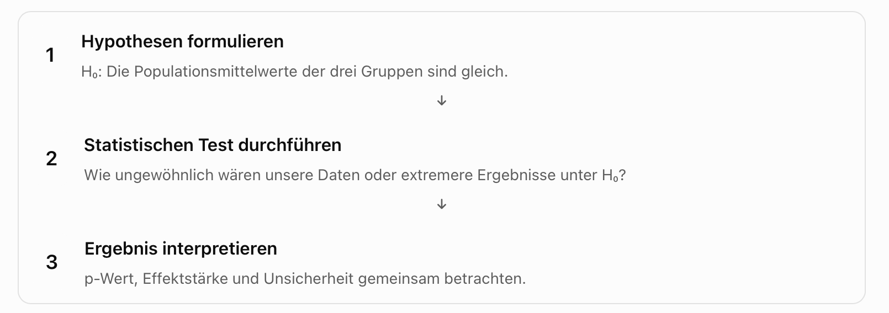
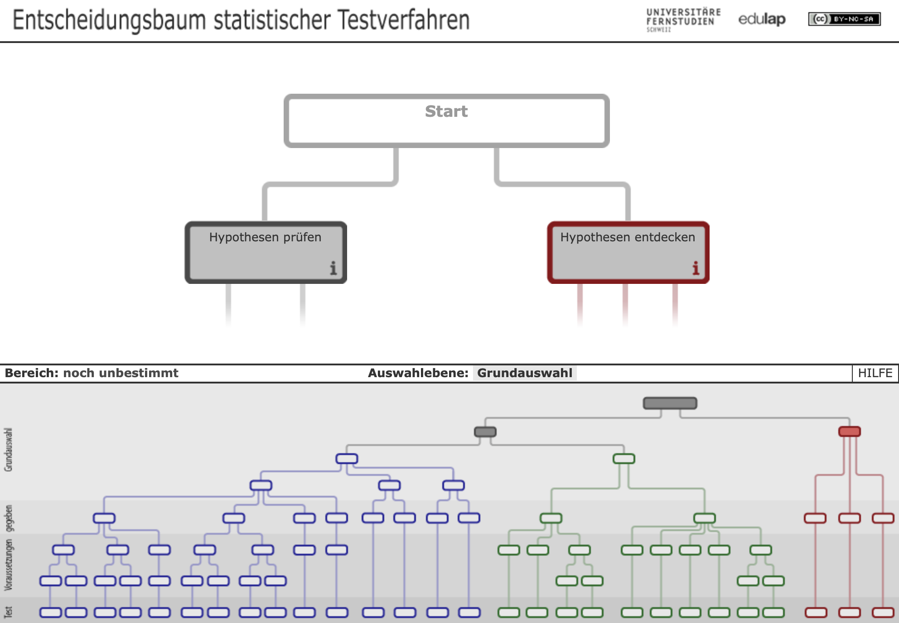
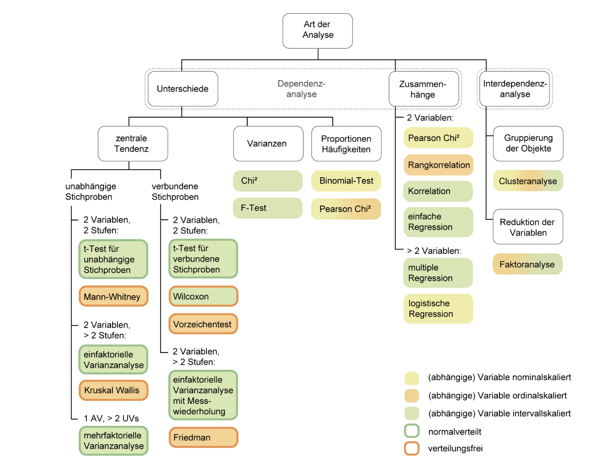
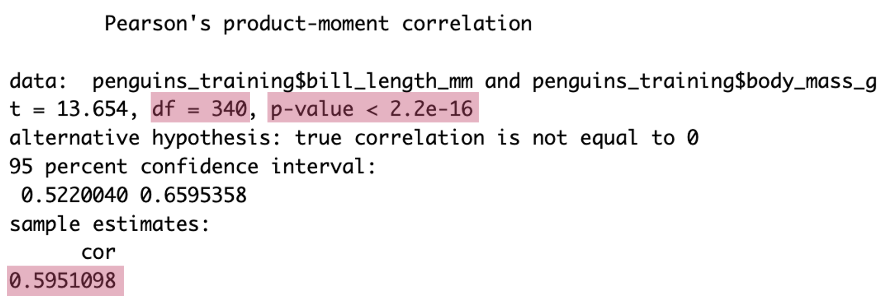
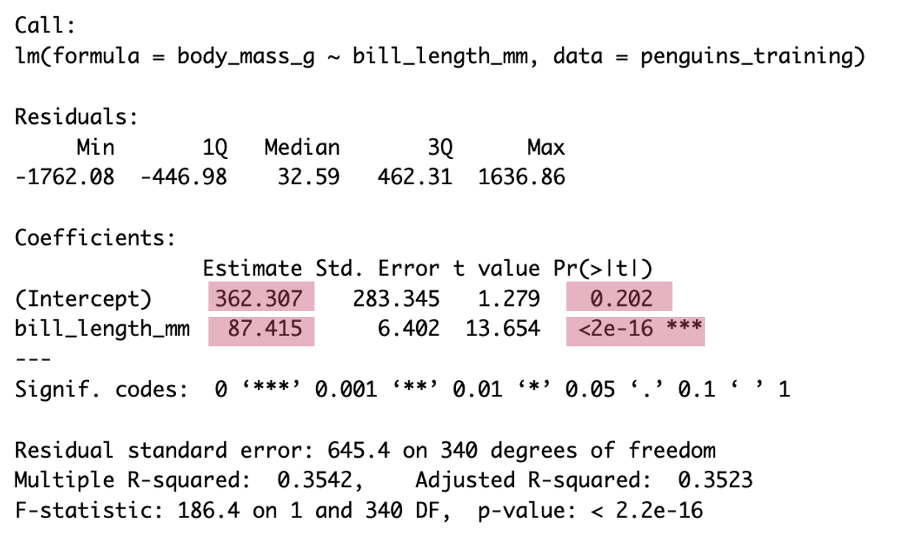
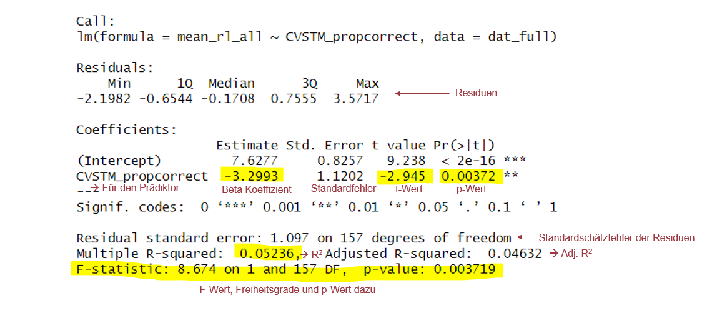

```{r, echo = FALSE, message = FALSE, warning = FALSE}

library(tidyverse)
library(palmerpenguins)
library(apaTables)
penguins_training <- palmerpenguins::penguins |>
  select(
    species, body_mass_g, bill_length_mm, flipper_length_mm, bill_depth_mm
  ) |>
  drop_na(
    body_mass_g, bill_length_mm,
    flipper_length_mm, bill_depth_mm
  )
```

## R u Ready? Reproduzierbare Datenaufbereitung und -analyse mit R

HS 2026<br><br><br> **Seminarleitung**: Dr. Sandra Grinschgl<br> **Leitung beider Seminargruppen:** MSc. Laura Hirt<br> **Tutor**: BSc. Jan-Pierre Pahnke<br><br><br>**11. Einheit**, 25.11.2026

{fig-align="center" width="306"}

::: notes
In der letzten Einheit haben wir begonnen, unsere aufbereiteten Daten auszuwerten.

Wir haben deskriptive Kennwerte berechnet, eine wissenschaftliche Tabelle erstellt und unsere ersten Ergebnisse visualisiert.

Heute gehen wir einen Schritt weiter: Wir möchten verstehen, wie sich Zusammenhänge statistisch untersuchen lassen und wie mir mit Regressionsmodellen Vorhersagen treffen können.

Diese Verfahren gehören nicht zu den verpflichtenden Analysen unserer Repliktion. Sie sind aber wichtige Grundlagen für spätere Forschungsprojekte.
:::

------------------------------------------------------------------------

## Offene Fragen zu EH10 und Hands-on 5B

**Was ist bei den ersten Auswertungen unseres Forschungsprojekts noch unklar?**

<br>

::::: columns
::: {.column width="45%"}
{fig-align="center" width="306"}
:::

::: {.column width="55%"}
<br>

-   Datenimport und Faktoren in `analysis.qmd`

-   Tabelle 1: deskriptive Kennwerte und `kable()`

-   Abbildung 4: `ggplot2`, Fehlerbalken und Grafikexport
:::
:::::

<br>

**Gibt es Fragen, bevor wir von der Beschreibung zur statistischen Prüfung übergehen?**

::: notes
Bevor wir neue statistische Verfahren kennenlernen, möchte ich kurz offene Fragen aus der letzten Einheit sammeln.
:::

------------------------------------------------------------------------

## Wo befinden wir uns?

**ANALYSIEREN: Von der Beschreibung zur statistischen Prüfung**

<br>

{fig-align="center" width="75%"}

<br>

**EH10:** Daten beschreiben und visualisieren (Tabellen & Grafiken)

**EH11:** Zusammenhänge und Vorhersagen (Korrelation & Regression)

**EH12/13:** Unterschiede statistisch untersuchen (One-Way & Mixed ANOVA)

::: notes
Unser Forschungsprojekt befindet sich weiterhin in der Analysephase. In EH10 haben wir damit begonnen, unsere Daten zu beschreiben und zu visualisieren.

Heute lernen wir zwei weitere Verfahren kennen, mit denen Zusammenhänge untersucht und Vorhersagen getroffen werden können.

In EH12 und EH13 kehren wir dann zu unseren Originaldaten zurück und führen die im Datenanalyseplan vorgesehenen ANOVAs durch.

Ihr könnt euch diese Einheit deshalb als Erweiterung unseres statistischen Werkzeugkastens vorstellen.
:::

------------------------------------------------------------------------

## Was können uns unsere bisherigen Ergebnisse sagen?

**Wir beobachten Unterschiede zwischen den Gruppen - aber was bedeuten sie?**

<br>

{fig-align="center" width="95%"}

<br>

**Wir beobachten:** Die Mittelwerte der drei Feedbackgruppen unterscheiden sich in unserer Stichprobe.

**Aber:** Können solche Unterschiede auch dann auftreten, wenn sich die Gruppen in der Population gar nicht unterscheiden?

::: notes
Wir haben in EH10 die Mittelwerte unserer drei Feedbackgruppen berechnet und gesehen, dass sich diese unterscheiden.

Aber bedeutet das automatisch, dass auch in der Population Unterschiede bestehen? Nicht unbedingt. Denn wenn wir eine andere Stichprobe untersucht hätten, könnten wir etwas andere Mittelwerte erhalten.

Genau diese Unsicherheit müssen wir berücksichtigen, wenn wir aus unseren beobachteten Daten weiterhegende Schlussfolgerungen ziehen möchten.
:::

------------------------------------------------------------------------

## Von der Deskriptiv- zur Inferenzstatistik

**Wir haben unsere Daten beschrieben - doch was können wir daraus schliessen?**

<br>

{fig-align="center" width="95%"}

<br>

**💡 Die Deskriptivstatistik beschreibt unsere Daten. Die Inferenzstatistik hilft uns, beobachtete Ergebnisse unter Berücksichtigung statistischer Unsicherheit einzuordnen.**

::: notes
In der letzten Einheit haben wir uns mit der Deskriptivstatistik beschäftigt. Wir haben Mittelwerte und Standardabweichungen berechnet und unsere Ergebnisse in Tabellen und Grafiken dargestellt.

Schauen wir uns noch einmal die mittleren Modellfensteröffnungen aus unserer Studie an. In der Below-Gruppe beträgt der Mittelwert 5.39, in der Kontrollgruppe 5.14 und in der Above-Gruppe 5.09. Die Deskriptivstatistik sagt uns also: In unserer Stichprobe unterscheiden sich die drei Gruppenmittelwerte. Das können wir direkt beobachten und beschrieben.

Aber jetzt stellt sich eine weiterführende Frage: Was bedeuten diese Unterschiede? Könnten solche Unterschiede auch dann auftreten, wenn sich die entsprechenden Gruppenmittelwerte in der Population gar nicht unterscheiden?

Genau hier setzt die Inferenzstatistik an. Sie berücksichtigt, dass unsere Stichprobe nur einen Ausschnitt der Population darstellt und dass Stichprobenergebnisse zufällig schwanken können.

Mit geeigneten statistischen Tests können wir beurteilen, wie gut unsere Beobachtungen mit bestimmten Annahmen über die Population vereinbar sind.

Der wichtigste Unterschied ist also: Die Deskriptivstatistik beschreibt unsere beobachteten Daten. Die Inferenzstatistik hilft uns, daraus unter bestimmten Annahmen statistische Schlussfolgerungen zu ziehen.
:::

------------------------------------------------------------------------

## Wie funktioniert inferenzstatistisches Testen?

**Wir beurteilen unsere Stichprobenergebnisse anhand einer statistischen Hypothese**

<br>

{fig-align="center" width="95%"}

<br>

**Statistische Signifikanz und die Grösse eines Effekts beantworten unterschiedliche Fragen.**

::: notes
Die Inferenzstatistik verwendet ein statistisches Modell, um Beobachtungen aus einer Stichprobe einzuordnen.

Häufig beginnen wir mit einer Nullhypothese, bspw. der Annahme, dass sich die Populationsmittelwerte nicht unterscheiden.

Ein p-Wert beschreibt, wie ungewöhnlich unser Ergebnis oder ein noch extremeres Ergebnis unter der Nullhypothese und den Modellannahmen wäre. Wie wahrscheinlich ist es also, das beobachtete Ergebnis oder ein noch extremeres Ergebnis zu erhalten, wenn die Nullhypothese wahr ist. Ein nicht signifikanter Test beweist nicht, dass die Nullhypothese wahr ist. Er liefert lediglich keine ausreichende Evidenz, sie anhand dieses Tests zurückzuweisen.

Daneben interessiert uns auch die Effektgrösse: Wie stark ist der beobachtete Zusammenhang oder Unterschied eigentlich?

Sowohl die statistische Signifikanz als auch die Effekgrösse gehören zu einer sorgfältigen Ergebnisinterpretation.
:::

------------------------------------------------------------------------

## Wie wählen wir das richtige Testverfahren?

**Die Forschungsfrage und das Studiendesign bestimmen die Analyse**

<br>

| Frage | Worauf achten wir? |
|------------------------------------|------------------------------------|
| Was möchten wir wissen? | Zusammenhang, Vorhersage oder Unterschied? |
| Welche Variablen haben wir? | Numerisch oder kategorial? Welche ist die AV? |
| Wie wurden die Daten erhoben? | Unabhängige Gruppen oder wiederholte Messungen? |

<br>

**💡 Genau diese Entscheidungen haben wir bereits in unserem Datenanalyseplan vorbereitet.**

::: notes
Bevor wir einen statistischen Test berechnen, müssen wir überlegen, welche Frage wir überhaupt beantworten möchten.

Geht es um einen Zusammenhang zwischen zwei numerischen Variablen? Wollen wir eine Variable vorhersagen? Oder interessieren uns Unterschiede zwischen Gruppen?

Anschliessend betrachten wir die beteiligten Variablen und das Studiendesign. Besonders wichtig ist bspw., ob wir verschiedene Personen miteinander vergleichen oder dieselben Personen mehrfach messen.

Diese Entscheidungen sollten nicht erst beim Blick auf die Ergebnisse getroffen werden. Deshalb haben wir unseren Datenanalyseplan bereits zu Beginn des Semesters erstellt.
:::

------------------------------------------------------------------------

## Hilfe bei der Wahl des passenden Tests

**Entscheidungsbäume können bei der Wahl eines geeigneten Verfahrens unterstützen**

<br>

::::: columns
::: {.column width="50%"}
[Entscheidungsbaum statistischer Testverfahren](https://ilias.unibe.ch/deliver.php/FczLCsIwEIXhd5m1mJm0yUxK6ZNkE5LxAraKDSKI7-4IZ_Odxf-BB0yw9_uznDW70_7y2VVM2aGYGxmZ4-g5Fqk-MqWoLbRKlJ2tlV7gAJtFrlvT9_HS15sda4eJWMJA3nP6zvOyEKcw8IiIf4kGZZX6Aw/-/html/index.html)

{fig-align="left" width="65%"}
:::

::: {.column width="50%"}
[Entscheidungsbaum UZH](https://www.methodenberatung.uzh.ch/de/datenanalyse_spss.html)

{fig-align="left" width="65%"}
:::
:::::

<br>

👉 Entscheidungsbäume helfen bei der Orientierung, ersetzen aber nicht das Verständnis der Forschungsfrage, des Designs und der Variablen!

------------------------------------------------------------------------

## Welche Verfahren behandeln wir?

**Unterschiedliche Forschungsfragen benötigen unterschiedliche statistische Verfahren**

<br>

::: {style="font-size:0.85em;"}
| Forschungsfrage | Verfahren | Im Seminar |
|----------------------------|----------------------|----------------------|
| Hängen zwei numerische Variablen zusammen? | Korrelation | EH11 (Training) |
| Lässt sich eine numerische Variable vorhersagen? | Lineare Regression | EH11 (Training) |
| Unterschieden sich zwei Gruppen bzw. Messungen? | t-Test | EH12 |
| Unterscheiden sich unsere drei Feedbackgruppen? | One-Way ANOVA | EH12 (Abschlussarbeit) |
| Unterscheiden sich Veränderungen über die Zeit zwischen Gruppen? | Mixed ANOVA | EH13 (Abschlussarbeit) |
:::

<br>

Für unsere Replikation benötigen wir v.a. die One-Way und Mixed ANOVAs - einschliesslich Effektstärken und erforderlicher Post-hoc Gruppenvergleiche.

::: notes
Hier seht ihr die Verfahren, die wir in den letzten Seminareinheiten behandeln.

Heute beginnen wir mit Korrelation und Regression. Beide eigenen sich zur Untersuchung von Zusammenhängen, beantworten aber unterschiedliche Fragen.

In der nächsten Einheit lernen wir t-Tests kennen und gehen anschliessend zur One-Way ANOVA über. Damit untersuchen wir unsere drei Feedbackgruppen.

In EH13 folgt dann die Mixed ANOVA. Dort berücksichtigen wir zusätzlich, dass die Leistungseinschätzungen derselben Personen zu zwei Zeitpunkten gemessen wurden.
:::

------------------------------------------------------------------------

## Unser Trainingsdatensatz: Penguins

**Wir lernen Korrelation und Regression an einem bekannten, eigenständigen Beispiel**

<br>

***Übergeordnete Frage:** Wie gut lässt sich die Körpermasse eines Pinguins anhand seiner Körpermerkmale vorhersagen?*

<br>

:::::: columns
::: {.column width="30%"}
{fig-align="center" width="40%"}
:::

:::: {.column width="70%"}
::: {style="font-size:0.85em;"}
| Variable            | Bedeutung            | Rolle        |
|---------------------|----------------------|--------------|
| `body_mass_g`       | Körpermasse in Gramm | Zielvariable |
| `bill_length_mm`    | Schnabellänge in mm  | Prädiktor 1  |
| `flipper_length_mm` | Flossenlänge in mm   | Prädiktor 2  |
| `bill_depth_mm`     | Schnabeltiefe in mm  | Prädiktor 3  |
:::
::::
::::::

<br>

**344 Beobachtungen im Ausgangsdatensatz; 342 mit vollständigen Werten für diese vier Messgrössen.**

::: notes
Für die heutigen Verfahren verwenden wir bewusst nicht unsere aufbereiteten Grinschgl-Daten, sondern nochmals den Penguins-Datensatz.

Unsere Frage lautet: Wie gut lässt sich die Körpermasse eines Pinguins anhand seiner Körpermerkmale vorhersagen?

Wir beginnen mit der Schnabellänge und ergänzen später weitere Körpermerkmale. Wichtig ist, dass wir über die gesamte Einheit hinweg dieselbe Frage und dieselbe Datengrundlage verwenden.
:::

------------------------------------------------------------------------

## Wie hängen zwei Variablen zusammen?

**Ein Streudiagramm zeigt, ob und wie zwei numerische Variablen gemeinsam variieren**

<br>

***Unsere Forschungsfrage:** Hängen Schnabellänge und Körpermasse von Pinguinen zusammen?*

```{r}
# Streudiagramm erstellen
ggplot(
  data = penguins_training,
  aes(x = bill_length_mm, y = body_mass_g)
) +
  geom_point(
    color = "steelblue",
    alpha = 0.6,
    size = 2.5
  ) +
  labs(
    x = "Schnabellänge (mm)",
    y = "Körpermasse (g)"
  ) +
  theme_minimal(base_size = 16)
```

<br>

**Beobachtung:** Pinguine mit längerem Schnabel besitzen tendenzielle eine höhere Körpermasse.

::: notes
Beginnen wir mit unserer ersten Frage: Hängen Schnabellänge und Körpermasse von Pinguinen zusammen?

Hier sehen wir ein Streudiagramm. Jeder Punkt repräsentiert einen Pinguin. Auf der horizontalen Achse steht die Schnabellänge, auf der vertikalen Achse die Körpermasse.

Wir erkennen einen positiven Trend: Pinguine mit längerem Schnabel sind tendenziell auch schwerer. Allerdings liegen nicht alle Punkte auf einer geraden Linie. Der Zusammenhang ist also nicht perfekt.

Wir möchten deshalb nun wissen, wie stark dieser Zusammenhang tatsächlich ist.
:::

------------------------------------------------------------------------

## Wie beschreiben wir die Stärke eines Zusammenhangs?

**Der Pearson-Korrelationskoeffizient *r* beschreibt Richtung und Stärke eines linearen Zusammenhangs**

<br>

{fig-align="center" width="100%"}

<br>

**Das Vorzeichen zeigt die Richtung, der Betrag die Stärke des linearen Zusammenhangs. *`r`* ist zugleich eine standardisierte Effektstärke.**

::: notes
Um einen solchen Zusammenhang zu beschreiben, können wir den Pearson-Korrelationskoeffizienten verwenden.

Es liegt immer zwischen minus eins und plus eins. Ein positives Vorzeichen bedeutet, dass höhere Werte der einen Variable tendenziell mit höheren Werten der anderen Variablen einhergehen. Bei einem negativen Vorzeichen ist es umgekehrt.

Je näher der Betrag an eins liegt, dest stärker ist der lineare Zusammenhang. Ein Wert von null bedeutet dagegen, dass kein linearer Zusammenhang besteht.

Ein nichtlinearer Zusammenhang kann trotzdem vorhanden sein.

In unserem Beispiel liegt der Wert ungefähr bei 0.60 - wir beobachten also einen deutlich positiven linearen Zusammenhang.
:::

------------------------------------------------------------------------

## Wie berechnen wir eine Korrelation in R?

**Mit `cor.test()` berechnen wir den Zusammenhang und erhalten einen statistischen Test**

<br>

```{r, echo=TRUE, eval=FALSE}
cor.test(
  penguins_training$bill_length_mm,
  penguins_training$body_mass_g,
  method = "pearson"
)
```

{fig-align="left" width="80%"}

<br>

**Interpretation:** Es besteht ein positiver, statistisch signifikanter linearer Zusammenhang zwischen Schnabellänge und Körpermasse (*r* =.60, *p* \< .001).

::: notes
In R können wir den Pearson-Korrelationskoeffizienten mit `cor.test()` berechnen.

Wir geben die beiden Variablen an und legen mit `method = "pearson"` fest, welche Art von Korrelation wir berechnen möchten.

Der Korrelationskoeffizient beträgt ungefähr 0.595. Der p-Wert liegt unter .001. Unter der Nullhypothese eines fehlenden linearen Populationszusammenhangs wäre ein mindestens so extremer Wert sehr ungewöhnlich.

Wir können deshalb von einem statistisch signifikanten positiven Zusammenhang sprechen. Eine Korrelation erklärt uns aber nicht, ob die Schnabellänge die Körpermasse verursacht oder umgekehrt.
:::

------------------------------------------------------------------------

## Welche Voraussetzungen hat eine Korrelation?

**Pearson und Spearman untersuchen unterschiedliche Formen von Zusammenhängen**

<br>

{fig-align="center" width="90%"}

<br>

**Ein Streudiagramm hilft uns, die Art des Zusammenhangs vor der Testwahl einzuschätzen.**

::: notes
Nicht für jede Beziehung zwischen Variablen eignet sich automatisch eine Pearson-Korrelation.

Pearson misst lineare Zusammenhänge. Wir sollten deshalb zunächst prüfen, ob der Verlauf ungefähr linear ist und ob einzelne extreme Werte den Zusammenhang stark beeinflussen könnten.

Für die klassische Inferenz müssen zudem die entsprechenden statistischen Annahmen berücksichtigt werden.

Eine Alternative ist Spearman. Hier werden die Werte durch ihre Rangplätze ersetzt. Das Verfahren eignet sich u.a. für monotone Zusammenhänge, die nicht geradlinig verlaufen. Allerdings löst Spearman nicht jedes Problem. Die Beobachtungen müssen auch hier unabhängig voneinander sein.
:::

------------------------------------------------------------------------

## Korrelation oder Regression?

**Beide Verfahren untersuchen Zusammenhänge, setzen aber unterschiedliche Schwerpunkte**

<br>

{fig-align="center" width="90%"}

<br>

**Gemeinsamkeit:** Beide Verfahren können lineare Zusammenhänge untersuchen - keines der beiden beweist für sich genommen Kausalität.

::: notes
Wir haben jetzt gerade untersucht, wie stark Schnabellänge und Körpermasse zusammenhängen.

Jetzt verändern wir unsere Fragestellung: Wir möchten die Körpermasse anhand der Schnabellänge vorhersagen.

Das ist der entscheidende Perspektivenwechsel. Bei der Korrelation sind die beiden Variablen gleichberechtigt. Bei der Regression legen wir fest, welche Variable vorhergesagt werden soll und welche Variablen zur Vorhersage dienen.

Beide Verfahren untersuchen Zusammenhänge. Auch ein Regressionsmodell allein liefert aber keinen Beweis für einen Ursache-Wirkungs-Zusammenhang.
:::

------------------------------------------------------------------------

## Wie funktioniert eine einfache lineare Regression?

**Eine Gerade beschreibt den erwarteten Wert der abhängigen Variable**

<br>

{fig-align="center" width="90%"}

<br>

**Grundidee:** Die Regressionsgerade wird so geschätzt, dass die Summe der quadrierten Abweichungen zwischen beobachteten und vorhergesagten Werten möglichst klein ist.

::: notes
Bei einer einfachen linearen Regression versuchen wir, den erwarteten Wert einer AV durch eine Gerade zu beschreiben.

Die Gerade hat zwei zentrale Bestandteile:

-   Der Intercept gibt an, welcher Wert vorhergesagt wird, wenn der Prädiktor null beträgt.

-   Die Steigung beschreibt, wie stark sich der vorhergesagte Wert verändert, wenn der Prädiktor um eine Einheit steigt.

In unserem Beispiel interessiert und also, um wie viele Gramm sich die vorhergesagte Körpermasse bei einem zusätzlichen Millimeter Schnabellänge verändert.

R wählt die Gerade so, dass die quadrierten Abweichungen der beobachteten Werte von der Geraden möglichst gering sind.
:::

------------------------------------------------------------------------

## Wie berechnen wir die Regression in R?

**Mit `lm()` schätzen wir ein lineares Modell; `summary()` zeigt uns die Ergebnisse**

<br>

::::: columns
::: {.column width="55%"}
```{r, echo=TRUE}
model_1 <- lm(
  body_mass_g ~ bill_length_mm,
  data = penguins_training
)

summary(model_1)
```
:::

::: {.column width="45%"}
```{r}
# Streudiagramm mit Regressionsgerade
ggplot(
  data = penguins_training,
  aes(x = bill_length_mm, y = body_mass_g)
) +
  geom_point(
    color = "steelblue",
    alpha = 0.6,
    size = 2.5
  ) +
  geom_smooth(
    method = "lm",
    formula = y ~ x,
    se = FALSE,
    color = "steelblue",
    linewidth = 1.2
  ) +
  labs(
    x = "Schnabellänge (mm)",
    y = "Körpermasse (g)"
  ) +
  scale_x_continuous(breaks = seq(35, 60, by = 5)) +
  theme_minimal(base_size = 16) +
  theme(
    panel.grid.minor = element_blank()
  )
```
:::
:::::

<br>

**Gerade** = vorhergesagten Zusammenhang zwischen Schnabellänge und Körpermasse.

::: notes
Für unsere erste Regression benötigen wir nur zwei Funktionen.

-   Mit lm() erstellen wir ein lineares Modell. Links vom Tilde-Zeichen steht die AV, also die Körpermasse. Rechts steht der Prädiktor, hier die Schnabellänge.

-   Das geschätzte Modell speichern wir unter model_1.

-   Mit summary() können wir uns die wichtigsten Ergebnisse anzeigen lassen.

In der Grafik sehen wir nun zusätzlich die geschätzte Regressionsgerade. Sie beschreibt die vorhergesagte Körpermasse in Abhängigkeit von der Schnabellänge. Die einzelnen Punkte liegen unterschiedlich weit von dieser Geraden entfernt.
:::

------------------------------------------------------------------------

## Wie interpretieren wir die Regressionskoeffizienten?

**Die Koeffizienten beschrieben, wie sich die vorhergesagte Körpermasse verändert**

<br>

::::: columns
::: {.column width="55%"}
{fig-align="left" width="95%"}
:::

::: {.column width="45%"}
<br><br>

{fig-align="center" width="95%"}
:::
:::::

**Interpretation:** Bei einer um 1mm grösseren Schnabellänge ist die vorhergesagte Körpermasse im Mittel um ungefähr 87g höher.

::: notes
Schauen wir uns die Ergebnisse genauer an.

Der Koeffizient der Schnabellänge beträgt ungefähr 87.42. Das bedeutet: Steigt die Schnabellänge um einen Millimeter, steigt die vom Modell vorhergesagte Körpermasse im Mittel um rund 87 Gramm.

Der dazugehörige p-Wert liegt unter .001. Die Daten sprechen also gegen die NUllhypothese einer Steigung von null.

Der Intercept beträgt ungefähr 362 Gramm. Er beschreibt die vorhergesagte Körpermasse bei einer Schnabellänge von null Millimetern. Da solche Werte ausserhalb unseres beobachteten Bereichs liegen, ist dieser konkrete Intercept hier biologisch nicht sinnvoll interpretierbar.
:::

------------------------------------------------------------------------

## Wie gut erklärt unser Modell die Daten?

**\\(R\^2\\)** **beschreibt den Anteil der durch das Modell erklärten Varianz**

<br>

Ab hier müssen die Folien noch überarbeitet werden. Wird am Montag (23.11.26) gemacht!

------------------------------------------------------------------------

## Multiple lineare Regression

<br>

Eine abhängige Variable (AV) wird durch mehrere Prädiktoren (UVs) vorhergesagt.

<br>

```{r, eval=FALSE}
model_2 <- lm(mean_rl_all ~ cvstm_propcorrect + vp_propcorrect,
              data = dat_full)

summary(model_2)
```

➡️ Jeder Prädiktor wird geprüft, während die anderen Prädiktoren im Modell kontrolliert werden.

Dadurch können wir untersuchen, ob ein Prädiktor zusätzlich zur Vorhersage beiträgt.

------------------------------------------------------------------------

## Regression: Output verstehen

<br>

{fig-align="center"}

::: notes
Hier eine **sehr kurze, punktuelle Zusammenfassung**:

-   **Intercept (7.63)**: Ausgangswert von *mean_rl_all*, wenn cvstm_propcorrect = 0.

-   **Steigung (-3.30)**: Hoeherer cvstm_propcorrect sagt niedrigeren mean_rl_all voraus (negativer Zusammenhang

-   **p = .0037**: Zusammenhang ist **signifikant**.

-   **Residuen**: Durchschnittliche Abweichung vom Modell ca. 1.10.

-   **R² = 0.052**: Modell erklaert **5% der Varianz** → kleiner Effekt.

-   **F-Test p = .0037**: Das Gesamtmodell ist signifikant.

**Kurz:** Höhere cvstm_propcorrect-Werte gehen mit niedrigeren mean_rl_all-Werten einher, aber das Modell erklaert nur wenig Varianz.
:::

------------------------------------------------------------------------

## Voraussetzungen der linearen Regression

<br>

Damit wir eine lineare Regression sinnvoll interpretieren können:

-   linearer Zusammenhang zwischen Prädiktor(en) und abhängiger Variable

-   normalverteilte Residuen (siehe Hands On 5)

-   Homoskedastizität

-   keine starken Ausreisser

-   bei multipler Regression: keine starke Multikollinearität

<br>

👉 Die Voraussetzungen prüfen wir über Diagnostikplots und Kennwerte.

------------------------------------------------------------------------

### **Nützliche Funktionen für Regressionen und verwandte Analysen in R**

| Funktion | Beschreibung |
|------------------------------------|------------------------------------|
| `lm(y ~ x)` | Einfache lineare Regression mit einer abhängigen Variablen *y* und einem Prädiktor *x*. |
| `lm(y ~ x1 + x2)` | Multiple Regression mit einer abhängigen Variablen *y* und zwei Prädiktoren *x1* und *x2*. |
| `summary()` | Gibt die Ergebnisse der Regressionsanalyse für ein Regressionsmodell aus. |
| `confint()` | Konfidenzintervalle für die Regressionskoeffizienten. |

------------------------------------------------------------------------

| Funktion | Beschreibung |
|------------------------------------|------------------------------------|
| `fitted()` | Vorhergesagte Werte des Regressionsmodells. |
| `resid()` | Residuen des Regressionsmodells. |
| `predict()` | Vorhergesagte Werte für neue Werte der Prädiktorvariablen. |
| `anova(model1, model2)` | Vergleicht die Determinationskoeffizienten zweier Regressionsmodelle mit einem F-Test. |
| `vif()` \* | Variance Inflation Factors (VIF) für jeden Prädiktor; aus dem **car**-Paket. |

\* aus zusätzlichen Paketen

------------------------------------------------------------------------

## Hierarchische Regression

<br>

Bei der hierarchischen Regression vergleichen wir mehrere Modelle.

```{r, echo=TRUE, eval=FALSE}
model_1 <- lm(y ~ x1,
              data = data)

model_2 <- lm(y ~ x1 + x2,
              data = data)

model_3 <- lm(y ~ x1 + x2 + x3,
              data = data)

anova(model_1, model_2, model_3)
```

Fragestellung:

➡️ Erklärt das komplexere Modell zusätzliche Varianz?

👉 Wir prüfen also, ob neue Prädiktoren die Vorhersage verbessern.

<br>

Siehe hier: [**Lineare Regression mit R (einfach, multiple, hierarchisch)**](https://www.youtube.com/watch?v=JzcIKIW6mfc)

------------------------------------------------------------------------

## Hands On - Block 6!

-   Visualisierungen mit `ggplot2`

-   Korrelationen

-   Regressionen

------------------------------------------------------------------------

## Heute haben wir:

-   Aufbau von `ggplot()` repetiert

-   Korrelationen und Regressionen in R kennengelernt

**Reminder: R Übung bis Freitag 08.05., Peer Feedback über ILIAS bis 13.05.**

------------------------------------------------------------------------

## Peer Feedback:

--siehe Datei im Ordner Abgaben—
