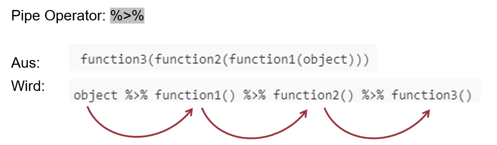
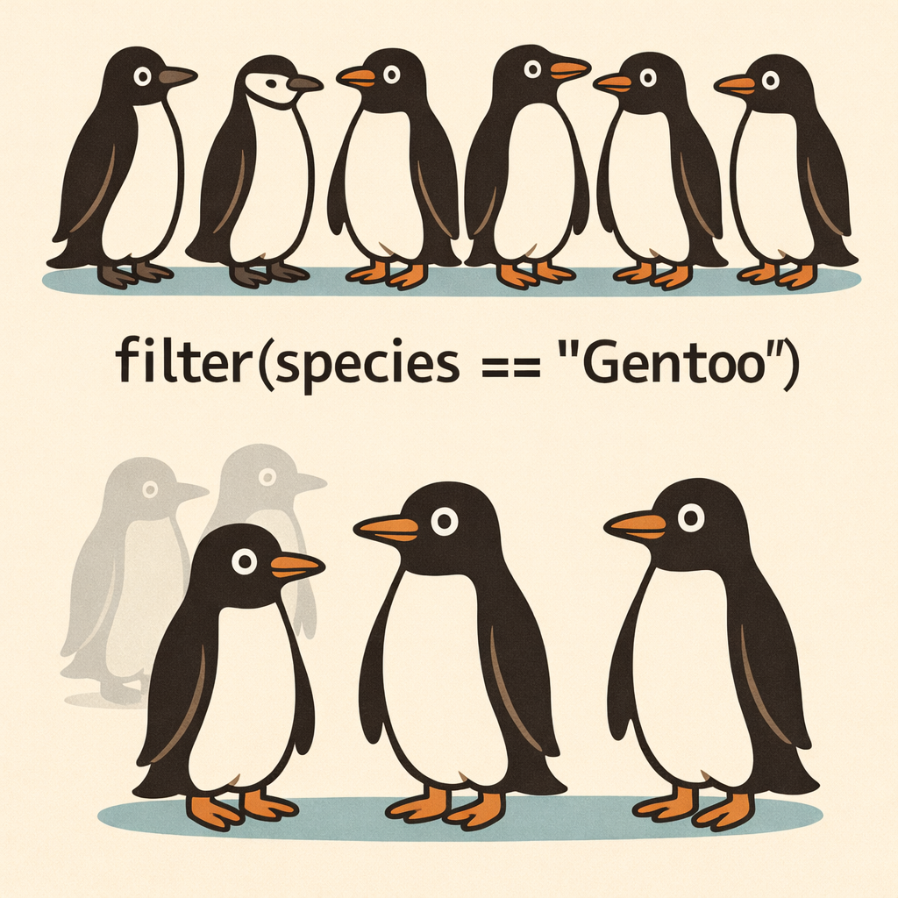

## R u Ready? Reproduzierbare Datenaufbereitung und -analyse mit R

HS 2026<br><br><br> **Seminarleitung**: Dr. Sandra Grinschgl<br> **Leitung beider Seminargruppen:** MSc. Laura Hirt<br> **Tutor**: BSc. Jan-Pierre Pahnke<br><br><br>**6. Einheit**, 21.10.2026

{fig-align="center" width="306"}

::: notes
Willkommen zur sechsten Einheit. In der letzten Sitzung haben wir unseren zusammengeführten Datensatz kennengelernt und uns damit beschäftigt, was die verschiedenen Variablen bedeuten und wie wir sie dokumentieren können.

Heute gehen wir einen Schritt weiter: Wir lernen, wie wir mit R gezielte Veränderungen an unserem Datensatz vornehmen und diese Veränderungen so dokumentieren, dass sie jederzeit reproduziert werden können.

Dabei werden wir insbesondere verschiedene Funktionen aus dem Paket `dplyr` kennenlernen, die uns während des weiteren Semesters begleiten werden.
:::

------------------------------------------------------------------------

## Organisatorisches und offene Fragen

<br>

✓ **Codebook:** Erste Abgabe heute, 21.10.2026

✓ **Datenstand dieser Abgabe: `dat_full`** nach EH4 (159 x 36)

➡️ **Heute im Hands-on:** Transformationen im bestehenden `processing.qmd` ergänzen

<br>

**Das Codebook wird nach den Transformationen fortlaufend aktualisiert.**

::: notes
Zuerst noch ein organisatorischer Punkt: Die erste Codebook-Abgabe ist heute fällig. Für diese Abgabe dokumentiert ihr den Zustand direkt nach dem Zusammenführen aus EH4.

Die Veränderungen, die wir heute kennenlernen, müssen noch nicht zu dieser ersten Version gehören. Wir werden sie anschliessend im Processong-Skript durchführen und das Codebook entsprechend aktualisieren. Wer heute noch nicht so weit kommt, macht das gar nichts. Euer Codebook muss diese Verändeurngen bei der Abgabe noch nicht integriert haben!

Fragen zu Codebook?
:::

------------------------------------------------------------------------

## Wo befinden wir uns?

**AUFBEREITEN: Daten verstehen → Daten gezielt verändern**

<br>

{fig-align="center" width="75%"}

<br>

**EH5:** Was bedeuten die Variablen?

**EH6:** Wie verändern wir sie nachvollziehbar?

::: notes
Wir befinden uns weiterhin in der Phase der Datenaufbereitung.

In EH4 haben wir die sieben Rohdatensätze zusammengeführt. Dadurch können wir die verschiedenen Informationen einer Person gemeinsam betrachten.

In EH5 haben wir gelernt, dass wir diese Informationen zuerst verstehen und dokumentieren müssen. Genau dafür haben wir das Codebook erstellt.

Jetzt wissen wir bereits viel besser, welche Variablen wir besitzen. Damit können wir auch begründet entscheiden, welche Veränderungen notwendig sind, damit wir die Variablen später analysieren können. Wir wechseln also von *Daten verstehen und dokumentieren* zu *Daten gezielt verändern und die Änderungen nachvollziehbar festhalten.*
:::

------------------------------------------------------------------------

## Inhalte heute

-   Aktueller Projektstand und notwendige Transformationen

-   Wiederholung: Faktoren

-   Pipe-Operator verstehen und anwenden

-   Zentrale Funktionen aus `dplyr`:

    -   `filter()` → Daten auswählen

    -   `select()` → Variablen auswählen

    -   `rename()` → Variable umbenennen

    -   `mutate()` → neue Variablen erstellen / bestehende Variablen verändern

    -   `across()` → einen Schritt auf mehrere Spalten gleichzeitig anwenden

------------------------------------------------------------------------

## Was müssen wir an `dat_full` verändern?

**Drei konkrete Aufgaben aus unserer Replikation**

<br>

| Ausgangszustand | Benötigte Änderung | Warum? |
|----|----|----|
| `group_all` | `group` | Einheitlicher Name der Experimentalbedingung |
| `csvtm_sum` | `cvstm_sum` | Schreibweise gemäss Dateninformationen |
| `pre1`, `pre2`, `pre3`, `pre4`,`post` | 0-10 → 0-100 | Skala für die spätere Replikation |

<br>

**Noch nicht heute:** `mmq_mean` berechnen und Long-Datensatz erzeugen.

::: notes
Bevor wir uns Funktionen anschauen, beginnen wir mit den konkreten Anforderugen an unseren Datensatz.

-   Erstens möchten wir die Variable group_all künftig einheitlich group nennen.

-   Zweitens enthält ein Variablenname in den Daten einen Schreibfehler: csvtm_sum soll entsprechend der Datenbeschreibung cvstm_sum heissen.

-   Drittens liegen die fünf Ratings momentan auf einer Skala von 0 bis 10 vor. Für die Replikation benötigen wir sie auf der Skala von 0 bis 100.

Das sind überschaubare Änderungen, für die wir aber grundlegende R-Funktionen kennenlernen.

Die Berechnung des MMQ-Mittelwerts und die spätere Umstrukturierung in das Long-Format folgen erst in EH9. So wissen wir, welches Ziel wir heite konkret erreichen wollen.
:::

------------------------------------------------------------------------

## Nicht jeder R-Befehl gehört ins Processing-Skript

<br>

:::::: columns
::: {.column width="33%"}
**R-Konsole**

<br>

*Ausprobieren und untersuchen*

→ Temporär
:::

::: {.column width="34%"}
**`processing.qmd`**

<br>

*Daten reproduzierbar verändern*

→ Dauerhaft
:::

::: {.column width="33%"}
**Codebook (Excel)**

<br>

*Daten erklären*

→ Aktuell halten
:::
::::::

<br>

**Merksatz:** Untersuchen ≠ verändern ≠ dokumentieren.

::: notes
Aus Hands-on 3 kennt ihr bereits drei Arbeitsorte, die wir heute bewusst auseinanderhalten.

-   In der Konsole dürfen wir Dinge ausprobieren. Bspw. können wir vorübergehend nur einzelne Zeilen anzeigen oder untersuchen, welchen Datentyp eine Variable besitzt. Solche Abfragen müssen nicht dauerhaft in unserem Forschungsprojekt gespeichert werden.

-   In unserem Processing-Skript dokumentieren wir dagegen alle notwendigen Verarbeitungsschritte. Wir dokumentieren also alle Schritte, die notwendig sind, um aus den sieben Rohdateien den aufbereiteten Datensatz zu erzeugen. Wenn wir bspw. Variablennamen verändern oder Ratings umskalieren, müssen diese Änderungen dort stehen. Wichtige Qualitätskontrollen gehören ebenfalls dazu.

-   Das Codebook ist unser dritter Arbeitsort: Es beschreibt, was die Variablen des aktuell gespeicherten Datensatzes bedeuten. Eine Veränderung im R-Code kann deshalb eine Anpassung im Codebook erforderlich machen.
:::

------------------------------------------------------------------------

## Rückblick EH5: Kategorial bedeutet nicht automatisch `factor`

**`group_all` beschreibt drei Experimentalgruppen - R speichert die Werte bisher als `character`**

<br>

```{r, echo=FALSE, eval=TRUE}
dat_full <- readr::read_delim("raw/dat_full.csv")
library(tidyverse)
```

```{r, echo=TRUE, eval=TRUE}
# Wie ist die Variable aktuell gespeichert?
class(dat_full$group_all)

# Nur zum Ausprobieren: automatische Umwandlung in ein separates Faktorobjekt
group_faktor <- as.factor(dat_full$group_all)

# Welche Klasse hat das Objekt?
class(group_faktor)
# Welche Faktorstufen?
levels(group_faktor)
```

<br>

`as.factor()` **wandelt Werte in einen Faktor um. Die Faktorstufen werden automatisch bestimmt.**

::: notes
In EH5 haben wir eine zentrale Unterscheidung kennengelernt: Ein technischer Datentyp sagt noch nicht, was eine Variable wissenschaftlich bedeutet.

-   group_all ist ein gutes Beispiel: Dir drei Textwerte above, below und control stehen für verschiedene Experimentalbedingungen. Inhaltlich ist die Variable nominalskaliert. Technisch liegt sie nach dem Einlesen aber als character vor.

-   Was passiert, wenn R diese Kategorien ausdrücklich als Faktor behandeln soll? Die einfachste Möglichkeit ist `as.factor(`). Wir übergeben die Variable und erhalten ein Faktorobjekt. Mit `class()` sehen wir den neuen Datentyp, mit `levels()` die Faktorstufen. Bei dieser Character-Variable werden sie automatisch alphabetisch angeordnet: above, below, control.

-   Ganz wichtig: Wir erstellen hier ein separates Übungsobjekt. Wir überschreiben hier nicht dat_full\$group_all. Die Funktion ist heute nur eine kurze Demonstration des Begriffs aus EH5 und keine Transformation für das Processing-Skript.

-   Übergang: Aber was ist, wenn wir die Reihenfolge dieser Kategorien bewusst festlegen oder numerischen Codes verständliche Bezeichnungen geben möchten?
:::

------------------------------------------------------------------------

## `as.factor()` oder `factor()`?

<br>

::::: columns
::: {.column width="48%"}
**`as.factor()`**

**Automatische Faktorbildung:** vorhandene Codes als Faktorstufen übernommen.

```{r, echo=TRUE, eval=TRUE}
demo_strategies <- 
  as.factor(dat_full$strategies)

# Levels
levels(demo_strategies)
```

<br><br>

*Die gespeicherten Codes `1`, `2`, `3` werden zu Faktorstufen.*
:::

::: {.column width="52%"}
**`factor()`**

**Gezielte Faktorbildung:** Reihenfolge & Beschriftung ausdrücklich festgelegt.

```{r, echo=TRUE, eval=TRUE}
uebung_strategies <- factor(
  dat_full$strategies,
  levels = c(1, 2, 3),
  labels = c("Internal memory",
             "Offloading", "Both")
)

# Levels
levels(uebung_strategies)
```

*Stufen und Beschriftungen lassen sich festlegen.*
:::
:::::

<br>

⚠️ **Heute nur zum Verständnis:** Die für die Analysen benötigten Faktoren definieren wir später in `analysis.qmd`.

::: notes
Wir bleiben bewusst beim bereits bekannten Beispiel aus EH5: strategies enthält die numerischen Codes 1, 2 und 3. Diese stehen für verschiedene Strategien - nicht für eine quantitative Abstufung. Wir haben die Bedeutung der Codes schon im Codebook und in den Response Labels festgehalten.

-   Mit `as.factor()` macht R aus den drei Codes nun unmittelbar Faktorstufen. Das reicht aus, wenn die automatische Reihenfolge und die vorhandenen Codebezeichnungen passen.

-   Mit `factor()` haben wir mehr Kontrolle: Über levels geben wir an, welche ursprünglichen Codes vorkommen und in welcher Reihenfogle sie stehen sollen. Mit labels können wir zusätzlich lesbare Bezeichnungen festlegen.

-\> Wichtig ist hier NICHT, dass ihr euch heute jede Variante auswendig merkt. Ihr sollt verstehen: Kategorien können als character oder numeric gespeichert sein; für eine statistische Auswertung können wir sie bei Bedarf gezielt als Faktoren definieren.

Für unsere Modelle werden wir die benötigten Faktoren nach dem Einlesen der aufbereiteten Daten zu Beginn von analysis.qmd definieren.

Nun wenden wir uns den Schritten zu, die wir tatsächlich dauerhaft in processing.qmd benötigen: Datenpipelines und Transformationen.
:::

------------------------------------------------------------------------

## Unsere Processing-Pipeline wächst weiter

**Die Rohdateien bleiben unverändert. Wir erweitern den bestehenden Code.**

<br>

+-----------------------------+----------------------------------------------------------+
| Bisher nach EH4             | Ab EH6                                                   |
+=============================+==========================================================+
| 1.  Rohdaten importieren    | 1.  Rohdaten importieren                                 |
+-----------------------------+----------------------------------------------------------+
| 2.  Datensätze mergen       | 2.  Datensätze mergen                                    |
+-----------------------------+----------------------------------------------------------+
| 3.  Merge kontrollieren     | 3.  Merge kontrollieren                                  |
+-----------------------------+----------------------------------------------------------+
| 4.  **Datensatz speichern** | 4.  **Transformieren → 5. Kontrollieren → 6. Speichern** |
+-----------------------------+----------------------------------------------------------+

<br>

**Entscheidend: `write_csv()`** steht **nach** den neuen Transformationen.

::: notes
Bevor wir neue Funktionen kennenlernen, überlegen wir nochmals, wo diese eigentlich in unserem Aufbereitungsskript hingehören.

Aus Hands-on 2 besitzen wir bereits ein Processing-Skript, das die Rohdateien einliest, zusammenführt, kontrolliert und speichert.

Jetzt kommen neue Verarbeitungsschritte hinzu.

Wir verändern aber nicht manuell die gespeicherte CSV-Datei und erstellen auch kein neues Skript. Stattdessen ergänzen wir den vorhandenen Code.

Wichtig ist die Reihenfolge: Zuerst werden die Rohdateien eingelesen und zusammengeführt, dann werden die notwendigen Transformationen durchgeführt, das Ergebnis geprüft und erst danach der neue Datenstand gespeichert.

So bleibt der gesamte Weg von den Rohdaten zum aufbereiteten Datensatz reproduzierbar.

Ich habe euch auf der nächsten Folie einmal eine mögliche Vorlage unseres bisherigen Processing-Skripts erzeugt.
:::

------------------------------------------------------------------------

##  {data-background-iframe="../../PDFs/processing.html#view=FitH&navpanes=0&toolbar=0" data-background-interactive=""}

------------------------------------------------------------------------

## Pipe-Operator: Code lesbarer gestalten

<br>

❌ **Ohne Pipe: verschachtelter Code**

```{r, echo=TRUE, eval=FALSE}
head(
  select(
    filter(dat_full, group_all == "control"),
    code, group_all, pre1
  )
)
```

<br>

✅ **Mit Pipe: Schritt für Schritt lesbar (`|>` oder `%>%`)**

```{r, echo=TRUE, eval=FALSE}
dat_full |>
  filter(group_all == "control") |>
  select(code, group_all, pre1) |>
  head()
```

<br>

💡 Beide Varianten führen zum gleichen Ergebnis. Mit der Pipe können wir die Verarbeitungsschritte von oben nach unten lesen.

::: notes
Wir möchten uns aus unserem Datensatz einmal nur die Personen der Kontrollgruppe anzeigen lassen, anschliessend drei Variablen auswählen und schliesslich die ersten sechs Zeilen betrachten.

Das können wir in R mit mehreren ineinander verschachtelten Funktionen machen. Der Code funktioniert, ist aber nicht besonders einfach zu lesen. Wir müssen von innen nach aussen denken, um die Reihenfolge der Verarbeitungsschritte zu verstehen.

Mit dem Pipe-Operator können wir dieselben Schritte nacheinander schreiben. Wir beginnen mit unserem Datensatz, filtern die Kontrollgruppe, wählen die drei Variablen aus und zeigen die ersten Zeilen an.

Die Befehle stehen nun in derselben Reihenfolge, in der sie ausgeführt werden. Genau das macht längere Verarbeitungsschritte wesentlich übersichtlicher.
:::

------------------------------------------------------------------------

## Wie funktioniert eine Pipe?

`|>` oder `%>%`

<br>



**Das Ergebnis eines Verarbeitungsschritts wird an die nächste Funktion weitergegeben.**

::: notes
Schauen wir uns genauer an, was bei der Pipe passiert.

Ohne Pipe-Operator müssen zusammenhängende Funktionen verschachtelt geschrieben werden. Der Code wird dort von innen nach aussen gelesen und ausgeführt. Wir würden hier also zunächst Funktion 1 auf das Objekt anwenden, dann einen Schicht nach aussen gehen und Funktion 2 auf dieses Objekt anwenden und im letzten Schritt noch Funktion 3 auf das Ergebnis von Funktion 2 anwenden. Dieser Code ist korrekt, jedoch ziemlich schwer lesbar. Mit verschiedenen Klammern wird festlegt, welche Funktion in welcher Schicht anzuwenden ist.

Unten ist genau derselbe Code einmal mit dem Pipe-Operator dargestellt. Der grosse Vorteil davon ist, dass dadurch mehrere Verarbeitungsschritte schrittweise miteinander verbunden werden können. Das Ergebnis eines Schrittes bildet dabei die Grundlage für den nächsten Schritt.

Der Code wird viel einfacher lesbar: Wir nehmen das Objekt und übergeben es an die erste Funktion. Danach nehmen wir das Resultat davon und übergeben es an die zweite Funktion. Das Resultat davon übergeben wir dann an die dritte Funktion.
:::

------------------------------------------------------------------------

## Was macht die Pipe technisch?

<br>

Die Pipe (`|>` oder `%>%`):

-   übergibt das Ergebnis links an die Funktion rechts

-   setzt das Ergebnis links als erstes Argument in die nächste Funktion ein

<br>

```{r, echo= TRUE , eval=FALSE}
dat_full |> filter(group_all == "control")
```

=

```{r, echo= TRUE , eval=FALSE}
filter(dat_full, group_all == "control")
```

::: notes
Wir werden diese Schreibweise heute in den Übungen noch besser kennenlernen und dann nächste Woche intensiv üben.

Ich würde mir angewöhnen, von Beginn an mit diesem Pipe-Operator zu arbeiten, da er insbesondere längere Verarbeitungsschritte deutlich vereinfacht.
:::

------------------------------------------------------------------------

## Daten transformieren mit `dplyr`

<br>

-   `dplyr` bietet zentrale Funktionen für die Datenaufbereitung

-   Teil des `tidyverse`

-   die Funktionen lassen sich optimal mit dem Pipe-Operator kombinieren

<br>

{fig-align="center" width="240"}

------------------------------------------------------------------------

## `dplyr`: Welche Funktion macht was?

**Eine Forschungsfrage bestimmt, welchen Verarbeitungsschritt wir brauchen**

<br>

| Unsere Frage | Funktion | Was verändert sich im Ergebnis? |
|----|----|----|
| Welche Personen interessieren uns? | `filter()` | Auswahl der Zeilen |
| Welche Variablen brauchen wir? | `select()` | Auswahl der Spalten |
| Wie sollen Variablen heissen? | `rename()` | Spaltennamen |
| Welche Werte wollen wir berechnen? | `mutate()` | Spaltenwerte / neue Spalten |
| Welche Spalten brauchen dieselbe Berechnung? | `across()` | Mehrere Spalten gleichzeitig |

::: notes
Gerade haben wir die Pipe kennengelernt. Jetzt brauchen wir konkrete Funktionen, die wir in dieser Verarbeitungskette verwenden können.

dplyr gehört zum tidyverse, das wir bereits im Processing-Skript laden.

Heute schauen wir uns 5 Funktionen an. Sie lösen unterschiedliche Probleme:

-   filter wählt Beobachtungen nach bestimmten Bedingungen aus

-   select wählt bestimmte Variablen aus

-   rename ändert Variablennamen

-   und mutate berechnet oder verändert Werte.

-   across ist keine Funktion, die wir hier alleine verwenden; sie hilft uns innerhalb von mutate, dieselbe Berechnung auf mehrere Variablen gleichzeitig anzuwenden.

Ich möchte, dass ihr zuerst die jeweilige Aufgabe einer Funktion versteht. Die Syntax wird danach leichter.
:::

------------------------------------------------------------------------

## `filter()`: Beobachtungen auswählen I

`filter()` **behält nur die Zeilen, die eine Bedingung erfüllen**

<br>

{fig-align="center"}

------------------------------------------------------------------------

## `filter()`: Beobachtungen auswählen II

`filter()` **behält nur die Zeilen, die eine Bedingung erfüllen**

<br>

::::: columns
::: {.column width="53%"}
**Allgemeine Form**

```{r, echo=TRUE, eval=FALSE}
filter(datensatz, bedingung)
```

**Mit Pipe**

```{r, echo=TRUE, eval=FALSE}
dat_full |>
  filter(group_all == "control")
```
:::

::: {.column width="47%"}
**Was kommt heraus?**

-   Vorher: 159 Personen, 36 Variablen
-   Nachher: 53 Personen, 36 Variablen
-   Nur die Zeilen mit `group_all == "control"` bleiben erhalten

**Die Spalten bleiben erhalten.**
:::
:::::

<br>

**Vorerst nur anschauen:** Keine Zuweisung an `dat_full`.

::: notes
Unsere erste Funktion heisst filter(). Sie beantwortet immer die Frage: Welche Beobachtungen möchte ich behalten?

Im Beispiel hier möchten wir einmal nur die Kontrollgruppe anschauen. Deshalb nehmen wir als Bedingung innerhalb von filter group_all gleich control.

In R stehen für einen Vergleich zwei Gleichheitszeichen. Da die Variable ein character ist, müssen wir control in Anführungszeichen setzen.

Wir starten also mit allen 159 Personen. In den Originaldaten gehören 53 Personen zur Kontrollgruppe, weshalb das Ergebnis nur noch 53 Zeilen enthält. Die 36 Spalten bleiben dagegen erhalten.

filter() löscht dabei nicht von selbst Personen aus unserem gespeicherten Hauptdatensatz. Wir weisen das Ergebnis ja nicht dat_full zu, sondern betrachten damit nur vorübergehend eine Auswahl.

Später kann filter() selbstverständlich auch bewusst für bestimmte Analysestichproben eingesetzt werden. Hier wollen wir aber weiterhin alle drei Experimentalgruppen behalten.
:::

------------------------------------------------------------------------

## `filter()`: Beobachtungen auswählen III

`filter()` **behält nur die Zeilen, die eine Bedingung erfüllen**

<br>

Es können nicht nur bestimmte Zeilen behalten werden, sondern auch bestimmte Zeilen nicht gewählt werden.

<br>

Es sollen alle Bedingungen ausser der Kontrollgruppe gewählt werden:

**Option 1: filter !=**

```{r, echo=TRUE, eval=FALSE}
dat_full |>
  filter(group_all != "control")
```

<br>

**Option 2: filter_out()**

```{r, echo=TRUE, eval=FALSE}
dat_full |>
  filter_out(group_all == "control")
```

------------------------------------------------------------------------

## `select()`: Variablen auswählen I

`select()` **behält nur die angegebenen Spalten (Variablen)**

<br>

**Variablen direkt auswählen**

<br>

::::: columns
::: {.column width="53%"}
**Allgemeine Form**

```{r, echo=TRUE, eval=FALSE}
select(datensatz, spalte1, spalte2, ...)
```

**Mit Pipe**

```{r, echo=TRUE, eval=FALSE}
dat_full |>
  select(code, group_all, pre1)
```

Spaltennamen werden ohne Anführungszeichen angegeben.
:::

::: {.column width="47%"}
**Was kommt heraus?**

-   Vorher: 159 Personen, 36 Variablen
-   Nachher: 159 Personen, 3 Variablen
-   `code`, `group_all`, `pre1` bleiben übrig

**Die Zeilen bleiben erhalten.**
:::
:::::

<br>

**Unterschied: `filter()`** wählt Zeilen, `select()` wählt Spalten.

::: notes
Jetzt wechseln wir von den Personen zu den Variablen. select() beantwortet die Frage: Welche Spalten brauchen wir?

Wir möchten uns bspw. nur die ID, die experimentelle Gruppe und die erste subjektive Leistungseinschätzung ansehen.

In select() geben wir die drei Spaltennamen getrennt durch Kommas an.

Das Ergebnis besitzt immer noch 159 Zeilen, aber nur drei Spalten.

Der Unterschied zur letzten Folien ist also zentral: filter() wählt bestimmte Zeilen aus, select() bestimmte Spalten (Variablen).
:::

------------------------------------------------------------------------

## `select()`: Variablen auswählen II

`select()` **behält nur die angegebenen Spalten (Variablen)**

<br>

**Variablen mit Hilfsfunktionen auswählen, z.B.**

<br>

```{r, echo=TRUE, eval=FALSE}
dat_full |>
  select(code, starts_with("pre"))
```

<br>

Wählt alle Spalten, deren Namen mit `"pre"` beginnt.

<br>

**Weitere Hilfsfunktionen:**

-   `ends_with`

-   `contains()`

------------------------------------------------------------------------

## `select()`: Variablen auswählen III

`select()` **behält nur die angegebenen Spalten (Variablen)**

<br>

**Variablen ausschliessen mit `-`**

<br>

```{r, echo=TRUE, eval=FALSE}
dat_full |>
  select(-code, -strategies)
```

<br>

-   `-` bedeutet: diese Spalten entfernen

-   alle anderen Spalten bleiben erhalten

------------------------------------------------------------------------

## `filter()` und `select` kombinieren

**Eine Pipeline kann mehrere Fragen nacheinander beantworten**

<br>

```{r, echo=TRUE, eval=FALSE}
dat_full |>
  filter(group_all == "control") |>
  select(code, group_all, pre1)
```

<br>

**Schritt für Schritt:**

`159 x 36` **→ `filter()` → `53 x 36` → `select()` → `53 x 3`**

<br>

⚠️ **Wichtig:** Ohne `dat_full <-` wird der Datensatz nicht überschrieben, sondern nur das Ergebnis der Pipeline ausgegeben.

::: notes
Wir haben vorhin gesehen, dass die Pipe das Ergebnis eines Schritts an den nächsten Schritt weitergibt.

Hier kombinieren wir einmal filter() und select(). Wir beginnen mit allen 159 Zeilen und 36 Spalten.

-   Nach filter() bleiben die 53 Personen aus der Kontrollgruppe übrig.

-   Anschliessend nimmt select() genau dieses Zwischenergebnis und wählt daraus die drei gewünschten Variablen aus.

-   Am Ende erhalten wir 53 Zeilen und 3 Spalten. Beide Funktionen arbeiten also hintereinander am jeweils vorherigen Ergebnis.
:::

------------------------------------------------------------------------

## `rename()`: Variablennamen ändern

**`rename()` verändert den Spaltennamen, nicht die Werte**

<br>

**Allgemeine Form**

```{r, echo=TRUE, eval=FALSE}
rename(datensatz, neuer_name = alter_name)
```

<br>

```{r, echo=TRUE, eval=FALSE}
# Vorübergehende Vorschau
dat_full |>
  rename(group = group_all)
```

<br>

| Vorher                             | Nachher                 |
|------------------------------------|-------------------------|
| Spalte heisst `group_all`          | Spalte heisst `group`   |
| Werte: `above`, `below`, `control` | Werte bleiben identisch |

::: notes
Jetzt lernen wir eine andere Art von Veränderung kennen.

Bei filter() und select() haben wir ausgewählt, welche Daten wir sehen möchten.

Bei rename() geht es darum, wie eine Variable heisst. Links vom Gleichheitszeichen kommt der neue Name, rechts der bisherige Name der Variable.

Hier soll group_all von nun an group heissen. Die Gruppenzugehörigkeit einer Person verändert sich dadurch natürlich nicht. Die drei Gruppen above, below und control bleiben unverändert.

Auch die Anzahl der Zeilen und Spalten bleibt gleich.
:::

------------------------------------------------------------------------

## `rename()`: Variablennamen im Projekt anpassen

**Diese Änderungen gehören dauerhaft in `processing.qmd`**

<br>

```{r, echo=TRUE, eval=TRUE}
dat_full <- dat_full |>
  rename(
    group = group_all,
    cvstm_sum = csvtm_sum
  )
```

<br>

**Wichtig:**

`dat_full <- dat_full ...` : Wir speichern das Ergebnis wieder unter `dat_full`.

<br>

**Danach kontrollieren:** Stimmen Namen, Zeilen- und Spaltenzahl noch?

::: notes
Jetzt führen wir diese Umbenennungen tatsächlich in unserem Forschungsprojekt aus. Wir möchten zwei Variablennamen korrigieren: group_all soll group heissen, und der Schreibfehler csvtm_sum wir zu cvstm_sum.

Beides lässt sich in einem einzigen rename-Aufruf angeben.

Neu ist die Zuweisung vor der Pipeline. R berechnet zuerst das Ergebnis rechts vom Pfeil und speichert es anschliessend unter dat_full.

Das bisherige Objekt wir damit im aktuellen R-Environment ersetzt.

Der Befehl soll nach der Merge-Kontrolle und vor dem Speichern der Datei im Processing-Skript stehen. Danach müssen wir kontrollieren, ob die neuen Namen vorhanden sind, die alten nicht mehr vorkommen und der Datensatz weiterhin 159 Zeilen und 36 Spalten besitzt.

Das Codebook muss daraufhin auch aktualisiert werden.
:::

------------------------------------------------------------------------

## War die Umbenennung erfolgreich?

**Das Ergebnis muss kontrolliert werden**

```{r, echo=TRUE, eval= TRUE}
# Stimmen die Spaltennamen?
names(dat_full)

# Dimensionen
dim(dat_full)

# Personen pro Gruppe
table(dat_full$group)
```

<br>

**Wichtig:** Die Umbenennung hat keine Werte und Fallzahlen verändert.

::: notes
Wir haben nun die erste dauerhafte Verarbeitung vorgenommen. Deshalb prüfen wir auch direkt ihr Ergebnis.

-   Mit names() lassen wir uns die aktuellen Spaltennamen anzeigen und kontrollieren, ob group und cvstm_sum vorhanden sind. Die alten Namen sollen nicht mehr vorkommen.

-   Mit dim() prüfen wir die Dimensionen des Datensatzes. Eine reine Umbenennung darf weder Personen noch Variablen hinzufügen oder entfernen.

-   Mit table() können wir zusätzlich prüfen, dass die Gruppen noch dieselben Häufigkeiten besitzen, also jeweils 53 Personen.

Erst wenn die Ergebnisse unseren Erwartungen entsprechen, gehen wir zum nächsten Verarbeitungsschritt über.
:::

------------------------------------------------------------------------

## `mutate()`: Variablen berechnen

`mutate()` **erstellt neue Spalten oder verändert Werte vorhandener Spalten**

<br>

**Allgemeine Form**

```{r, echo=TRUE, eval=FALSE}
mutate(datensatz, neue_variable = berechnung)
```

<br>

```{r, echo=TRUE, eval=TRUE}
# Noch keine dauerhafte Änderung in dat_full
dat_full |>
  mutate(pre1_100 = pre1 * 10) |>
  select(code, pre1, pre1_100) |>
  head(n = 3)
```

<br>

**Die Berechnung erfolgt für alle Zeilen. Die ursprüngliche Spalte `pre1` bleibt erhalten.**

::: notes
Unsere nächste Funktion heisst mutate().

Sie ist besonders wichtig, wenn wir neue Variablen aus bereits bestehenden Werten berechnen möchten.

Ein Beispiel kennen wir schon aus unserem Forschungsprojekt: Die Leistungseinschätzungen liegen derzeit auf einer 0-10-Skala, benötigt werden aber Werte von 0 bis 100.

Dafür multiplizieren wir die bestehenden Werte mit 10.

Wir erzeugen aber zunächst nur probeweise eine neue Spalte namens pre1_100. Für jeden vorhandenen pre1-Wert wird dabei ein entsprechender neuer Wert berechnet.

Ein Wert von 6.2 wird bspw. zu 62. Das ist hier nur eine Rechenillustration: die Vorschau erlaubt uns den direkten Vergleich beider Spalten. Mit select() zeigen wir nur die drei relevanten Spalten und mit head() die ersten drei Zeilen an.

Weil wir das Ergebnis nicht wieder dat_full zuweisen, erzeugen wir noch keine dauerhafte Änderung an unserem Hauptdatensatz.
:::

------------------------------------------------------------------------

## `mutate()`: Neue Spalte oder bestehende Spalte verändern?

**Der Name links von `=` entscheidet, was mit der Spalte passiert**

<br>

::::: columns
::: {.column width="50%"}
**Neue Spalte hinzufügen**

```{r, echo=TRUE, eval=FALSE}
dat_full |>
  mutate(
    pre1_100 = pre1 * 10
  )
```

`pre1` bleibt, `pre1_100` kommt hinzu.
:::

::: {.column width="50%"}
**Vorhandene Spalte verändern**

```{r, echo=TRUE, eval=FALSE}
dat_full |>
  mutate(
    pre1 = pre1 * 10
  )
```

Die Spalte `pre1` erhält neue Werte.
:::
:::::

<br>

**Beide Befehle sind hier nur Vorschauen:** erst mit `<-` wird `dat_full` überschrieben.

::: notes
Hier sehen wir zwei Möglichkeiten von mutate() nebeneinander.

-   Links erhält die neue Spalte einen neuen Namen: pre1_100. Deshalb enthält das Ergebnis sowohl die ursrpüngliche Spalte pre1 als auch die neue Spalte.

-   Rechts steht links vom Gleichheitszeichen wieder pre1. Dadurch ersetzt mutate() im Ergebnis die bisherigen pre1-Werte durch die mit 10 multiplizierten Werte. Die Zahl der Spalten bleibt auf der rechten Seite gleich.

Achtet auch darauf, dass beide Beispiele keine Zuweisung an dat_full enthalten. Wir können die Ergebnisse daher gedanklich und praktisch ausprobieren, ohne unseren Hauptdatensatz zu verändern.

-\> Für die Replikation möchten wir am Ende die 5 vorhandenen Ratingvariablen umskalieren, ohne 5 zusätzliche Spalten zu erzeugen. Genau dafür setzen wir mutate() gleich zusammen mit across() ein.
:::

------------------------------------------------------------------------

## `across()`: Berechnung für mehrere Spalten

**Einmal schreiben - auf mehrere Spalten anwenden**

<br>

```{r, echo=TRUE, eval=FALSE}
dat_full |>
  mutate(
    across(
      c(pre1, pre2, pre3, pre4, post),
      ~ .x * 10
    )
  )
```

<br>

::::: columns
::: {.column width="50%"}
**Welche Spalten?**

`c(pre1, pre2, pre3, pre4, post)`

Die fünf Ratingvariablen.
:::

::: {.column width="50%"}
**Welche Berechnung?**

`~ .x * 10`

`.x` steht jeweils für die aktuelle Spalte.
:::
:::::

::: notes
Wir möchten nicht nur pre1 verändern, sondern insgesamt alle 5 Rating-Variablen.

Die Berechnung ist bei jeder dieser Variablen gleich: Wert mal 10.

Wir könnten das fünfmal einzeln schreiben, aber das wäre umständlich.

across() ermöglicht es, innerhalb von mutate() dieselbe Regel auf mehrere Spalten anzuwenden.

Die Funktion braucht hier zwei Angaben:

-   Zuerst nennen wir die Spalten, auf die wir sie anwenden möchten.

-   Danach folgt die Barechnung: Die Welle kennzeichnet eine kurze anonyme Funktion, .x steht jeweils für die gerade bearbeitete Spalten. Es wird also pre1 mit 10 multipliziert, dann pre2 und so weiter.

across() verändert die Werte aller fünf bereits bestehender Spalten und erzeugt keine zusätzlichen Ratingspalten.
:::

------------------------------------------------------------------------

## `across()`: Unsere 5 Ratings dauerhaft transformieren

**Jetzt integrieren wir die Transformation in die bestehende Processing-Pipeline**

<br>

```{r, echo=TRUE, eval=TRUE}
dat_full <- dat_full |>
  mutate(
    across(
      c(pre1, pre2, pre3, pre4, post),
      ~ .x * 10
    )
  )
```

<br>

**Kontrolle**

```{r, echo=TRUE, eval=TRUE}
dat_full |>
  select(code, starts_with("pre"), post) |>
  head(n = 3)
```

::: notes
Wir übernehmen nun den eben erklärten across-Aufruf in unsere dauerhafte Verarbeitung. Der Unterschied ist wieder die Zuweisung am Anfang: dat_sull wird durch das transformierte Ergebnis ersetzt.

Die 5 Ratingspalten heissen weiterhin pre1 bis pre4 und post. Ihre Werte werden jedoch mit 10 multipliziert. Damit verändert sich die Skalierung, nicht aber die Bedeutung der Variablen.

Es muss nun wieder das Codebook aktualisiert werden.
:::

------------------------------------------------------------------------

## Was müssen wir im Codebook aktualisieren?

**Verarbeitung und Dokumentation müssen zum selben Datensatz passen**

<br>

| Transformation            | Änderung im Codebook                   |
|---------------------------|----------------------------------------|
| `group_all` → `group`     | Variablenname (evtl. Kommentar)        |
| `csvtm_sum` → `cvstm_sum` | Variablenname (evtl. Kommentar)        |
| Ratings: 0-10 → 0-100     | Theoretischer Wertebereich & Kommentar |

------------------------------------------------------------------------

## Nun: Hands-on 3

<br>

**Im bestehenden Forschungsprojekt:** `code/processing.qmd`

<br>

1.  `group_all` → `group` und `csvtm_sum` → `cvstm_sum`
2.  Fünf Ratingvariablen mit `across()` skalieren
3.  Veränderungen prüfen und Codebook aktualisieren
4.  `processing.qmd` vollständig rendern

<br>

**Checkpoint:** `dat_full.csv` enthält weiterhin **159 × 36** – mit den neuen Namen und skalierten Ratings.

------------------------------------------------------------------------

## Hausübungen & Ausblick

-   Codebook bis **21.10.2026 (23:55 Uhr)**

    -   Bei Verlängerung bei uns melden

<br>

-   Peer-Feedback Codebook bis **Mi, 28.10.2026**

    -   Ggf. eine Woche Verlängerung

<br>

**Nächste Woche: dplyr-Trainingslabor**

{fig-align="center" width="180"}
