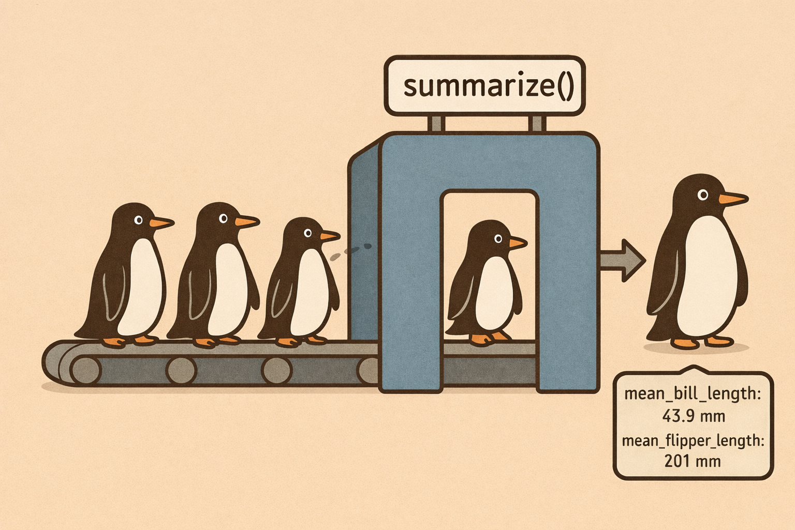
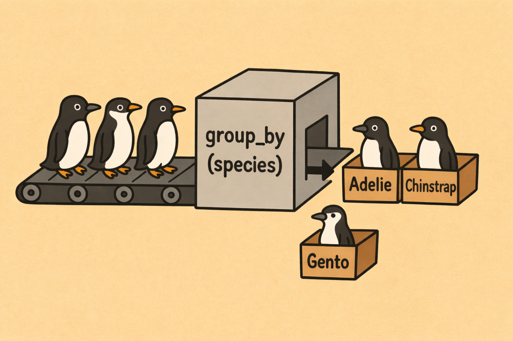

## R u Ready? Reproduzierbare Datenaufbereitung und -analyse mit R

HS 2026<br><br><br> **Seminarleitung**: Dr. Sandra Grinschgl<br> **Leitung beider Seminargruppen:** MSc. Laura Hirt<br> **Tutor**: BSc. Jan-Pierre Pahnke<br><br><br>**7. Einheit**, 28.10.2026

{fig-align="center" width="306"}

::: notes
Willkommen zur siebten Einheit. Heute sind wir schon in der Hälfte des Semesters angekommen und machen einmal bewusst etwas anderes als in den vergangenen Wochen: Wir arbeiten heute nicht primär an unserem Forschungsprojekt weiter, sondern trainieren einmal die Werkzeige, die wir dafür brauchen.

Ihr habt letzte Woche die grundlegenden dplyr-Funktionen kennengelernt und die notwendigen Transformationen im Processing-Skript vorgenommen.

Heute kriegt ihr die Gelegenheit, diese Funktionen an einem separaten Datensatz einmal zu üben. Ihr lernt, passende Funktionen selber auszuwählen und auch miteinander zu kombinieren.
:::

------------------------------------------------------------------------

## Wo befinden wir uns?

**AUFBEREITEN: Werkzeuge beherrschen, bevor wir weitere Datenprobleme lösen**

<br>

{fig-align="center" width="75%"}

<br>

**EH6:** Notwendige Transformationen in `processing.qmd` durchführen.

**EH7:** dplyr-Werkzeuge an anderen Datensätzen selbstständig anwenden.

::: notes
Wir bleiben also in der Phase der Datenaufbereitung.

Unser gemeinsames Projekt steht inzwischen nach der Zusammenführung, Dokumentation und ersten Transformationen an einem guten Zwischenpunkt.

Bevor wir nächste Woche gezielt Datenfehler behandeln und in EH9 Analysevariablen und den Long-Datensatz erzeugen, nehmen wir uns heute Zeit, die wichtigsten Funktionen wirklich zu festigen.

Das ist kein Themenwechsel weg vom Forschungsprozess: Wir trainieren heute Fähigkeiten, die wir später bei neuen oder problematischen Daten eigenständig einsetzen müssen. An unserem Processing-Skript nehmen wir heute mal keine weiteren Änderungen vor sondern arbeiten in einem neuen Quarto-Dokument nur zu Übungszwecken.
:::

------------------------------------------------------------------------

## Heute: Kurzer Input, viel Übungszeit

<br>

**1. Wiederholen:** Fünf Funktionen aus EH6

**2. Erweitern:** `arrange()`, `relocate()`, `summarise()` und `group_by()`

**3. Verbinden:** Eine Pipeline selbstständig lesen und planen

**4. Anwenden:** Eigenständige Übungszeit

**5. Abschliessen:** Abgaben und Cheatsheet-Wettbewerb

<br>

**Ziel:** Nicht nur R-Code wiedererkennen, sondern **die passende Funktion selbst auswählen.**

::: notes
Der Ablauf ist heute bewusst kompakt. Wir repetieren zuerst kurz die Funktionen von letzter Woche, ergänzen dann vier neue Funktionen und lernen anschliessend, wie sie kombiniert werden.

Danach gehört der grösste Teil der Zeit euch. Ihr arbeitet selbstständig oder in kleinen Gruppen an Aufgaben mit anderen Datensätzen.

Am Schluss gibt es Abgabehinweise und Informationen zu einem freiwilligen Wettbewerb für Zusatzpunkte.
:::

------------------------------------------------------------------------

## Rückblick: Welche Funktion macht was?

<br>

| Unsere Frage | Funktion | Wirkung |
|------------------------|------------------------|------------------------|
| Welche **Beobachtungen** möchten wir behalten? | `filter()` | Zeilen auswählen |
| Welche **Variablen** interessieren uns? | `select()` | Spalten auswählen |
| Wie soll eine **Variable heissen**? | `rename()` | Spaltenname ändern |
| Welche **Werte** wollen wir berechnen? | `mutate()` | Neue/bestehende Spalten bearbeiten |
| Wie wenden wir **dieselbe Berechnung mehrfach** an? | `across()` | Mehrere Spalten innerhalb von `mutate()` bearbeiten |

::: notes
Hier noch einmal eine kurze Repetition der fünf Funktionen von letzter Woche.

-   Mit filter() wählen wir bestimmte Fälle oder Beobachtungen nach Bedingungen aus.

-   Mit select() wählen wir einzelne Variablen aus.

-   rename() verändert Variablennamen, aber nicht die Werte.

-   mutate() berechnet oder verändert Werte und bearbeitet neue oder bereits bestehende Spalten.

-   across() hilft uns, dieselbe Operation auf mehrere Spalten gleichzeitig anzuwenden.

Diese Funktionen haben also unterschiedliche Aufgaben. Gemeinsam ist ihnen allen, dass sie praktisch mithilfe eines Pipe-Operators auf einen Datensatz angewendet werden können und sich auch miteinander kombinieren lassen.
:::

------------------------------------------------------------------------

## 4 weitere `dplyr`-Funktionen

<br>

| Funktion | Leitfrage | Wirkung |
|------------------------|------------------------|------------------------|
| `arrange()` | In welcher Reihenfolge sollen die **Zeilen** stehen? | Zeilen sortieren |
| `relocate()` | Wo sollen bestimmte **Spalten** stehen? | Spalten verschieben |
| `summarise()` | Welche Kennwerte fasse unsere Daten zusammen? | Beobachtungen zu Kennwerten verdichten |
| `group_by()` | Für welche Gruppen sollen Berechnungen getrennt erfolgen? | Gruppierung festlegen |

<br>

**Zwei Paare:** Reihenfolge verändern; Informationen zusammenfassen.

::: notes
Heute kommen noch vier weitere Funktionen hinzu.

Die ersten beiden betreffen die Reihenfolge:

-   arrange() sortiert die Zeilen des Datensatzes,

-   relocate() verschiebt die Spalten in ihrer Anordnung.

Bei de verändern also nur die Darstellungsweise der Daten, verändern diese selbst aber nicht. Es werden Zeilen oder Spalten innerhalb des Datensatzes verschoben, ohne dabei inhaltlich etwas zu verändern.

Die anderen beiden Funktionen helfen uns, Informationen kompakt zusammenzufassen:

-   summarise() berechnet verschiedene Kennwerte,

-   group_by() gibt vor, für welche Gruppen wir solche Berechnungen getrennt durchführen wollen.

Diese Funktionen schauen wir uns nun noch kurz anhand von Beispielen an.
:::

------------------------------------------------------------------------

## `arrange()`: Beobachtungen sortieren

**`arrange()` verändert die Reihenfolge der Zeilen - nicht ihre Werte**

<br>

```{r, echo=FALSE, eval=TRUE}
library(palmerpenguins)
library(dplyr)
```

::::: columns
::: {.column width="53%"}
**Aufsteigend (Standard)**

```{r, echo=TRUE, eval=TRUE}
penguins |>
  arrange(body_mass_g) |>
  select(species, body_mass_g) |>
  head(4)
```
:::

::: {.column width="47%"}
**Absteigend mit `desc()`**

```{r, echo=TRUE, eval=TRUE}
penguins |>
  arrange(desc(body_mass_g)) |>
  select(species, body_mass_g) |>
  head(4)
```
:::
:::::

<br>

Die Beobachtungen bleiben vorhanden; wir ändern nur, welche Zeilen zuerst angezeigt werden.

::: notes
Wir arbeiten hier einmal mit dem Penguinen-Datensatz, der in R vorinstalliert ist.

Angenommen, wir möchten uns die Penguine einmal nach ihrem Gewicht her betrachten. Wenn wir zuerst die leichtesten Penguine betrachten wollen, sortieren wir die Zeilen mit arrange() nach der Körpermasse. Ohne weiteren Angaben werden Zahlen mit arrange() aufsteigend sortiert.

Wenn wir die schwersten Penguine zuerst sehen möchten, verwenden wir das Argument desc innerhalb von arrange().

Mit select() geben wir uns anschliessend nur zwei Variablen des Datensatzes aus und mit head beschränken wir die Ansicht auf die ersten vier Zeilen des Datensatzes.

arrange() löscht weder Personen noch ändert es Werte. Es wird nur die Reihenfolge der Beobachtungen verändert.
:::

------------------------------------------------------------------------

## `relocate()`: Spalten verschieben

**`relocate()` verändert die Reihenfolge der Spalten - nicht ihre Werte**

<br>

```{r, echo=TRUE, eval=TRUE}
# Urspüngliche Reihenfolge
penguins |>
  head(n = 2)
```

<br>

```{r, echo=TRUE, eval=TRUE}
# Sepzies hinter die Insel verschieben
penguins |>
  relocate(species, .after = island) |>
  head(n = 2)
```

<br>

**Weitere Möglichkeit: `.before = ...`** platziert eine Spalte **vor** einer anderen.

::: notes
Während arrange() die Reihenfolge von Beobachtungen verändert, betrifft relocate() die Reihenfolge von Variablen.

Das ist nützlich, wenn wichtige Spalten übersichtlich nebeneinander stehen sollen.

Hier wollen wir einmal die Art der Spezies direkt hinter die Insel verschieben, auf der die Pinguine beobachtet wurden. Das Argument .after gibt an, hinter welcher Spalte die ausgewählte Variable stehen soll.

Mit .before funktioniert es entsprechend davor.

Auch hier bleiben alle Zeilen und Spalten erhalten - nur die Spaltenreihenfolge verändert sich.
:::

------------------------------------------------------------------------

## summarise(): Viele Beobachtungen zu Kennwerten verdichten I

**`summarise()` erzeugt eine neue, kompaktere Ergebnistabelle**

<br>

{fig-align="center" width="1436"}

<br>

Einzelne Beobachtungen verschwinden, übrig bleibt die zusammengefasste Information.

::: notes
Jetzt wollen wir nicht mehr einzelne Beobachtungen anschauen, sondern viele Beobachtungen durch einige Kennwerte zusammenfassen. Dazu dient summarise(). Die Funktion kann mit s oder z geschrieben werden.
:::

------------------------------------------------------------------------

## summarise(): Viele Beobachtungen zu Kennwerten verdichten II

**`summarise()` erzeugt eine neue, kompaktere Ergebnistabelle**

<br>

```{r, echo=TRUE, eval=TRUE}
penguins |>
  summarise(
    n = n(),
    mittlere_masse = mean(body_mass_g, na.rm = TRUE)
  )
```

<br>

-   `n()` zählt die Beobachtungen

-   `mean()` berechnet den Mittelwert der Körpermasse

-   `na.rm = TRUE` lässt fehlende Werte bei der Mittelwertberechnung aus.

**Ergebnis:** Eine Zeile mit zwei Kennwerten für den gesamten Datensatz.

::: notes
Mit n() zählen wir zunächst die Beobachtungen unseres Penguindatensatzes.

Mit mean() berechnen wir die durchschnittliche Körpermasse der Penguine. Weil im Datensatz bei einzelnen Beobachtungen Werte fehlen, geben wir na.rm = TRUE an. Das bedeutet nur für diese Berechnung, dass fehlende Werte nicht in den Mittelwert eingehen sollen.

Sie werden damit aber nicht aus der Datei gelöscht!

Ohne vorherige Gruppierung der Pinguine erhalten wir genau eine Zeile mit Kennwerten für den gesamten Datensatz.
:::

------------------------------------------------------------------------

## `group_by()`: Daten für getrennte Berechnungen gruppieren

**`group_by()` legt fest, welche Beobachtungen zusammengehören**

<br>

:::::: columns
::: {.column width="40%"}
{fig-align="center"}
:::

:::: {.column width="60%"}
```{r, echo=TRUE, eval=FALSE}
penguins |>
  group_by(species)
```

<br>

::: {style="font-size: 0.65em;"}
| Ohne Gruppierung | Mit `group_by(species)` |
|------------------------------------|------------------------------------|
| Alle 344 Pinguine bilden eine Gesamtheit. | Die 344 Pinguine sind drei Arten zugeordnet. |
| Berechnungen beziehen sich auf alle Pinguine. | Nachfolgende Berechnungen können pro Art erfolgen. |
:::
::::
::::::

<br>

**Wichtig:** `group_by()` berechnet noch keinen Mittelwert und entfernt keine Zeilen.

::: notes
Oft interessiert uns nicht der Durchschnitt aller Pinguine, sondern bspw. die durchschnittliche Körpermasse je Pinguinart.

Dafür müssen wir R mitteilen, nach welcher Variable getrennt gerechnet werden soll.

group_by(species) kennzeichnet die Daten als nach Art gruppiert. Die ursprünglichen 344 Zeilen bleiben bestehen.

group_by() allein erzeugt also noch keine Zusammenfassung. Es verändert, wie nachfolgende Funktionen wie aummarise() ihre Berechnungen ausführen.
:::

------------------------------------------------------------------------

## Entscheidender Unterschied: Ohne und mit `group_by()`

<br>

::::: columns
::: {.column width="50%"}
**Ohne Gruppierung**

```{r, echo=TRUE, eval=TRUE}
penguins |>
  summarise(
    n = n(),
    mean_masse = mean(body_mass_g, na.rm = TRUE)
    )
```

<br>

*Eine Zeile insgesamt*
:::

::: {.column width="50%"}
**Mit Gruppierung**

```{r, echo=TRUE, eval=TRUE}
penguins |>
  group_by(species) |>
  summarise(
    n = n(),
    mean_masse = mean(body_mass_g, na.rm = TRUE)
    )
```

*Eine Zeile pro Art*
:::
:::::

::: notes
Das ist die wichtigste Gegenüberstellung der heutigen Sitzung. Links verwenden wir summarise() direkt auf den gesamten Datensatz. Wir erhalten eine einzige Zeile mit n = 344 und einem Gesamtmittelwert aller Pinguine.

Rechts dagegen gruppieren wir zuerst nach Pinguinart und führen exakt dieselbe Zusammenfassung aus. Jetzt erhalten wir drei Zeilen.

Dieselbe Logik benötigten wir später bspw. für gruppierte Deskriptivstatistiken der drei Feedbackgruppen in unserem Forschungsprojekt.
:::

------------------------------------------------------------------------

## Eine Frage - mehrere `dplyr`-Funktionen

**Frage:** Welche Pinguinart besitzt die höchste durchschnittliche Körpermasse?

<br>

```{r, echo=TRUE, eval=TRUE}
penguins |>
  group_by(species) |>
  summarise(
    n = n(),
    mittlere_masse = mean(body_mass_g, na.rm = TRUE)
  ) |>
  arrange(desc(mittlere_masse))
```

<br>

**Was geschieht nacheinander?**

`group_by()` → Arten festlegen

`summarise()` → Mittelwerte berechnen

`arrange()` → Ergebnis sortieren

::: notes
Nun verbinden wir mehrere neue Funktionen in einer einzigen Pipeline.

Wir beginnen mit den Pinguindaten und gruppieren sie nach Art. Anschliessend berechnen wir pro Art die Anzahl und die mittlere Körpermasse. Zum Schluss sortieren wir diese drei Ergebniszeilen absteigend nach der mittleren Körpermasse. Die schwerste Art steht damit zuoberst.
:::

------------------------------------------------------------------------

## Nun: dplyr-Trainingslabor

<br>

{fig-align="center" width="65%"}

------------------------------------------------------------------------

## Hausübungen & Ausblick

-   Peer-Feedback Codebook bis **Mi, 28.10.2026 (23:55)**

    -   Ggf. eine Woche Verlängerung

<br>

**Weitere Schritte:**

-   **EH8 (04.11.):** Problematische Daten erkennen und bereinigen.
-   **EH9 (11.11.):** MMQ-Skalenwert berechnen und Long-Daten aus **`pre1` und `pre4`** erzeugen.

------------------------------------------------------------------------

## Freiwillig: R-Cheatsheet-Wettbewerb

**Erstellt euer eigenes kompaktes R-Nachschlagewerk**

<br>

🎯 **Ziel:** Auf Basis einer Vorlage (ILIAS) ein eigenes R-Cheatsheet mit wichtigen Befehlen, Beispielen und kurzen Erklärungen erstellen.

<br>

💡 **Idee:** Persönliches Nachschlagewerk für R-Workflows, Funktionen und Analysen; auch nützlich für spätere Projekte und/oder die Masterarbeit.

<br>

⭐ **Extrapunkte**

-   2 Punkte für Teilnahme (bei erfüllten Mindestkriterien)

-   +2 Punkte für das beste Cheatsheet (Abstimmung im Seminar)

<br>

**Genaue Informationen auf der [Webseite](https://r-you-ready.github.io/Webseite_HS26_Seminar/scripts/04_misc/wettbewerb_cheatsheet.html)**
