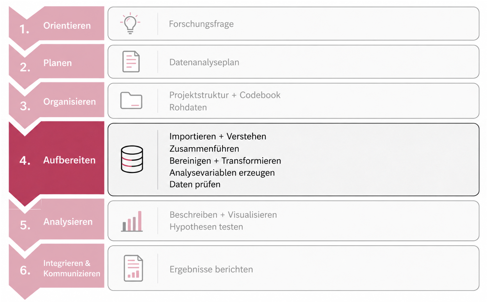
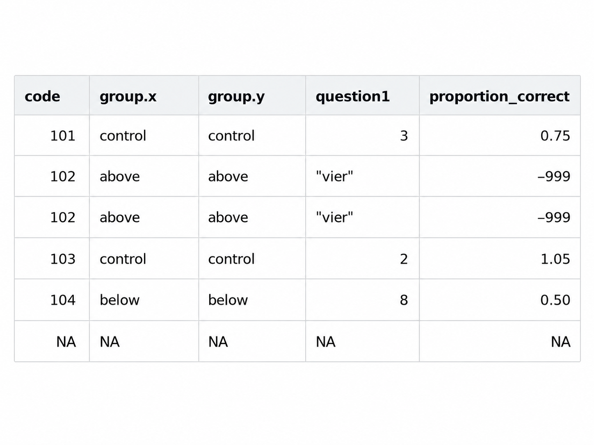
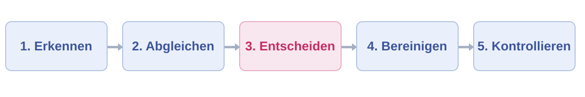
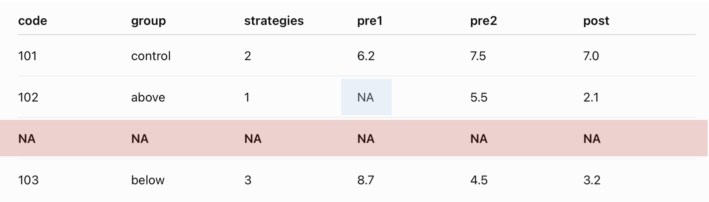
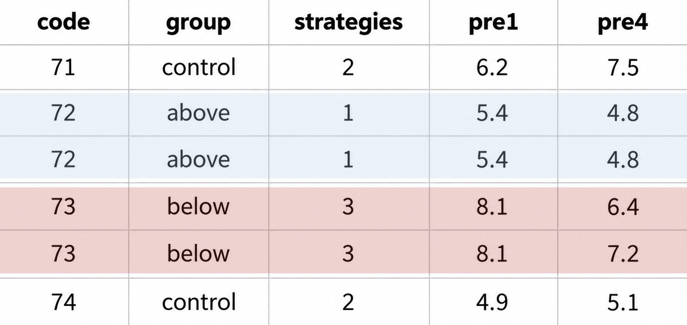

```{r, echo = FALSE, message=FALSE}

library(tidyverse)
library(palmerpenguins)
penguins <- palmerpenguins::penguins
dat_full <- readr::read_delim("raw/dat_full.csv")
```

## R u Ready? Reproduzierbare Datenaufbereitung und -analyse mit R

HS 2026<br><br><br> **Seminarleitung**: Dr. Sandra Grinschgl<br> **Leitung beider Seminargruppen:** MSc. Laura Hirt<br> **Tutor**: BSc. Jan-Pierre Pahnke<br><br><br>**8. Einheit**, 04.11.2026

{fig-align="center" width="306"}

::: notes
Willkommen zur achten Einheit.

Letzte Woche habt ihr viel Zeit damit verbracht, die verschiedenen Funktionen aus dplyr selbstständig auszuprobieren. Heute geht es weniger darum, möglichst viele weitere Funktionen kennenzulernen. Wir beschäftigen uns mit einer Frage, die in jeder empirischen Untersuchung wichtig ist: Was tun wir, wenn unsere Daten nicht so aussehen, wie wir es erwarten?

Im gemeinsamen Forschungsprojekt sind die Originaldaten weitgehend vollständig aufbereitet. Das ist angenehm, aber nicht unbedingt repräsentativ für die Arbeit mit neuen Forschungsdaten. Gerade bei den simulierten Abschlussdaten könnt ihr auf unterschiedliche Datenprobleme treffen.

Heute lernen wir deshalb, verschiedene Datenprobleme systematisch zu erkennen, ihre möglichen Ursachen zu prüfen und Korrekturen zu begründen.
:::

------------------------------------------------------------------------

## Wo befinden wir uns?

**AUFBEREITEN: Qualität sichern, bevor wir analysieren**

<br>

{fig-align="center" width="75%"}

<br>

**EH7:** `dplyr`-Funktionen selbstständig anwenden.

**EH8:** Datenprobleme erkennen, erklären und begründet bereinigen.

**EH9:** `mmq_mean` berechnen & Long-Daten aus `pre1` und `pre4` erzeugen.

::: notes
Wir sind weiterhin im vierten Schritt unseres Forschungsprozessen. Ihr habt inzwischen gelernt, wie wir Daten importieren, zusammenführen, dokumentieren und mit dplyr verändern können.

Was uns noch fehlt, ist ein systematischer Blick auf mögliche Probleme in den Rohdaten. Bevor wir aus einzelnen Fragebogenitems einen Skalenwert berechnen oder ein statistisches Modell schätzen, müssen die dafür verwendeten Daten korrekt interpretiert und ausreichend geprüft sein.

Da in den Originaldaten keine Fehlerquellen vorhanden sind, arbeiten wir heute nicht am Processing-Skript weiter. Wie auch letzte Woche trainieren wir heute einen Denkprozess und unterschiedliche Verarbeitungsschritte, die ihr später auf eure individuell simulierten Abschlussdaten übertragen könnt.

Nächste Woche kehren wir dann wieder zur konkreten Aufbereitung des gemeinsamen Forschungsprojekts zurück und in 2 Wochen führen wir erste Berechnungen durch.
:::

------------------------------------------------------------------------

## Ein kleiner Datensatz - alles in Ordnung?

**Schaut zuerst nur auf die Daten. Was fällt euch auf?**

<br>

{fig-align="center" width="50%"}

<br>

Wie viele Auffälligkeiten findet ihr?

::: notes
-   Die Person 102 kommt mit identischer Zeile zweimal vor.

-   Die letzte Zeile enthält überhaupt keine Information.

-   group.x und group.y scheinen identische Spalten zu sein. Könnte sein, dass diese durch das Mergen entstanden sind.

-   Bei question1 stehen die Werte von Person 102 als Zahlwort ausgeschrieben in Anführungszeichen.

-   Eine Proportion kann nur Werte zwischen 0 und 1 enthalten. Der Wert -999 ist daher auffällig und auch 1.05 unmöglich.

Mit dieser kleinen Übung haben wir schon den ersten wichtigen Schritt bei der Fehlererkennung erfüllt: Wir beschrieben Auffälligkeiten, bevor wir etwas löschen oder verändern.
:::

------------------------------------------------------------------------

## Nicht jede Auffälligkeit ist automatisch ein Fehler

**Wir unterscheiden verschiedene Probleme - und brauchen unterschiedliche Prüfungen**

<br>

::: {style="font-size:0.85em;"}
| Bereich | Woran erkennen wir mögliche Probleme? | Typische Beispiele |
|------------------|------------------------------|------------------------|
| **Datenstruktur** | Doppelte Zeilen/IDs, unerwartete Spalten | Leerzeilen, Duplikate, ID- und Spaltenprobleme |
| **Werte und Kodierung** | Werte passen nicht zum dokumentierten Format | Zahlwörter, unzulässige Codes |
| **Fehlende Information** | Informationen fehlen oder sind als Platzhalter gespeichert | `NA`, leere Felder, Platzhalter, spezielle Missing-Codes |
| **Skala und Richtung** | Variablen wurden unterschiedlich skaliert/gepolt | Bereits transformierte oder anders gepolte Variablen |
:::

<br>

**Entscheidende Frage:** Was wäre laut Studiendesign und Dateninformationen zu erwarten?

::: notes
Wir können die auffälligen Stellen aus der kleinen Tabelle von vorhin in vier Bereiche einordnen.

-   **Erstens die Struktur:** Sind alle Fälle eindeutig? Gibt es unerwartete Zeilen oder Spalten? Sind also vielleicht einige der IDs doppelt vorhanden? Existieren duplizierte Spalten oder zusätzliche, irrelevante Spalten?

-   **Zweitens die Werte und Kodierungen:** Sind die Datentypen und die Werte einer Variable passend? Sind numerische Variablen wirklich numerisch erfasst?

-   **Drittens fehlende Informationen:** Sind im Datensatz fehlende Werte vorhanden? Wie wird ein fehlender Wert dargestellt und warum könnte er fehlen? Wie können wir damit umgehen?

-   **Viertens noch die Skalierung und Richtung einer Messung:** Sind alle Werte auf derselben Skala erhoben? Oder sind einige Items anders skaliert? Existieren umgepolte Items innerhalb einer Skala?

Nicht jede Auffälligkeit erfordert dieselbe Massnahme. Eine doppelte ID ist bspw. in einem Datensatz mit wiederholten Messungen möglicherweise völlig normal. In einer Datei, die genau eine Zeile pro Versuchsperson enthalten soll, ist sie dagegen ein Warnsignal.

Deshalb braucht ihr bei jeder Datenprüfung die Erwartungen aus dem Datenanalyseplan, dem Codebook und den ergänzenden Studieninformationen. Die Rohdaten allein verraten euch nicht immer, was richtig ist.
:::

------------------------------------------------------------------------

## Unser Vorgehen bei Datenproblemen

**Erst verstehen - dann verändern**

<br>

{fig-align="center" width="75%"}

<br>

**1. Erkennen:** Welche Werte, Variablen oder IDs fallen auf?

**2. Abgleichen:** Was erwarten wir laut Codebook und Studiendesign?

**3. Entscheiden:** Fehler, zulässige Besonderheit oder ungeklärter Fall?

**4. Bereinigen:** Nur fachlich begründete Korrekturen im R-Skript vornehmen.

**5. Kontrollieren:** Sind die Daten danach plausibel und ist der Schritt dokumentiert?

<br>

**Merksatz:** Eine erfolgreich ausgeführte R-Funktion ist noch kein Beweis für korrekte Daten!

::: notes
Ich möchte euch für die gesamte Einheit ein festes Vorgehen mitgeben. Wir beginnen nie damit, einfach alle Zeilen zu löschen, die irgendwie merkwürdig aussehen.

Zunächst erkennen wir Auffälligkeiten, dann gleichen wir sie mit den erwarteten Daten ab. Erst danach entscheiden wir, ob ein Fehler vorliegt und welche Korrektur zulässig und angemessen ist.

Die Korrektur gehört in den reproduzierbaren Verarbeitungscode. Anschliessend vergleichen wir den Zustand vor und nach der Änderung: Haben wir nur das Problem behoben oder versehentlich auch andere Daten verändert?

Dieser Ablauf gilt unabhängig davon, ob wir leere Zeilen, doppelte IDs, Textwerte oder bereits skalierte Variablen untersuchen.

In den nächsten Folien sehen wir dafür kurze Beispiele. Die umfangreichere eigenständige Umsetzung übt ihr direkt danach in den Übungen.
:::

# Probleme mit der Datenstruktur

**Stimmt der Aufbau unseres Datensatzes?**

-   Vollständig leere Zeilen

-   Doppelte Beobachtungen und Personen-IDs

-   Auffällige Spalten und uneinheitliche Join-Schlüssel

------------------------------------------------------------------------

## Vollständig leere Zeile ≠ einzelne fehlende Angabe

**Fehlt nur ein Wert - oder fehlt eine ganze Beobachtung?**

<br>

:::::: columns
::: {.column width="60%"}
<br>

{fig-align="left" width="95%"}
:::

:::: {.column width="40%"}
::: eh8-three
**Erkennen:** Eine vollständig leere Zeile enthält in allen Spalten `NA`.

**Besonderheit:** Hier fehlt nicht nur eine einzelne Antwort, sondern die gesamte Beobachtung. Auch die Personen-ID fehlt - die Zeile lässt sich keiner Person zuordnen.

**Umgang:** Vollständig leere Zeilen können nach Prüfung entfernt werden. Einzelne fehlende Werte bleiben dagegen zunächst erhalten.
:::
::::
::::::

------------------------------------------------------------------------

## Vollständig leere Zeilen mit `dplyr` erkennen

**Wie finden wir Zeilen, in denen sämtliche Angaben fehlen?**

<br>

::::: columns
::: {.column width="45%"}
**1. Vollständig leere Zeilen finden**

```{r, echo=TRUE, eval=FALSE}

leere_zeilen <- data_cb |>
  filter(
    if_all(everything(), is.na)
  )
```

**2. Anzahl bestimmen**

```{r, echo=TRUE, eval=FALSE}

nrow(leere_zeilen)
# [1] 0
```
:::

::: {.column width="55%"}
**Was passiert hier?**

-   `is.na()` prüft, ob ein Wert fehlt.

-   `everthing()` berücksichtigt alle Spalten.

-   `if_all()` verlangt, dass **alle Spalten einer Zeile** die Bedingung erfüllen.

-   `filter()` wählt diese Zeilen aus.

-   `nrow()` zählt die gefundenen Zeilen.
:::
:::::

<br>

**Wir erkennen und zählen vollständig leere Zeilen - wir entfernen noch keine Beobachtungen.**

::: notes
Auf der vorherigen Folie haben wir eine Person gesehen, bei der nur ein einzelner Wert fehlt, und eine vollständig leere Zeile, bei der sogar die ID fehlt.

Wie können wir solche Zeilen erkennen, ohne unseren gesamten Datensatz manuell durchzugehen?

Dafür nutzen wir filter(), das wir bereits kennen. Neu ist die Funktion if_all().

Mit everything() beziehen wir alle Spalten ein. is.na() überprüft, ob ein Wert fehlt. if_all() sorgt dafür, dass die Bedingung für jede einzelne Spalte der betreffenden Zeile erfüllt sein muss.

Das Ergebnis speichern wir zunächst in einem separaten Objekt namens leere_zeilen. Anschliessend können wir mit nrow() zählen, wie viele solcher Zeilen gefunden wurden.

In unserem unveränderten Originaldatensatz erwarten wir null vollständig leere Zeilen. Bei anderen Daten, bspw. beim Einlesen fehlerhafter Rohdaten, können solche Zeilen aber durchaus vorkommen.

Wichtig ist: Wir haben bislang nichts gelöscht. Zuerst untersuchen wir die Daten. Erst wenn wir sicher sind, dass es sich tatsächlich um vollständig leere Beobachtungen handelt, entscheiden wir über eine Entfernung.
:::

------------------------------------------------------------------------

## Vollständig leere Zeilen gezielt entfernen

**Erst prüfen, dann bereinigen - und anschliessend kontrollieren**

<br>

**1. Vollständig leere Zeilen entfernen**

```{r, echo=TRUE, eval=FALSE}

data_cb <- data_cb |>
  filter(!if_all(everything(), is.na))
```

<br>

::::: columns
::: {.column width="48%"}
**Was ist neu?**

-   `!` bedeutet **NICHT** und kehrt die Bedingung um.

-   Wir behalten alle Zeilen, die **nicht vollständig leer** sind.

-   Durch `<-` speichern wir das bereinigte Ergebnis wieder unter `data_cb`.
:::

::: {.column width="52%"}
**2. Ergebnis kontrollieren**

```{r, echo=TRUE, eval=FALSE}

data_cb |>
  filter(if_all(everything(), is.na)) |>
  nrow()

# Erwartetes Ergebnis: 0
```

Nach der Bereinigung sollten **keine vollständig leeren Zeilen** mehr vorhanden sein.
:::
:::::

**Wichtig:** Einzelne fehlende Antworten bleiben erhalten. Vollständig leere Zeilen sollten möglichst vor dem Zusammenführen der Rohdatensätze entfernt werden.

::: notes
Auf der vorherigen Folie haben wir gelernt, wie wir vollständig leere Zeilen erkennen und zählen können.

Was machen wir nun, wenn wir tatsächlich solche Zeilen finden?

Wenn wir festgestellt haben, dass es sich um vollständig leere und überflüssige Beobachtungen handelt, können wir diese gezielt entfernen.

Dafür verwenden wir fast denselben Befehl wie zuvor. Neu ist nur das Ausrufezeichen vor if_all().

Das Ausrufezeichen bedeutet nicht. Wir behalten also alle Zeilen, bei denen nicht sämtliche Werte fehlen. Personen, bei denen nur einzelne Werte fehlen, bleiben dadurch erhalten.

Das Ergebnis weisen wir mit dem Zuweosungsoperator wieder data_cb zu. Damit speichern wir die Bereinigung in unserem R-Objekt.

Anschliessend überprüfen wir erneut, wie viele vollständig leere Zeilen noch vorhanden sind. Wenn die Bereinigung erfolgreich war, erhalten wir null.

Besonders wichtig ist auch die Position dieses Schrittes im Forschungsprojekt. Wenn vollständig leere Zeilen bereits in den einzelnen Rohdateien vorkommen, sollten wir sie möglichst vor dem Mergen entfernen.
:::

------------------------------------------------------------------------

## Doppelte Zeile ≠ doppelte Personen-ID

**Ist dieselbe Beobachtung doppelt vorhanden - oder gibt es mehrere Beobachtungen pro Person?**

<br>

:::::: columns
::: {.column width="60%"}
<br>

{fig-align="left" width="85%"}
:::

:::: {.column width="40%"}
::: eh8-three
**Erkennen:** Die Zeilen mit ID `72` sind vollständig identisch (dupliziert). ID `73` kommt ebenfalls zweimal vor, allerdings mit unterschiedlichen Werten bei `pre4`.

**Mögliche Ursache:** Doppelter Datenexport, fehlerhadte Zusammenführung oder tatsächlich mehrere Messungen.

**Umgang:** Vollständig identische Zeilen können nach Prüfung entfernt werden. Bei gleichen IDs mit unterschiedlichen Angaben muss zunächst die Ursache geklärt werden.
:::
::::
::::::

::: notes
Wir haben gerade gesehen, dass in Datensätzen vollständig leere Zeilen vorkommen können. Ein weiteres häufiges Problem sind doppelte Beobachtungen.

Schauen wir uns zuerst die Person mit der ID 72 an. Diese Person kommt zweimal vor. Wenn wir die beiden Zeilen vergleichen, sehen wir, dass sämtliche Werte identisch sind. Vermutlich wurde hier eine Beobachtung versehentlich zweimal gespeichert.

Bei Person 73 sieht es anders aus. Die ID kommt ebenfalls zweimal vor, aber die Werte bei pre4 unterscheiden sich. Welche dieser beiden Beobachtungen wäre jetzt die richtige? Das können wir anhand des Datensatzes allein nicht entscheiden.

Hier müssen wir berücksichtigen, wie unsere Daten aufgebaut sein sollten. In unserem Wide-Datensatz dat_full erwarten wir genau eine Zeile pro VPN. Zwei unterschiedliche Zeilen mit derselben ID wären deshalb ein Problem, das wir untersuchen müssen.

Später, in unserem Long-Datensatz mit mehreren Messzeitpunkten, darf und muss dieselbe Personen-ID hingegen sogar zweimal vorkommen. Dort gehört dann zu jeder Person und jedem Messzeitpunkt eine eigene Zeile.

Entscheidend ist also nicht allein, ob eine ID mehrfach vorkommt, sondern ob dies zur vorgesehenen Datenstruktur passt.

Wir dürfen deshalb nicht einfach automatisch alle mehrfach vorkommenden IDs entfernen. Sonst riskieren wir, wichtige Informationen zu verlieren.
:::

------------------------------------------------------------------------

## Doppelte Zeilen mit `dplyr` erkennen

**Doppelte Beobachtungen vor dem Merge erkennen**

<br>

::::: columns
::: {.column width="45%"}
**1. Vollständig doppelte Zeilen finden**

```{r, echo=TRUE, eval=FALSE}

duplikate_zeilen <- data_cb |>
  filter(duplicated(.))

# Alternative
sum(duplicated(data_cb))
```

**2. Mehrfach vorkommende IDs finden**

```{r, echo=TRUE, eval=FALSE}

duplikate_ids <- data_cb |>
  count(code) |>
  filter(n > 1)
```
:::

::: {.column width="55%"}
**Was passiert hier?**

-   `duplicated(.)` prüft, ob eine ganze Zeile bereits vorher genauso vorkam.

-   `filter()` wählt genau diese vollständig doppelten Zeilen aus.

-   `count(code)` zählt, wie oft jede ID vorkommt.

-   `filter(n > 1)` zeigt nur IDs, die mehrfach vorhanden sind.

-   So unterscheiden wir zwischen echten Dubletten und mehrfach auftretenden IDs.
:::
:::::

<br>

**Wir prüfen hier noch nicht, was gelöscht wird - wir machen die Auffälligkeiten zuerst sichtbar.**

------------------------------------------------------------------------

## Vollständig duplizierte Zeilen entfernen

**Nur echte Dubletten ausschliessen - nicht bloss doppelte IDs**

<br>

**1. Vollständig duplizierte Zeilen entfernen**

```{r, echo=TRUE, eval=FALSE}

data_cb <- data_cb |>
  distinct()
```

<br>

::::: columns
::: {.column width="48%"}
**Was ist neu?**

-   `distinct()` entfernt **vollständig identische Zeilen.**

-   Dabei bleibt jede eindeutige Beobachtung einmal erhalten.

-   Unterschiedliche Zeilen mit derselben ID bleiben weiterhin im Datensatz.
:::

::: {.column width="52%"}
**2. Ergebnis kontrollieren**

```{r, echo=TRUE, eval=FALSE}
sum(duplicated(data_cb))

data_cb |>
  count(code) |>
  filter(n > 1)
```

Nach der Bereinigung sollten **keine duplizierten Zeilen** mehr vorhanden sein. Mehrfach vorkommente IDs können weiterhin existieren.
:::
:::::

**Wichtig:** Vollständig duplizierte Zeilen sollten möglichst vor dem Mergen der Rohdatensätze entfernt werden.

------------------------------------------------------------------------

# Probleme mit Werten & Kodierungen

**Sind die gespeicherten Werte korrekt und interpretierbar?**

-   Zahlen als Text oder Wörter

-   Unzulässige und widersprüchliche Werte

-   Ungeeignete Datentypen und uneinheitliche Kodierungen

------------------------------------------------------------------------

# Fehlende Informationen

**Was tun wir, wenn Angaben fehlen?**

-   Echte `NA`-Werte und spezielle Missing-Codes

-   Möglichkeiten zum Umgang mit fehlenden Werten

-   Rekonstruktion aus vorhandenen Werten

------------------------------------------------------------------------

# Probleme mit Skalen & Richtung

**Sind die Variablen einheitlich und richtig skaliert?**

-   Unterschiedliche oder bereits transformierte Skalen

-   Inverse Kodierung (*Reverse Coding*)

-   Korrekte Vorbereitung der Skalenberechnung

------------------------------------------------------------------------

-   

-   

-   Ab hier muss der Foliensatz noch überarbeitet werden.

Wird am Freitag oder Samstag gemacht!

## 

\

------------------------------------------------------------------------

### **Wieso müssen wir überhaupt fehlende Werte behandeln?**

-   Viele Funktionen in R funktionieren nur mit vollständigen Datensätzen.

-   Kennwerte wie Mittelwerte oder Standardabweichungen können nicht berechnet werden, wenn fehlende Werte enthalten sind.

-   Fehlende Werte können Ergebnisse verzerren, insbesondere wenn sie nicht zufällig fehlen.

### **Umgang mit fehlenden Werten:**

1️⃣ Finden -\> Wo sind fehlende Werte?

2️⃣ Verstehen -\> Warum fehlen sie?

3️⃣ Behandeln -\> abhängig von eurem Studiendesign und Fragestellungen

------------------------------------------------------------------------

## Formen fehlender Werte

**In R (Standardfall)**

`NA` = fehlender Wert (*Not Available*)

-   Wird von R automatisch erkannt

-   Funktionen können damit umgehen

<br>

**Häufige "versteckte" fehlende Werte**

-   Werden nicht als NA erkannt!

-   `999` oder `-999` -\> Platzhalter

-   `""` -\> leere Zellen

------------------------------------------------------------------------

## 1️⃣ Finden & identifizieren fehlender Werte

**Grundidee:** Fehlende Werte müssen zuerst sichtbar gemacht werden.

<br>

**Überblick über alle fehlenden Werte**

```{r, echo = TRUE}
table(is.na(penguins))
```

→ Anzahl fehlender vs. vorhandener Werte im Datensatz

<br>

**Fehlende Werte pro Variable**

```{r, echo = TRUE}

colSums(is.na(penguins))
```

→ Welche Variablen enthalten wie viele fehlende Werte?

------------------------------------------------------------------------

## 2️⃣ Fortgeschritten: Nachvollziehen!

<br>

**Missing Completely at Random (MCAR) - komplett zufällig**

Fehlende Werte entstehen rein zufällig & haben keinen Zusammenhang mit anderen Daten

→ Messgerät fällt zufällig aus\
<br>

**Missing at Random (MAR) - abhängig von beobachteten Daten**

Fehlende Werte hängen mit anderen beobachteten Variablen zusammen, jedoch nicht mit den fehlenden Variablen selbst.

→ Jüngere Personen beantworten eine Frage seltener\
<br>

**Missing Not at Random (MNAR) - abhängig vom fehlenden Wert selbst**

Fehlende Werte stehen in direktem Zusammenhang mit den nicht beobachteten (fehlenden) Werten selbst.

→ Personen mit hoher Angst brechen Angststudie frühzeitig ab

::: notes
MCAR: Während einer Online-Studie bricht bei einigen Teilnehmenden zufällig die Internetverbindung ab, sodass ihre Antworten fehlen. → Das Fehlen ist rein zufällig und unabhängig von ihren Eigenschaften oder Antworten.

MAR: In einer Befragung zu Stress und Schlafqualität überspringen jüngere Teilnehmende häufiger Fragen zur Schlafdauer. → Das Fehlen hängt mit dem beobachteten Merkmal *Alter* zusammen, aber nicht mit der tatsächlichen Schlafdauer.

MNAR: Bei einer Angststudie brechen Teilnehmende mit besonders hoher Angst die Untersuchung ab, bevor sie den Angstfragebogen ausfüllen. → Das Fehlen hängt direkt mit dem nicht beobachteten Wert der Angstvariable zusammen.
:::

------------------------------------------------------------------------

## **Mögliche Ansätze, um mit Missings umzugehen:**

<br>

**Fehlende Werte entfernen**\
Achtung: Je nach Analysemethode kann bereits **ein einziger fehlender Wert** dazu führen, dass eine ganze Versuchsperson aus der Analyse ausgeschlossen wird!

<br>

**Fehlende Werte imputieren**\
Das bedeutet, fehlende Werte **durch geschätzte Werte zu ersetzen** (z. B. Mittelwert, Regression, Multiple Imputation).\
→ Das üben wir **nicht in diesem Seminar**.

------------------------------------------------------------------------

## Fehlende Werte bei Berechnungen beachten

<br>

Viele R-Funktionen können fehlende Werte automatisch ausschliessen, z. B. mit `na.rm = TRUE`

<br>

```{r, eval = TRUE, echo = TRUE}

x <- c(1, NA)

mean(x, na.rm = FALSE)
```

→ Fehlende Werte werden in die Berechnung einbezogen (default-Einstellung); ergibt NA als Mittelwert

<br>

```{r, eval = TRUE, echo = TRUE}
mean(x, na.rm = TRUE)
```

→ Fehlende Werte werden explizit von der Berechnung ausgeschlossen; ergibt 1 als Mittelwert

------------------------------------------------------------------------

## Skalenberechnung

<br>

Damit wir unsere Analysen sinnvoll durchführen können, müssen wir oft **Skalen berechnen**, also mehrere Items zu einem Gesamtwert zusammenfassen.

<br>

**Schritte:**

1️⃣ **Transformation der Antwortformate** (z.B. von „Trifft häufig zu“ zu numerischen Werten).

<br>

2️⃣ **Beachtung von Reverse-Codierungen** (z.B. beim Konstrukt *Gewissenhaftigkeit*: Item „Ich bin bequem, neige zur Faulheit“ muss umgepolt werden).

<br>

3️⃣ **Berechnung der Skalenwerte** (z.B. durch Mittelwertbildung der entsprechenden Items).

------------------------------------------------------------------------

## 1️⃣ Transformation in numerische Werte

<br>

**Beispiel:** 8 Items eines Fragebogens (question_1 bis question_8) liegen als Textantworten auf einer 5-stufigen Likert-Skala vor. Diese sollen nun in numerische Werte (1 bis 5) umgewandelt werden.

<br>

```{r, eval = FALSE, echo = TRUE}
dat <- dat |>
  mutate(
    across(
      question_1:question_8,
      ~ recode(.,
        "trifft gar nicht zu" = 1,
        "trifft eher nicht zu" = 2,
        "teils/teils" = 3,
        "trifft eher zu" = 4,
        "trifft völlig zu" = 5
      )
    )
  )
```

→ Alle Items werden in einem Schritt transformiert.

→ Voraussetzung für jede weitere Analyse.

------------------------------------------------------------------------

## 2️⃣ Umpolung von Items (Reverse Coding)

<br>

**Ausgangssituation:** Fragebogen mit 12 Items (q_1 bis q_12) auf einer 4-stufigen Skala. Davon sind Item 2 und Item 5 noch negativ formuliert bzw. invers codiert.

**Problem:** Ohne Umpolung zeigen die Items in unterschiedliche Richtungen und der Skalenwert wird falsch!

```{r, eval = FALSE, echo = TRUE}
dat <- dat |>
  mutate(
    across(
      c(q_2, q_5),
      ~ case_when(
        . == 1 ~ 4,
        . == 2 ~ 3,
        . == 3 ~ 2,
        . == 4 ~ 1
      )
    )
  )
```

------------------------------------------------------------------------

## 3️⃣ Berechnung von Skalenwerten

<br>

**Einfache Variante:**

```{r, eval = FALSE, echo=TRUE}

dat_full <- dat_full |> 
  mutate(mmq_mean = (question1 + question2 + question3 + question4 + question5 + question6 + 
                     question7 + question8 + question9 + question10 + question11 +
                     question12 + question13 + question14 + question15 + question16 +
                     question17 + question18)/18)
```

<br>

**Sparsamere Varianten:** `dplyr`-Funktion verwenden, um z.B. nicht alle Variablen auszuschreiben

```{r, eval = FALSE, echo=TRUE}
#Sparsamere Alternative:
dat_full <- dat_full |> 
  mutate(mmq_mean = rowMeans(select(dat_full, starts_with("question")),
                             na.rm = TRUE))

#Sparsamere Alternative:
dat_full <- dat_full |>
  mutate(mmq_mean = rowMeans(across(question1:question18),
                             na.rm = TRUE))

#Sparsamere Alternative:
dat_full <- dat_full %>%
  rowwise() %>%
  mutate(mmq_mean = mean(c_across(starts_with("question")),
                         na.rm = TRUE))
```

::: notes
na.rm = TRUE bedeutet, dass für eine Person ein Skalenwert berechnet wird wenn es mind. 1 vorhandenen Wert gibt

Wenn na.rm = FALSE, dann wird kein Skalenwert für eine Person berechnet wenn es mind 1 fehlenden Wert gibt

c_across(), sodass die Spalten (columns) ausgewählt werden.
:::

------------------------------------------------------------------------

## Heute haben wir:

...weitere Funktionen von `dplyr` kennen gelernt

... Fehlende Werte und deren Umgang angeschaut

... Skalenberechnung angeschaut

------------------------------------------------------------------------

## Congrats you mastered `dplyr`!!

<br>

{fig-align="center" width="300"}

------------------------------------------------------------------------

## Bis nächstes Mal

<br>

**R-Hausübung 1**

-   Abgabe: **Mi,** **22.04.2026**

-   via ILIAS (Ordner: Abgaben)

-   Anschliessend individuelles Feedback von uns

<br>

**Hands-on Block 4**

-   fertigstellen
