```{r, echo = FALSE, message=FALSE}

library(tidyverse)
library(palmerpenguins)
penguins <- palmerpenguins::penguins
dat_full <- readr::read_delim("raw/dat_full.csv")
```

## R u Ready? Reproduzierbare Datenaufbereitung und -analyse mit R

HS 2026<br><br><br> **Seminarleitung**: Dr. Sandra Grinschgl<br> **Leitung beider Seminargruppen:** MSc. Laura Hirt<br> **Tutor**: BSc. Jan-Pierre Pahnke<br><br><br>**8. Einheit**, 04.11.2026

{fig-align="center" width="306"}

::: notes
Willkommen zur achten Einheit.

Letzte Woche habt ihr viel Zeit damit verbracht, die verschiedenen Funktionen aus dplyr selbstständig auszuprobieren. Heute geht es weniger darum, möglichst viele weitere Funktionen kennenzulernen. Wir beschäftigen uns mit einer Frage, die in jeder empirischen Untersuchung wichtig ist: Was tun wir, wenn unsere Daten nicht so aussehen, wie wir es erwarten?

Im gemeinsamen Forschungsprojekt sind die Originaldaten weitgehend vollständig aufbereitet. Das ist angenehm, aber nicht unbedingt repräsentativ für die Arbeit mit neuen Forschungsdaten. Gerade bei den simulierten Abschlussdaten könnt ihr auf unterschiedliche Datenprobleme treffen.

Heute lernen wir deshalb, verschiedene Datenprobleme systematisch zu erkennen, ihre möglichen Ursachen zu prüfen und Korrekturen zu begründen.
:::

------------------------------------------------------------------------

## Wo befinden wir uns?

**AUFBEREITEN: Qualität sichern, bevor wir analysieren**

<br>

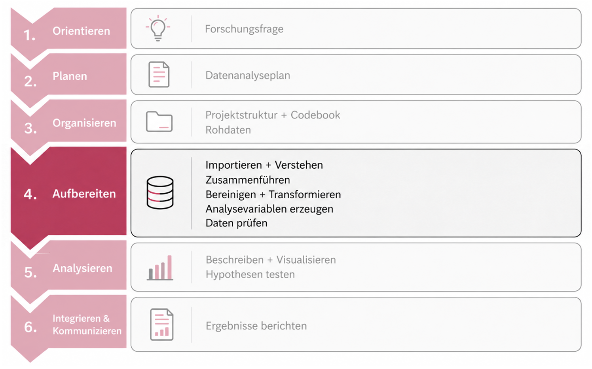{fig-align="center" width="75%"}

<br>

**EH7:** `dplyr`-Funktionen selbstständig anwenden.

**EH8:** Datenprobleme erkennen, erklären und begründet bereinigen.

**EH9:** `mmq_mean` berechnen & Long-Daten aus `pre1` und `pre4` erzeugen.

::: notes
Wir sind weiterhin im vierten Schritt unseres Forschungsprozessen. Ihr habt inzwischen gelernt, wie wir Daten importieren, zusammenführen, dokumentieren und mit dplyr verändern können.

Was uns noch fehlt, ist ein systematischer Blick auf mögliche Probleme in den Rohdaten. Bevor wir aus einzelnen Fragebogenitems einen Skalenwert berechnen oder ein statistisches Modell schätzen, müssen die dafür verwendeten Daten korrekt interpretiert und ausreichend geprüft sein.

Da in den Originaldaten keine Fehlerquellen vorhanden sind, arbeiten wir heute nicht am Processing-Skript weiter. Wie auch letzte Woche trainieren wir heute einen Denkprozess und unterschiedliche Verarbeitungsschritte, die ihr später auf eure individuell simulierten Abschlussdaten übertragen könnt.

Nächste Woche kehren wir dann wieder zur konkreten Aufbereitung des gemeinsamen Forschungsprojekts zurück und in 2 Wochen führen wir erste Berechnungen durch.
:::

------------------------------------------------------------------------

## Ein kleiner Datensatz - alles in Ordnung?

**Schaut zuerst nur auf die Daten. Was fällt euch auf?**

<br>

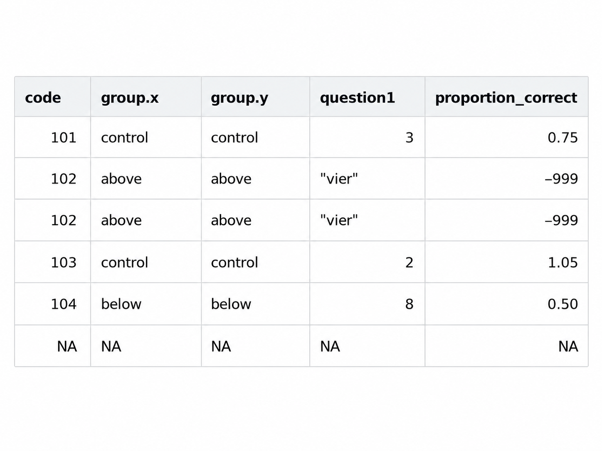{fig-align="center" width="100%"}

<br>

Wie viele Auffälligkeiten findet ihr?

::: notes
-   Die Person 102 kommt mit identischer Zeile zweimal vor.

-   Die letzte Zeile enthält überhaupt keine Information.

-   group.x und group.y scheinen identische Spalten zu sein. Könnte sein, dass diese durch das Mergen entstanden sind.

-   Bei question1 stehen die Werte von Person 102 als Zahlwort ausgeschrieben in Anführungszeichen.

-   Eine Proportion kann nur Werte zwischen 0 und 1 enthalten. Der Wert -999 ist daher auffällig und auch 1.05 unmöglich.

Mit dieser kleinen Übung haben wir schon den ersten wichtigen Schritt bei der Fehlererkennung erfüllt: Wir beschrieben Auffälligkeiten, bevor wir etwas löschen oder verändern.
:::

------------------------------------------------------------------------

## Nicht jede Auffälligkeit ist automatisch ein Fehler

**Wir unterscheiden verschiedene Probleme - und brauchen unterschiedliche Prüfungen**

<br>

::: {style="font-size:0.85em;"}
| Bereich | Woran erkennen wir mögliche Probleme? | Typische Beispiele |
|------------------------|------------------------|------------------------|
| **Datenstruktur** | Doppelte Zeilen/IDs, unerwartete Spalten | Leerzeilen, Duplikate, ID- und Spaltenprobleme |
| **Werte und Kodierung** | Werte passen nicht zum dokumentierten Format | Zahlwörter, unzulässige Codes |
| **Fehlende Information** | Informationen fehlen oder sind als Platzhalter gespeichert | `NA`, leere Felder, Platzhalter, spezielle Missing-Codes |
| **Skala und Richtung** | Variablen wurden unterschiedlich skaliert/gepolt | Bereits transformierte oder anders gepolte Variablen |
:::

<br>

**Entscheidende Frage:** Was wäre laut Studiendesign und Dateninformationen zu erwarten?

::: notes
Wir können die auffälligen Stellen aus der kleinen Tabelle von vorhin in vier Bereiche einordnen.

-   **Erstens die Struktur:** Sind alle Fälle eindeutig? Gibt es unerwartete Zeilen oder Spalten? Sind also vielleicht einige der IDs doppelt vorhanden? Existieren duplizierte Spalten oder zusätzliche, irrelevante Spalten?

-   **Zweitens die Werte und Kodierungen:** Sind die Datentypen und die Werte einer Variable passend? Sind numerische Variablen wirklich numerisch erfasst?

-   **Drittens fehlende Informationen:** Sind im Datensatz fehlende Werte vorhanden? Wie wird ein fehlender Wert dargestellt und warum könnte er fehlen? Wie können wir damit umgehen?

-   **Viertens noch die Skalierung und Richtung einer Messung:** Sind alle Werte auf derselben Skala erhoben? Oder sind einige Items anders skaliert? Existieren umgepolte Items innerhalb einer Skala?

Nicht jede Auffälligkeit erfordert dieselbe Massnahme. Eine doppelte ID ist bspw. in einem Datensatz mit wiederholten Messungen möglicherweise völlig normal. In einer Datei, die genau eine Zeile pro Versuchsperson enthalten soll, ist sie dagegen ein Warnsignal.

Deshalb braucht ihr bei jeder Datenprüfung die Erwartungen aus dem Datenanalyseplan, dem Codebook und den ergänzenden Studieninformationen. Die Rohdaten allein verraten euch nicht immer, was richtig ist.
:::

------------------------------------------------------------------------

## Unser Vorgehen bei Datenproblemen

**Erst verstehen - dann verändern**

<br>

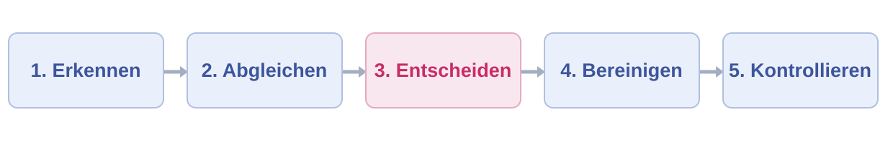{fig-align="center" width="75%"}

<br>

**1. Erkennen:** Welche Werte, Variablen oder IDs fallen auf?

**2. Abgleichen:** Was erwarten wir laut Codebook und Studiendesign?

**3. Entscheiden:** Fehler, zulässige Besonderheit oder ungeklärter Fall?

**4. Bereinigen:** Nur fachlich begründete Korrekturen im R-Skript vornehmen.

**5. Kontrollieren:** Sind die Daten danach plausibel und ist der Schritt dokumentiert?

<br>

**Merksatz:** Eine erfolgreich ausgeführte R-Funktion ist noch kein Beweis für korrekte Daten!

::: notes
Ich möchte euch für die gesamte Einheit ein festes Vorgehen mitgeben. Wir beginnen nie damit, einfach alle Zeilen zu löschen, die irgendwie merkwürdig aussehen.

Zunächst erkennen wir Auffälligkeiten, dann gleichen wir sie mit den erwarteten Daten ab. Erst danach entscheiden wir, ob ein Fehler vorliegt und welche Korrektur zulässig und angemessen ist.

Die Korrektur gehört in den reproduzierbaren Verarbeitungscode. Anschliessend vergleichen wir den Zustand vor und nach der Änderung: Haben wir nur das Problem behoben oder versehentlich auch andere Daten verändert?

Dieser Ablauf gilt unabhängig davon, ob wir leere Zeilen, doppelte IDs, Textwerte oder bereits skalierte Variablen untersuchen.

In den nächsten Folien sehen wir dafür kurze Beispiele. Die umfangreichere eigenständige Umsetzung übt ihr direkt danach in den Übungen.
:::

# Probleme mit der Datenstruktur

**Stimmt der Aufbau unseres Datensatzes?**

-   Vollständig leere Zeilen

-   Doppelte Beobachtungen und Personen-IDs

-   Auffällige Spalten

------------------------------------------------------------------------

## Vollständig leere Zeile ≠ einzelne fehlende Angabe

**Fehlt nur ein Wert - oder fehlt eine ganze Beobachtung?**

<br>

:::::: columns
::: {.column width="60%"}
<br>

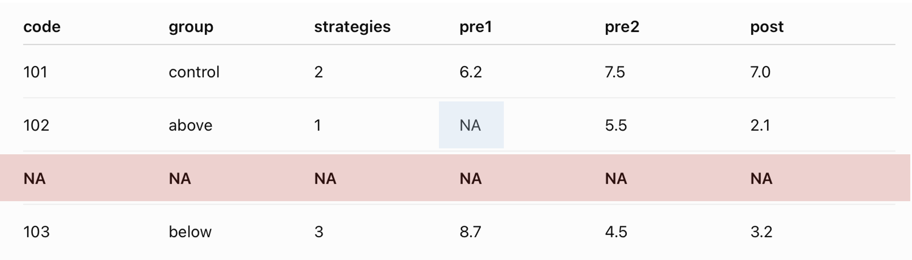{fig-align="left" width="95%"}
:::

:::: {.column width="40%"}
::: eh8-three
**Erkennen:** Eine vollständig leere Zeile enthält in allen Spalten `NA`.

**Besonderheit:** Hier fehlt nicht nur eine einzelne Antwort, sondern die gesamte Beobachtung. Auch die Personen-ID fehlt - die Zeile lässt sich keiner Person zuordnen.

**Umgang:** Vollständig leere Zeilen können nach Prüfung entfernt werden. Einzelne fehlende Werte bleiben dagegen zunächst erhalten.
:::
::::
::::::

------------------------------------------------------------------------

## Vollständig leere Zeilen mit `dplyr` erkennen

**Wie finden wir Zeilen, in denen sämtliche Angaben fehlen?**

<br>

::::: columns
::: {.column width="45%"}
**1. Vollständig leere Zeilen finden**

```{r, echo=TRUE, eval=FALSE}

leere_zeilen <- data_cb |>
  filter(
    if_all(everything(), is.na)
  )
```

**2. Anzahl bestimmen**

```{r, echo=TRUE, eval=FALSE}

nrow(leere_zeilen)
# [1] 0
```
:::

::: {.column width="55%"}
**Was passiert hier?**

-   `is.na()` prüft, ob ein Wert fehlt.

-   `everthing()` berücksichtigt alle Spalten.

-   `if_all()` verlangt, dass **alle Spalten einer Zeile** die Bedingung erfüllen.

-   `filter()` wählt diese Zeilen aus.

-   `nrow()` zählt die gefundenen Zeilen.
:::
:::::

<br>

**Wir erkennen und zählen vollständig leere Zeilen - wir entfernen noch keine Beobachtungen.**

::: notes
Auf der vorherigen Folie haben wir eine Person gesehen, bei der nur ein einzelner Wert fehlt, und eine vollständig leere Zeile, bei der sogar die ID fehlt.

Wie können wir solche Zeilen erkennen, ohne unseren gesamten Datensatz manuell durchzugehen?

Dafür nutzen wir filter(), das wir bereits kennen. Neu ist die Funktion if_all().

Mit everything() beziehen wir alle Spalten ein. is.na() überprüft, ob ein Wert fehlt. if_all() sorgt dafür, dass die Bedingung für jede einzelne Spalte der betreffenden Zeile erfüllt sein muss.

Das Ergebnis speichern wir zunächst in einem separaten Objekt namens leere_zeilen. Anschliessend können wir mit nrow() zählen, wie viele solcher Zeilen gefunden wurden.

In unserem unveränderten Originaldatensatz erwarten wir null vollständig leere Zeilen. Bei anderen Daten, bspw. beim Einlesen fehlerhafter Rohdaten, können solche Zeilen aber durchaus vorkommen.

Wichtig ist: Wir haben bislang nichts gelöscht. Zuerst untersuchen wir die Daten. Erst wenn wir sicher sind, dass es sich tatsächlich um vollständig leere Beobachtungen handelt, entscheiden wir über eine Entfernung.
:::

------------------------------------------------------------------------

## Vollständig leere Zeilen gezielt entfernen

**Erst prüfen, dann bereinigen - und anschliessend kontrollieren**

<br>

**1. Vollständig leere Zeilen entfernen**

```{r, echo=TRUE, eval=FALSE}

data_cb <- data_cb |>
  filter(!if_all(everything(), is.na))
```

<br>

::::: columns
::: {.column width="48%"}
**Was ist neu?**

-   `!` bedeutet **NICHT** und kehrt die Bedingung um.

-   Wir behalten alle Zeilen, die **nicht vollständig leer** sind.

-   Durch `<-` speichern wir das bereinigte Ergebnis wieder unter `data_cb`.
:::

::: {.column width="52%"}
**2. Ergebnis kontrollieren**

```{r, echo=TRUE, eval=FALSE}

data_cb |>
  filter(if_all(everything(), is.na)) |>
  nrow()

# Erwartetes Ergebnis: 0
```

Nach der Bereinigung sollten **keine vollständig leeren Zeilen** mehr vorhanden sein.
:::
:::::

<br>

**Wichtig:** Einzelne fehlende Antworten bleiben erhalten. Vollständig leere Zeilen sollten möglichst vor dem Zusammenführen der Rohdatensätze entfernt werden.

::: notes
Auf der vorherigen Folie haben wir gelernt, wie wir vollständig leere Zeilen erkennen und zählen können.

Was machen wir nun, wenn wir tatsächlich solche Zeilen finden?

Wenn wir festgestellt haben, dass es sich um vollständig leere und überflüssige Beobachtungen handelt, können wir diese gezielt entfernen.

Dafür verwenden wir fast denselben Befehl wie zuvor. Neu ist nur das Ausrufezeichen vor if_all().

Das Ausrufezeichen bedeutet nicht. Wir behalten also alle Zeilen, bei denen nicht sämtliche Werte fehlen. Personen, bei denen nur einzelne Werte fehlen, bleiben dadurch erhalten.

Das Ergebnis weisen wir mit dem Zuweosungsoperator wieder data_cb zu. Damit speichern wir die Bereinigung in unserem R-Objekt.

Anschliessend überprüfen wir erneut, wie viele vollständig leere Zeilen noch vorhanden sind. Wenn die Bereinigung erfolgreich war, erhalten wir null.

Besonders wichtig ist auch die Position dieses Schrittes im Forschungsprojekt. Wenn vollständig leere Zeilen bereits in den einzelnen Rohdateien vorkommen, sollten wir sie möglichst vor dem Mergen entfernen.
:::

------------------------------------------------------------------------

## Doppelte Zeile ≠ doppelte Personen-ID

**Ist dieselbe Beobachtung doppelt vorhanden - oder gibt es mehrere Beobachtungen pro Person?**

<br>

:::::: columns
::: {.column width="60%"}
<br>

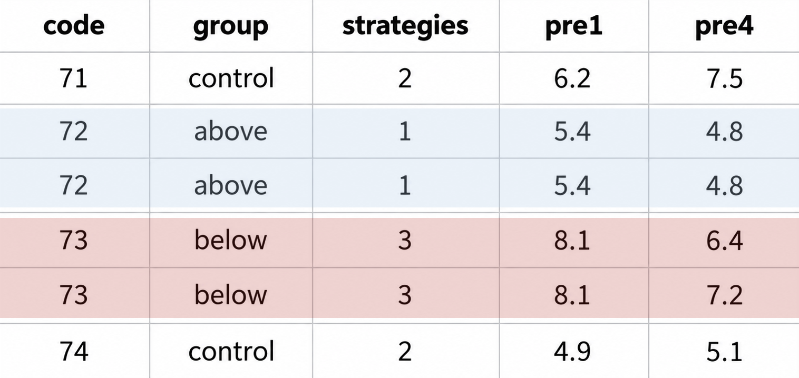{fig-align="left" width="85%"}
:::

:::: {.column width="40%"}
::: eh8-three
**Erkennen:** Die Zeilen mit ID `72` sind vollständig identisch (dupliziert). ID `73` kommt ebenfalls zweimal vor, allerdings mit unterschiedlichen Werten bei `pre4`.

**Mögliche Ursache:** Doppelter Datenexport, fehlerhadte Zusammenführung oder tatsächlich mehrere Messungen.

**Umgang:** Vollständig identische Zeilen können nach Prüfung entfernt werden. Bei gleichen IDs mit unterschiedlichen Angaben muss zunächst die Ursache geklärt werden.
:::
::::
::::::

::: notes
Wir haben gerade gesehen, dass in Datensätzen vollständig leere Zeilen vorkommen können. Ein weiteres häufiges Problem sind doppelte Beobachtungen.

Schauen wir uns zuerst die Person mit der ID 72 an. Diese Person kommt zweimal vor. Wenn wir die beiden Zeilen vergleichen, sehen wir, dass sämtliche Werte identisch sind. Vermutlich wurde hier eine Beobachtung versehentlich zweimal gespeichert.

Bei Person 73 sieht es anders aus. Die ID kommt ebenfalls zweimal vor, aber die Werte bei pre4 unterscheiden sich. Welche dieser beiden Beobachtungen wäre jetzt die richtige? Das können wir anhand des Datensatzes allein nicht entscheiden.

Hier müssen wir berücksichtigen, wie unsere Daten aufgebaut sein sollten. In unserem Wide-Datensatz dat_full erwarten wir genau eine Zeile pro VPN. Zwei unterschiedliche Zeilen mit derselben ID wären deshalb ein Problem, das wir untersuchen müssen.

Später, in unserem Long-Datensatz mit mehreren Messzeitpunkten, darf und muss dieselbe Personen-ID hingegen sogar zweimal vorkommen. Dort gehört dann zu jeder Person und jedem Messzeitpunkt eine eigene Zeile.

Entscheidend ist also nicht allein, ob eine ID mehrfach vorkommt, sondern ob dies zur vorgesehenen Datenstruktur passt.

Wir dürfen deshalb nicht einfach automatisch alle mehrfach vorkommenden IDs entfernen. Sonst riskieren wir, wichtige Informationen zu verlieren.
:::

------------------------------------------------------------------------

## Doppelte Zeilen mit `dplyr` erkennen

**Doppelte Beobachtungen vor dem Merge erkennen**

<br>

::::: columns
::: {.column width="45%"}
**1. Vollständig doppelte Zeilen finden**

```{r, echo=TRUE, eval=FALSE}

sum(duplicated(data_cb))

# Alternative
duplikate_zeilen <- data_cb |>
  filter(duplicated(pick(everything())))
```

**2. Mehrfach vorkommende IDs finden**

```{r, echo=TRUE, eval=FALSE}

duplikate_ids <- data_cb |>
  count(code) |>
  filter(n > 1)
```
:::

::: {.column width="55%"}
**Was passiert hier?**

-   `duplicated(.)` prüft, ob eine ganze Zeile bereits vorher genauso vorkam.

-   `filter()` wählt genau diese vollständig doppelten Zeilen aus.

-   `count(code)` zählt, wie oft jede ID vorkommt.

-   `filter(n > 1)` zeigt nur IDs, die mehrfach vorhanden sind.

-   So unterscheiden wir zwischen echten Dubletten und mehrfach auftretenden IDs.
:::
:::::

<br>

**Wir prüfen hier noch nicht, was gelöscht wird - wir machen die Auffälligkeiten zuerst sichtbar.**

------------------------------------------------------------------------

## Vollständig duplizierte Zeilen entfernen

**Nur echte Dubletten ausschliessen - nicht bloss doppelte IDs**

<br>

**1. Vollständig duplizierte Zeilen entfernen**

```{r, echo=TRUE, eval=FALSE}

data_cb <- data_cb |>
  distinct()
```

<br>

::::: columns
::: {.column width="48%"}
**Was ist neu?**

-   `distinct()` entfernt **vollständig identische Zeilen.**

-   Dabei bleibt jede eindeutige Beobachtung einmal erhalten.

-   Unterschiedliche Zeilen mit derselben ID bleiben weiterhin im Datensatz.
:::

::: {.column width="52%"}
**2. Ergebnis kontrollieren**

```{r, echo=TRUE, eval=FALSE}
sum(duplicated(data_cb))

data_cb |>
  count(code) |>
  filter(n > 1)
```

Nach der Bereinigung sollten **keine duplizierten Zeilen** mehr vorhanden sein. Mehrfach vorkommente IDs können weiterhin existieren.
:::
:::::

<br>

**Wichtig:** Duplizierte Zeilen möglichst vor dem Mergen der Rohdatensätze entfernen.

------------------------------------------------------------------------

## Doppelte oder überflüssige Spalten?

**Gehören alle vorhandenen Variablen tatsächlich zu unserem Datensatz?**

<br>

:::::: columns
::: {.column width="60%"}
<br>

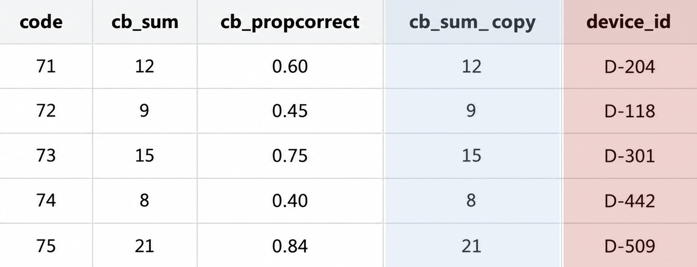{fig-align="left" width="85%"}
:::

:::: {.column width="40%"}
::: eh8-three
**Erkennen:** `cb_sum_copy` enthält dieselben Werte wie `cb_sum`. Die Variable `device_id` gehört nicht zu den erwarteten Studienvariablen.

**Mögliche Ursache:** Spalten wurden versehentlich kopiert oder beim Export zusätzliche Informationen gespeichert.

**Umgang:** Variablennamen und Inhalte mit der Datenbeschreibung vergleichen. Nur nach Prüfung überflüssige Spalten entfernen.
:::
::::
::::::

::: notes
Bisher haben wir Probleme betrachtet, die einzelne Zeilen betreffen. Aber auch bei den Spalten eines Datensatzes kann etwas schiefgehen.

Schaut euch zunächst cb_sum und cb_sum_copy an. Beide enthalten in unserem Beispiel dieselben Werte. Möglicherweise wurde die Spalte beim Export versehentlich dupliziert.

Zusätzlich finden wir eine Variable namens device_is. Diese steht nicht in unserer Datenbeschreibung und scheint eine technische Information aus dem Export zu enthalten.

Wenn wir bestätigt haben, dass die Variablen redundant bzw. nicht erforderlich sind, können wir sie gezielt entfernen.
:::

------------------------------------------------------------------------

## Überflüssige Spalten gezielt entfernen

**Variablen zuerst prüfen - anschliessend die benötigte Datenstruktur herstellen**

<br>

**1. Spaltennamen und Inhalte untersuchen**

```{r, echo=TRUE, eval=FALSE}
# Welche Variablen sind vorhanden?
names(data_cb)

# Sind die beiden Spalten vollständig identisch?
identical(data_cb$cb_sum, data_cb$cb_sum_copy)
# [1] TRUE
```

<br>

::::: columns
::: {.column width="48%"}
**2. Nach Prüfung entfernen**

```{r, echo=TRUE, eval=FALSE}
data_cb <- data_cb |>
  select(-cb_sum_copy, -device_id)
```

**Was passiert hier?**

-   `select()` wählt Spalten aus.

-   Mit `-` schliessen wir bestimmte Spalten aus.

-   `<-` speichert den bereinigten Datensatz.
:::

::: {.column width="52%"}
**3. Ergebnis kontrollieren**

```{r, echo=TRUE, eval=FALSE}
names(data_cb)
dim(data_cb)
```

**Erwartetes Ergebnis**

-   Beide Zusatzspalten nicht mehr vorhanden.

-   Die übrigen Variablen bleiben erhalten.

-   Die Anzahl der Beobachtungen bleibt unverändert.
:::
:::::

::: notes
Nachdem wir im Datenausschnitt zwei auffällige Spalten entdeckt haben, möchten wir überprüfen, ob wir sie tatsächlich benötigen.

Zuerst verwenden wir names(), um sämtliche Variablennamen anzuzeigen. Diese vergleichen wir mit den erwarteten Variablen aus unserer Datenbeschreibung.

Danach überprüfen wir mit identical(), ob die beiden Spalten cb_sum und cb_sum_copy tatsächlich in allen Beobachtungen identisch sind. In unserem künstlichen Beispiel ist das der Fall.

Wenn wir zusätzlich bestätigt haben, dass die Kopie redundant ist und device_id nicht für unsere Datenverarbeitung benötigt wird, können wir beide Spalten mit select() entfernen.

Da wir das Ergebnis wieder data_cb zuweisen, wird unser R-Objekt entsprechend verändert.

Anschliessend kontrollieren wir erneut die Variablennamen und Dimensionen des Datensatzes.

Solche Korrekturen führen wir möglichst vor dem Zusammenführen unserer Rohdatensätze durch.
:::

# Probleme mit Werten & Kodierungen

**Sind die gespeicherten Werte korrekt und interpretierbar?**

-   Zahlen als Text oder Wörter

-   Unzulässige und widersprüchliche Werte

-   Ungeeignete Datentypen und uneinheitliche Kodierungen

------------------------------------------------------------------------

## Zahlen als Wörter: Warum ist das ein Problem?

**Sind Zahlen als numerische Variable gespeichert?**

<br>

:::::: columns
::: {.column width="60%"}
<br>

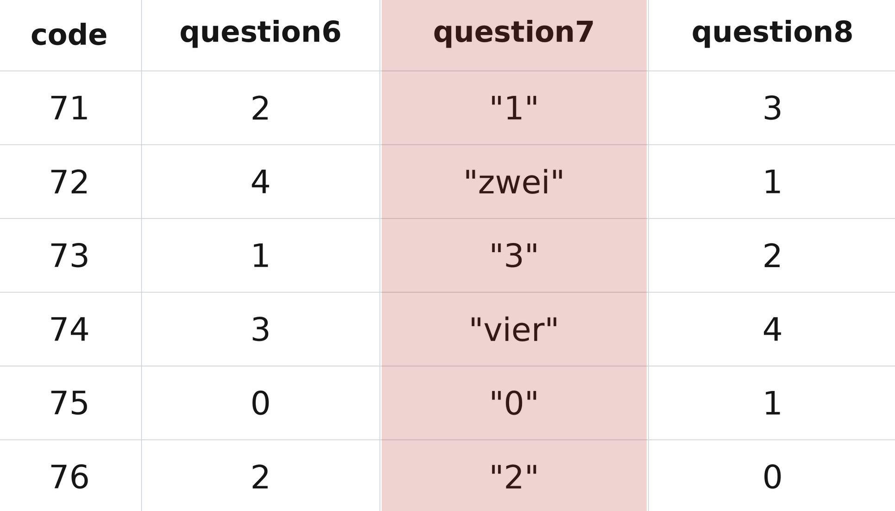{fig-align="left" width="85%"}
:::

:::: {.column width="40%"}
::: eh8-three
**Erkennen:** In `question7` stehen Werte wie `"zwei"` und `"vier"` statt numerischer Antwortcodes. Dadurch wird die Spalte als `character` gespeichert.

**Mögliche Ursache:** Unterschiedliche Eingaben oder Export- und Importeinstellungen.

**Umgang:** Beobachtete Werte mit dem Codebook abgleichen, bekannte Zahlwörter eindeutig umkodieren und danach den Datentyp überprüfen.
:::
::::
::::::

**Wichtig:** Korrekturen möglichst bereits in den Rohdaten vor dem Merge durchführen.

::: notes
Im letzten Block haben wir die Struktur unserer Rohdaten geprüft: doppelte Zeilen, IDs und Spalten. Jetzt wenden wir uns den Werten in den Spalten zu.

In unserem MMQ-Fragebogen erwarten wir für jedes Item Antwortwerte zwischen null und vier. Schaut euch die Variable question7 in diesem fiktiv veränderten Auszug aus data_mmq an. Manche Antworten stehen als Ziffern in Anführungszeichen, andere als ausgeschriebene Wörter wie zwei und vier.

R kann diese Spalte dann als Text, also character, einlesen. Das ist für die spätere Skalenberechnung ein Problem, weil wir mit den Antworten rechnen möchten.

Bevor wir sofort irgendwie in Zahlen umwandeln, müssen wir prüfen, welche Schreibweisen tatsächlich vorkommen und welche Antwortceodes laut Codebook erlaubt sind.

Die Korrektur gehört möglichst in die Aufbereitung des MMQ-Rohdatensatzes vor den Merge.
:::

------------------------------------------------------------------------

## Textkodierte Werte mit R erkennen

**Wie prüfen wir, ob eine Itemvariable tatsächlich numerisch gespeichert ist?**

<br>

::::: columns
::: {.column width="53%"}
**1. Datentyp überprüfen**

```{r, echo=TRUE, eval=FALSE}

class(data_mmq$question7)
# [1] "character"
```

**2. Unterschiedliche Werte ansehen**

```{r, echo=TRUE, eval=FALSE}

unique(data_mmq$question7)
# [1] "1" "zwei" "3" "vier" "0" "2"
```
:::

::: {.column width="47%"}
**Was erfahren wir?**

-   `class()` zeigt, **wie R die Variable gespeichert hat**.
-   `unique()` zeigt alle **unterschiedlichen gespeicherten Werte**.
-   Das **Codebook** sagt uns, welche Werte zulässig sind: hier **0 bis 4**.
:::
:::::

<br>

**Achtung:** `as.numeric("zwei")` ergibt mit einer Warnung `NA` – die eigentlich vorhandene Antwort ginge verloren!

::: notes
Wie erkennen wir das Problem im R-Skript?

Zuerst überprüfen wir mit class() den technischen Datentyp. In unserem Beispiel erhalten wir character statt numeric.

Mit unique() sehen wir anschliessend, welche unterschiedlichen Werte tatsächlich vorkommen. Das ist wichtig, weil einige Antworten vielleicht als Ziffern in Textform und andere als ausgeschriebene Wörter gespeichert sind.

Das Codebook sagt uns, dass nur Antworten von null bis vier erlaubt sind. Jetzt können wir entscheiden, welche Textwerte sich eindeutig zuordnen lassen.

Ein typischer Fehler ist, as.numeric() sofort auf die gesamte Spalte anzuwenden. Die Zeichenfolge "1" würde R noch interpretieren, das ausgeschriebene Wort "zwei" dagegen nicht. Daraus würde dann ein neuer fehlender Wert entstehen; obwohl die Information eigentlich vorhanden war.

Deshalb lautet die Reihenfolge: Werte prüfen, bekannte Kodierungen zuordnen und erst danach numerisch umwandeln.
:::

------------------------------------------------------------------------

## Zahlwörter rekodieren & Ergebnis prüfen

**Erst eindeutig zuordnen - dann in Zahlen umwandeln**

<br>

::::: columns
::: {.column width="55%"}
**1. Bekannte Zahlwörter rekodieren**

```{r, echo=TRUE, eval=FALSE}
data_mmq <- data_mmq |>
  mutate(
    question7 = case_when(
      question7 == "zwei" ~ "2",
      question7 == "vier" ~ "4",
      TRUE ~ question7
    ),
    question7 = as.numeric(question7)
  )
```
:::

::: {.column width="45%"}
**2. Ergebnis kontrollieren**

```{r, echo=TRUE, eval=FALSE}
class(data_mmq$question7)
# [1] "numeric"

range(data_mmq$question7, na.rm = TRUE)
# [1] 0 4
```
:::
:::::

<br>

**Was passiert hier?**

-   `case_when()` ersetzt **eindeutig bekannte Schreibweisen**.
-   `TRUE ~ question7` lässt übrige Werte zunächst unverändert.
-   `as.numeric()` macht daraus anschliessend **numerische Werte**.

**Wichtig:** Das ist noch kein Reverse Coding!

::: notes
Wir haben nun erkannt, dass in der Spalte question7 einige Antwortwerte als Zahlwörter gespeichert wurden. Wie korrigieren wir das?

Mit mutate() und case_when() ordnen wir die beiden zuvor überprüften Wörter eindeutig den gültigen Antwortcodes zu: zwei wird zu zwei als Zahl und vier wird zu vier als Zahl. Alle anderen Werte bleiben durch die letzte Regel zunächst unverändert.

Erst danach verwenden wir as.numeric(). Damit haben wir wieder eine numerische Itemvariable, mit der wir später rechnen können.

Anschliessend kontrollieren wir, ob der Datentyp stimmt und ob der Wertebereich innerhalb der zulässigen Antwortskala liegt.

Das ist noch kein Reverse Coding: Wir stellen hier nur den ursprünglich gemeinten Antwortcode wieder her. Ob einzelne Items zusätzlich umgepolt werden müssen, besprechen wir später getrennt.
:::

------------------------------------------------------------------------

## Ungültiger Wert ≠ ungewöhnlich hoher Wert

**Eine auffällige Zahl ist erst dann ein Fehler, wenn sie den zulässigen Wertebereich verletzt**

<br>

::::: columns
::: {.column width="60%"}
<br>

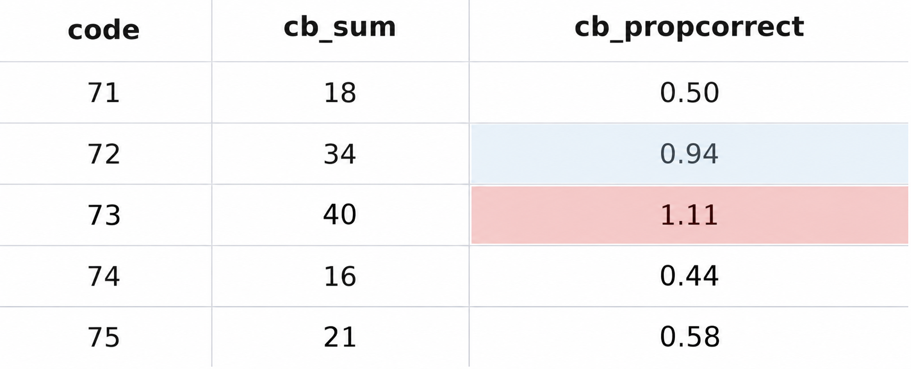{fig-align="left" width="85%"}
:::

::: {.column width="40%"}
**Erkennen:** `cb_propcorrect` ist ein Anteil von **0 bis 1**. `0.96` ist hoch, aber zulässig; `1.12` ist unmöglich.

**Mögliche Ursache:** Eingabe-, Berechnungs-, Import- oder Skalierungsfehler.

**Umgang:** Den Wert anhand der Dateninformationen und der Quelle prüfen. **Nicht eigenmächtig auf 1 setzen.**
:::
:::::

**Merke:** Entscheidend ist der *theoretisch zulässige Bereich* – nicht, ob ein Wert ungewöhnlich aussieht.

::: notes
Nach den uneinheitlich gespeicherten Antwortcodes schauen wir nun auf numerische Angaben, die zwar als Zahl gespeichert sind, aber inhaltlich unzulässig sein können.

Die Variable cb_propcorrect enthält den Anteil korrekter Antworten einer Person. Bei einem Anteil sind grundsätzlich Werte zwischen null und eins zulässig. Für Person 72 steht 0.96. Das ist ein hoher, aber vollkommen möglicher Anteil. Für Person 73 steht dagegen 1.12, also rechnerisch 112% korrekte Antworten. Das ist für einen solchen Anteil nicht möglich.

Die Ursache für diesen Wert kennen wir dadurch aber noch nicht. Es könnte bspw. ein Eingabe- oder Berechnungsfehler sein oder ein Wert, der in einer anderen Einheit gespeichert wurde. Wir müssen deshalb die Dateninformationen und nach Möglichkeit die Quelle überprüfen. Den Wert einfach auf 1 zu setzen wäre nicht begründet.
:::

------------------------------------------------------------------------

## Ungültige Werte mit R erkennen

**Zuerst mit dem dokumentierten Wertebereich abgleichen**

<br>

::::: columns
::: {.column width="55%"}
**1. Beobachteten Wertebereich prüfen**

```{r, echo=TRUE, eval=FALSE}
range(data_cb$cb_propcorrect, na.rm = TRUE)
# Im fiktiven Beispiel: 0.64 1.12
```

**2. Unzulässige Werte anzeigen**

```{r, echo=TRUE, eval=FALSE}
data_cb |>
  filter(
    cb_propcorrect < 0 |
      cb_propcorrect > 1
  )
```
:::

::: {.column width="45%"}
**Was passiert hier?**

-   `range()` zeigt den kleinsten und grössten beobachteten Wert.
-   `< 0` und `> 1` prüfen die **theoretischen Grenzen**.
-   `|` bedeutet **ODER**: Schon eine verletzte Grenze reicht aus.
-   `filter()` zeigt die betroffenen Beobachtungen an.
:::
:::::

**Wichtig:** Die Befehle dienen zunächst der **Diagnose**. Die Daten werden nicht verändert.

Sind die Werte unzulässig und keine verlässliche Korrektur möglich, können sie als `NA` kodiert werden.

::: notes
Wir beginnen wir immer mit der Diagnose. Mit range() prüfen wir den beobachteten Bereich. In unserem Beispiel finden wir einen Maximalwert von 1.12.

Mit filter() lassen wir un nun gezielt solche Fälle anzeigen, in denen der Antail unter null oder über eins liegt. Das senkrechte Zeichen bedeutet ODER. Es reicht, wenn eine der beiden Bedingungen zutrifft.

Wir verändern dadurch noch keine Daten. Unser Ziel ist zunächst, die betroffenen Personen oder Werte zu identifizieren und ihre Ursache zu prüfen.
:::

# Probleme mit fehlenden Informationen

**Was tun wir, wenn Angaben fehlen oder als Platzhalter gespeichert sind?**

-   Echte `NA`-Werte und spezielle Missing-Codes

-   Möglichkeiten zum Umgang mit fehlenden Werten

-   Rekonstruktion aus vorhandenen Werten

::: notes
Nach der Prüfung von Werte und Kodierungen kommen wir nun zur dritten Kategorie: fehlende Informationen. Wir kennen NA bereits aus unseren bisherigen Übungen.

Allerdings ist nicht jede fehlende Angabe im Datensatz zwingend auch als echtes NA gespeichert. Manchmal werden stattdessen besondere Zahlen oder Zeichenfolgen verwendet.

Diese müssen wir erkennen, bevor wir Mittelwerte berechnen oder Datensätze zusammenführen. Wir besprechen erst den Unterschied zwischen NA und einem möglichen Platzhalter, dann das Erkennen und die begründete Rekodierung.

Danach schauen wir uns noch an, was zu tun ist, wenn Informationen tatsächlich fehlen.
:::

------------------------------------------------------------------------

## „Fehlend“ - aber erkennt das R auch?

**Echtes `NA` oder versteckter Missing-Code?**

<br>

::::: columns
::: {.column width="60%"}
<br>

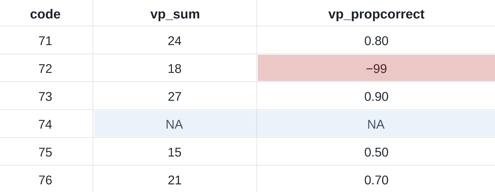{fig-align="left" width="85%"}
:::

::: {.column width="40%"}
**Erkennen:** In `vp_propcorrect` steht bei ID 74 `NA`, bei ID 72 dagegen `-99`. Gültige Anteile liegen zwischen **0 und 1.**

**Mögliche Ursache:** Eine Software speichert fehlende Angaben als besonderen Zahlencode. R liest diesen zunächst als Zahl ein.

**Umgang:** Bedeutung anhand der Dateninformationen überprüfen. **Nur bestätigte Missing-Codes** in `NA` umwandeln.
:::
:::::

::: notes
Die Variable vp_propcorrect beschriebt einen Anteil korrekter Antworten, also einen Wert zwischen null und eins.

Bei der Person 74 steht NA. R erkennt diesen Wert als fehlend.

Bei Person 72 steht dagegen -99. Das liegt offensichtlich ausserhalb des zulässigen Anteilsbereichs, ist für R aber zunächst eine gewöhnliche Zahl.

Ein solcher Wert könnte durch einen besonderen Exportcode entstanden sein, der fehlende Messungen kennzeichnet.

Wenn seine Bedeutung bestätigt ist, dürfen wir den Wert in ein NA umwandeln.
:::

------------------------------------------------------------------------

## Versteckte Missing-Codes mit R erkennen

**Wie unterscheiden wir echte `NA`-Werte von auffälligen Zahlencodes?**

<br>

::::: columns
::: {.column width="53%"}
**1. Echte `NA`-Werte zählen**

```{r, echo=TRUE, eval=FALSE}
sum(is.na(data_vp$vp_propcorrect))
# Im fiktiven Beispiel: 1
```

**2. Wertebereich prüfen**

```{r, echo=TRUE, eval=FALSE}
range(data_vp$vp_propcorrect, na.rm = TRUE)
# Im Beispiel: -99.0  0.9
```

**3. Auffällige Werte anzeigen**

```{r, echo=TRUE, eval=FALSE}
data_vp |>
  filter(vp_propcorrect < 0 |
         vp_propcorrect > 1)
```
:::

::: {.column width="47%"}
**Was erfahren wir?**

-   `is.na()` erkennt **echte** fehlende Werte.
-   `range()` zeigt den kleinsten und grössten beobachteten Wert.
-   `filter()` zeigt Werte **ausserhalb des zulässigen Bereichs**.
-   Ob `-99` tatsächlich „fehlend“ bedeutet, klären wir mit der **Datenbeschreibung**.
:::
:::::

<br>

**Achtung:** `na.rm = TRUE` ignoriert echte `NA`-Werte – einen Platzhalter wie `-99` jedoch **nicht**.

::: notes
Wie finden wir diese Unterschiede mit R?

Zunächst zählen wir mit sum(is.na(...)) die echten NAs. In unserem Beispiel ist nur der Wert von Person 74 ein echtes NA. Der Wert -99 wird dabei nicht mitgezählt.

Danach prüfen wir mit range() den beobachteten Wertebereich. Weil die Variable einen Anteil zwischen 0 und 1 beschreiben soll, macht uns der negative Wert aufmerksam. Mit filter() lassen wir uns die betreffenden Beobachtungen anzeigen.

Eine wichtige Konsequenz ist: Selbst wenn wir bei einer Berechnung na.rm gleich TRUE setzen, würde -99 nicht übersprungen, sondern als Zahl mitgerechnet. So könnten bspw. Mittelwerte massiv verfälscht werden.
:::

------------------------------------------------------------------------

## Missing-Codes gezielt in `NA` umwandeln

**Erst Bedeutung klären - dann rekodieren und kontrollieren**

<br>

**1. Nur nach Prüfung umkodieren**

```{r, echo=TRUE, eval=FALSE}
# Wenn -99 für fehlend steht
data_vp <- data_vp |>
  mutate(vp_propcorrect = na_if(vp_propcorrect, -99))
```

<br>

::::: columns
::: {.column width="48%"}
**Was ist neu?**

-   `na_if(x, -99)` macht aus dem bestätigten Platzhalter ein echtes `NA`.
-   Andere Werte bleiben unverändert.
-   `<-` speichert das bereinigte Ergebnis in `data_vp`.
:::

::: {.column width="52%"}
**2. Ergebnis kontrollieren**

```{r, echo=TRUE, eval=FALSE}
sum(is.na(data_vp$vp_propcorrect))
# Im fiktiven Beispiel: 2

range(data_vp$vp_propcorrect, na.rm = TRUE)
# Im Beispiel: 0.5  0.9
```

**Erwartet:** Der Platzhalter ist verschwunden; die gültigen Werte liegen weiterhin zwischen 0 und 1.
:::
:::::

**Wichtig:** Die fehlende Information wurde damit korrekt gekennzeichnet, aber nicht rekonstruiert.

::: notes
Wenn -99 tatsächlich für eine fehlende Angabe steht, können wir den Wert gezielt ersetzen.

Dafür gibt es die Funktion na_if. Damit sagen wir: Falls der Wert -99 lautet, setze an dieser Stelle ein echtes NA. Andere gültige Zahlen bleiben erhalten.

Anschliessend kontrollieren wir die Anzahl fehlender Werte und den gültigen Wertebereich.

Wir haben die fehlende Information damit korrekt gekennzeichnet, aber noch nicht rekonstruiert. Ob man Werte aus anderen Informationen wiederherstellen kann, besprechen wir im nächsten Schritt.
:::

------------------------------------------------------------------------

## Fehlende Werte rekonstruieren

**Fehlt die Information vollständig - oder nur eine daraus berechnete Variable?**

<br>

::::: columns
::: {.column width="55%"}
**Ausgangslage nach der Bereinigung**

| `code` | `vp_sum` | `vp_propcorrect` |
|--------|---------:|-----------------:|
| 72     |       18 |             `NA` |
| 74     |     `NA` |             `NA` |

<br>

**Bekannte Berechnungsregel:**

$$
\text{Anteil korrekt} = \frac{\text{Anzahl korrekt}}{36}
$$
:::

::: {.column width="45%"}
**Fehlenden Wert gezielt ergänzen**

```{r, echo=TRUE, eval=FALSE}
data_vp <- data_vp |>
  mutate(
    vp_propcorrect = if_else(
      is.na(vp_propcorrect) &
        !is.na(vp_sum),
      vp_sum / 36,
      vp_propcorrect
    )
  )
```

**Ergebnis kontrollieren**

```{r, echo=TRUE, eval=FALSE}
data_vp |>
  filter(code %in% c(72, 74)) |>
  select(code, vp_sum, vp_propcorrect)
```
:::
:::::

<br>

**Wichtig:** Nur eindeutig ableitbare Werte rekonstruieren. Ohne Ausgangsinformationen bleibt der Wert fehlend.

::: notes
Auf der vorherigen Folie haben wir einen bestätigten Missing-Code in einen echten NA-Wert umgewandelt. Nun stellt sich die Frage, ob dieser Wert tatsächlich fehlend bleiben muss.

NIcht unbedingt. Manchmal fehlt nur eine berechnete Kennzahl, während die zugrunde liegende Information noch vorhanden ist.

In unserem Beispiel enthält vp_sum die Anzahl korrekter Antworten. vp_propcorrect ist der Anteil korrekter Antworten. Wenn wir sicher wissen, dass dieser Anteil durch Division der korrekten Antworten durch 36 gültige Durchgänge berechnet wurde, lässt sich der fehlende Anteilswert wiederherstellen.

Bei ID 72 sind 18 korrekte Antworten vorhanden. Der Anteil beträgt dadurch 0.50.

Bei ID 74 fehlen hingegen beide Informationen, weshalb wir den Wert nicht rekonstruieren können.

Mit mutate() und if_else() ergänzen wir nur diejenigen fehlenden Anteilswerte, für die die benötigte Ausgangsinformation vorhanden ist.
:::

# Probleme mit Skalen & Richtung

**Sind die Variablen einheitlich und richtig skaliert?**

-   Unterschiedliche oder bereits transformierte Skalen

-   Inverse Kodierung (*Reverse Coding*)

-   Korrekte Vorbereitung der Skalenberechnung

------------------------------------------------------------------------

## Bereits umgerechnet? Nicht nochmals transformieren!

**Eine eigentlich richtige Transformation kann beim zweiten Mal falsch sein**

<br>

::::: columns
::: {.column width="60%"}
<br>

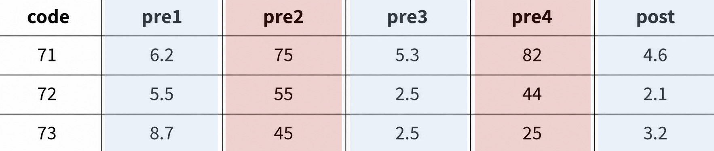{fig-align="left" width="85%"}
:::

::: {.column width="40%"}
**Erkennen:** Einige Ratingvariablen scheinen noch auf der Skala von 0-10 vorzuliegen, während andere bereits auf 0-100 skaliert wurden.

**Mögliche Ursache:** Die Daten wurden teilweise bereits transformiert oder stammen aus unterschiedlich aufbereiteten Dateien.

**Umgang:** Jede Variable vor der Transformation untersuchen. Nur Werte umrechnen, deren Skalierung tatsächlich angepasst werden muss.
:::
:::::

**Wichtig:** Bereits korrekt transformierte Variablen dürfen nicht erneut transformiert werden.

::: notes
Erinnert euch an EH6: Wir haben die fünf Ratingvariablen mit zehn multipliziert, damit sie der Skala von 0 bis 100 entsprechen.

Bei unserem ursprünglichen Datensatz war das richtig. Aber was passiert, wenn wir neue Daten erhalten, bei denen einzelne Variablen bereits transformiert wurden?

In diesem Beispiel fällt auf, dass pre2 und pre4 teilweise Werte über zehn enthalten. Das deutet darauf hin, dass sie möglicherweise schon auf der 0-100-Skala vorliegen.

Würden wir bspw. einen Wert von 75 nochmals transformieren, entstünde 750. Das wäre auf unserer Zielskala offensichtlich unzulässig.

Wir müssen deshalb vor einer Transformation überprüfen, in welchem Datenstand sich jede Variable befindet. Der beobachtete Wertebereich liefert einen wichtigen Hinweis.
:::

------------------------------------------------------------------------

## Skalierungen prüfen und anpassen

**Den Ausgangszustand kennen - dann nur notwendige Transformationen durchführen**

<br>

::::: columns
::: {.column width="45%"}
**1. Bisherige Werte untersuchen**

```{r, echo=TRUE, eval=FALSE}
summary(data_ratings[
  c("pre1", "pre2", "pre3", "pre4", "post")
])
```

Zeigt für jede Variable u.a. Minimum, Median und Maximum.
:::

::: {.column width="55%"}
**2. Nur notwendige Variablen transformieren**

```{r, echo=TRUE, eval=FALSE}
data_ratings <- data_ratings |>
  mutate(
    across(
      c(pre1, pre3, post),
      ~ .x * 10
    )
  )
```

**Ergebnis kontrollieren**

```{r, echo=TRUE, eval=FALSE}
summary(data_ratings[
  c("pre1", "pre2", "pre3", "pre4", "post")
])
```
:::
:::::

<br>

Danach sollen alle fünf Ratingvariablen auf derselben dokumentierten Skala von 0-100 vorliegen.

::: notes
Wie finden wir nun heraus, welche Variablen bereits transformiert wurden?

Zuerst können wir uns mit summary() die Verteilungen und Wertebereiche der fünf Ratingvariablen anzeigen lassen.

Wenn eine Variable ursprünglich auf einer Skala von null bis zehn vorliegen sollte, ist ein Wert von 75 ein deutlicher Hinweis, dass bereits eine Umrechnung stattgefunden hat.

Anschliessend gleichen wir die Ergebnisse mit der Dokumentation ab. Wenn klar ist, welche Variablen noch umgerechnet werden müssen, führen wir die Transformation durch.

Für diese Variablen verwenden wir erneut mutate() und across(), die wir bereits kennen.
:::

------------------------------------------------------------------------

## Inverse Items: Gleiche Zahlen, unterschiedliche Bedeutung?

**Warum müssen manche Fragebogenitems vor der Skalenbildung umgepolt werden?**

<br>

::::: columns
::: {.column width="60%"}
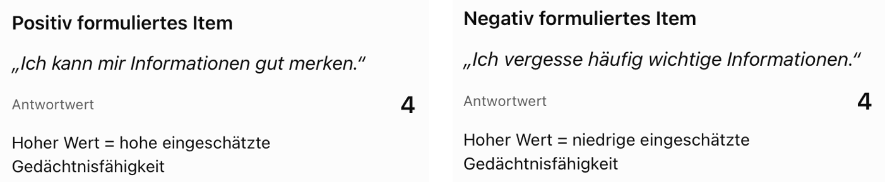{fig-align="left" width="95%"}

**Problem:** Derselbe Antwortwert kann je nach Itemformulierung eine gegenteilige inhaltliche Bedeutung besitzen.
:::

::: {.column width="40%"}
**Erkennen:** Items können dieselbe Eigenschaft in entgegengesetzter Richtung erfassen.

**Besonderheit:** Ein hoher Zahlenwert steht nicht bei jedem Item für eine hohe Ausprägung derselben Eigenschaft.

**Umgang:** Vor der gemeinsamen Skalenberechnung müssen alle Items in die gewünschte inhaltliche Richtung gebracht werden.
:::
:::::

::: notes
Stellt euch vor, wir möchten die subjektive Gedächtnisfähigkeit mit mehreren Aussagen untersuchen. Bei der ersten Aussage bedeutet eine hohe Zustimmung, dass sich eine Person eine gute Gedächtnisfähigkeit zuschreibt.

Bei der zweiten Aussage ist es genau umgekehrt: Eine hohe Zustimmung bedeutet, dass die Person häufig Dinge vergisst.

Obwohl beide Personen denselben Antwortwert von vier vergeben könnten, bedeutet dieser Wert bei den beiden Aussagen etwas Unterschiedliches.

Wenn wir nun einfach einen Mittelwert aus solchen Items bilden, würden wir gegensätzliche Bedeutungen miteinander vermischen.

Deshalb müssen wir vor der Skalenbildung sicherstellen, dass die Werte aller Items in dieselbe gewünschte Richtung zeigen. Dafür verwenden wir das sogenannte Reverse Coding, also die Umpolung inverser Items.
:::

------------------------------------------------------------------------

## Wie erkennen wir inverse Items?

**Entscheidend sind die Itembedeutung, die Kodierung und die Informationen im Codebook**

<br>

::::: columns
::: {.column width="55%"}
<br>

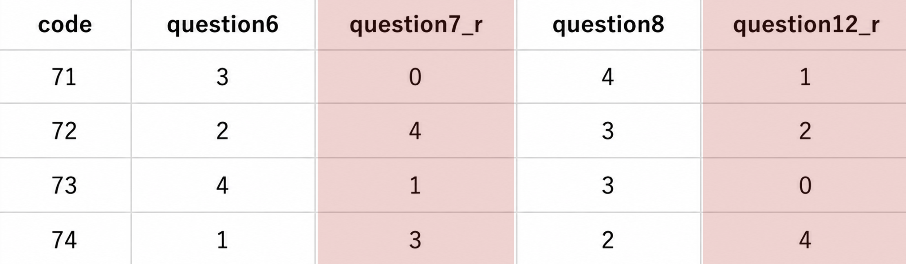{fig-align="left" width="85%"}
:::

::: {.column width="45%"}
**Erkennen:** Endung `_r` kann auf eine inverse Itemkodierung hinweisen.

**Besonderheit:** An den Zahlen allein erkennen wir nicht, ob ein Item umgepolt werden muss oder bereits umgepolt wurde.

**Umgang:** Itemformulierungen, Antwortskala & aktuelle Kodierung im Codebook prüfen. Erst danach entscheiden, ob Umpolung erforderlich ist.
:::
:::::

<br>

**Zusätzliche Kontrolle:** Bei Cronbachs Alpha können negative Item-Skala-Korrelationen auf falsch gepolte Items hinweisen.

::: notes
Jetzt schauen wir uns kurz an, wie solche Items in einem tatsächlichen Forschungsdatensatz erkennbar sein können.

Im Beispiel sehen wir mehrere Fragebogenvariablen. Zwei davon besitzen die Endung \_r. Eine solche Kennzeichnung kann darauf hinweisen, dass die Items eine besondere Kodierung besitzen.

Allerdings müssen wir hier genau unterscheiden. Ein Item kann erstens inhaltlich umgekehrt formuliert sein. Zweitens können seine Antwortwerte bereits numerisch umgepolt worden sein.

Das ist nicht dasselbe. Wenn eine Umpolung bereits durchgeführt wurde, wäre eine zweite Umpolung falsch.
:::

------------------------------------------------------------------------

## Inverse Items umpolen und kontrollieren

**Gleiche inhaltliche Richtung herstellen, bevor mehrere Items zusammengefasst werden**

<br>

::::: columns
::: {.column width="50%"}
**1. Prinzip der Umpolung bei einer 0–4-Skala**

<br>

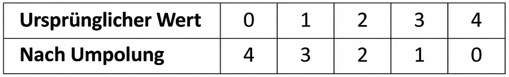{fig-align="left" width="85%"}

<br> **Berechnungsregel:** `neuer_wert = 4 - alter_wert`
:::

::: {.column width="50%"}
**2. Umpolung durchführen**

```{r, echo=TRUE, eval=FALSE}
data_mmq <- data_mmq |>
  mutate(
    across(
      c(question7_r, question12_r),
      ~ 4 - .x
    )
  )
```

-   `4 - .x` kehrt die Werte einer **0-4-Skala** um.

-   `mutate()` verändert ausgewählte Variablen.

-   `across()` wendet Umrechnung auf mehrere Items an.

-   Fehlende Werte (`NA`) bleiben erhalten.
:::
:::::

<br>

**Wichtig:** Keine bereits umgepolten Werte erneut umpolen.

::: notes
Wir wissen jetzt, weshalb inverse Items eine besondere Behandlung benötigen. Wie können wir die Richtung der Werte nun umkehren?

Bei einer Skala von 0 bis 4 verwenden wir die Regel 4 - den ursprünglichen Wert.

Aus 0 wird 4, aus 1 wird 3 und aus 4 wird 0. Der mittlere Wert 2 bleibt unverändert.

Bei mehreren Items eignet sich mutate() in Kombination mit across(). Die Formel wird auf alle angegebenen Variablen angewendet.

In unserem Forschungsprojekt erfolgt diese Vorbereitung vor der Berechnung von mmq_mean. Die ausführliche Skalenberechnung behandeln wir nächste Woche.
:::

------------------------------------------------------------------------

## Wo korrigieren wir Datenprobleme im Forschungsprojekt?

**Die richtige Position hängt davon ab, wann wir das Problem erkennen & zuverlässig beheben können**

<br>

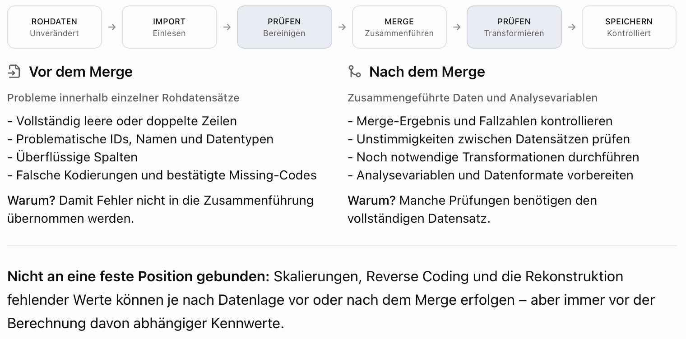{fig-align="center" width="85%"}

<br>

**So früh wie sinnvoll, sie spät wie nötig!** Es gibt nicht immer nur eine richtige Lösung.

------------------------------------------------------------------------

## Nun: Fehlerlabor

<br>

{fig-align="center" width="65%"}

<br>

**Jetzt seid ihr dran:** Öffnet Hands-on 4B auf der Seminarwebseite, ladet die Arbeitsvorlage, den Excel-Datensatz und das Codebook herunter und bearbeitet die Aufgaben in `fehlerlabor_vorlage.qmd`.

------------------------------------------------------------------------

## Hausübungen & Ausblick

-   R Hausübung I um eine Woche verschoben: **NEU 18.11.2026!**

    -   Unterlagen dazu ab heute auf der Webseite

    -   Abgabe wie gewohnt auf ILIAS

    -   Personalisierte Rückmeldung zu Korrektheit und Code-Stil von uns

<br>

**Weitere Schritte:**

-   **EH9 (11.11.):** MMQ-Skalenwert berechnen und Long-Daten aus **`pre1` und `pre4`** erzeugen.
