```{r, echo = FALSE, message=FALSE}

library(tidyverse)
library(palmerpenguins)
penguins <- palmerpenguins::penguins
dat_full <- readr::read_delim("raw/dat_full.csv")
```

## R u Ready? Reproduzierbare Datenaufbereitung und -analyse mit R

HS 2026<br><br><br> **Seminarleitung**: Dr. Sandra Grinschgl<br> **Leitung beider Seminargruppen:** MSc. Laura Hirt<br> **Tutor**: BSc. Jan-Pierre Pahnke<br><br><br>**9. Einheit**, 11.11.2026

{fig-align="center" width="306"}

------------------------------------------------------------------------

## Fortsetzung Fehlerlabor

<br>

{fig-align="center" width="65%"}

<br>

**Ca. 30 Minuten: Weiterarbeit Fehlerlabor**

------------------------------------------------------------------------

## Wo befinden wir uns?

**AUFBEREITEN: Die letzten Schritte vor dem Wechsel zur Datenanalyse**

<br>

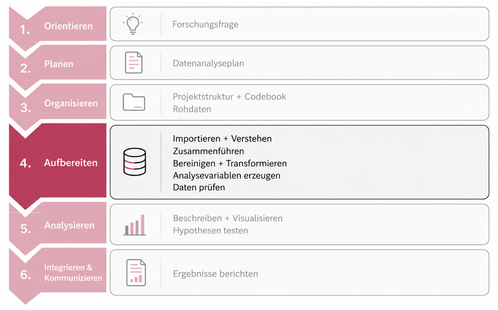{fig-align="center" width="75%"}

<br>

**Bisher:** Daten zusammengeführt, dokumentiert und transformiert.

**Heute:** Zurück zum gemeinsamen Forschungsprojekt - wir vervollständigen `processing.qmd`.

**Nächste Woche:** Wir beginnen, unsere Daten zu beschrieben und zu visualisieren.

------------------------------------------------------------------------

## Zwei letzte Schritte vor der Analyse

**Heute vervollständigen wir `processing.qmd`**

<br>

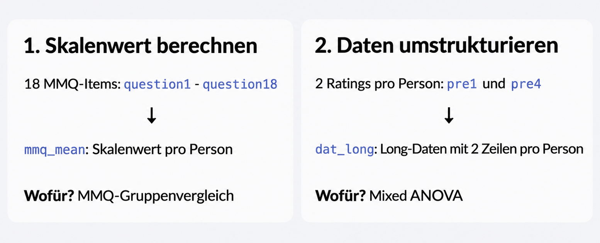{fig-align="center" width="65%"}

<br>

**Ergebnis heute:** `dat_full.csv` (mit `mmq_mean`) und `dat_long.csv` im Processed-Ordner.

------------------------------------------------------------------------

## Warum berechnen wir überhaupt Skalenwerte?

**Mehrere Items sollen gemeinsam ein psychologisches Merkmal erfassen**

<br>

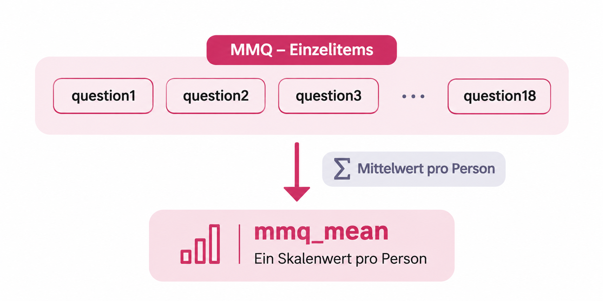{fig-align="center" width="65%"}

<br>

-   **Item:** einzelne Frage bzw. Aussage im Fragebogen

-   **Skalenwert:** zusammenfassender Wert für eine Person

-   **Mittelwert:** bleibt auf der ursprünglichen Antwortskala (hier 0-4)

::: notes
Unser MMQ-Fragebogen besteht in den bereitgestellten Daten aus 18 Items. Wir möchten aber nicht 18 isolierte Variablen miteinander vergleichen, sondern einen gemeinsamen Kennwert pro Person bilden.

Der Mittelwert behält die ursprüngliche 0-4-Skala bei und ist deshalb einfacher interpretierbar als ein Summenwert.
:::

------------------------------------------------------------------------

## Erst prüfen, dann mitteln

**Vor der Skalenberechnung müssen Antwortformat, Polung und fehlende Werte geklärt sein**

<br>

{fig-align="center" width="85%"}

<br>

**Merke:** Items erst korrekt kodieren und polen – dann zusammenfassen.

------------------------------------------------------------------------

## Von Textantworten zu Zahlen

**Likert-Skalen verwenden häufig textbasierte Antwortkategorien - für statistische Auswertungen brauchen wir numerische Codes**

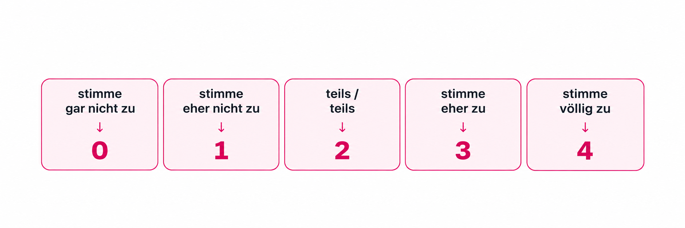{fig-align="center" width="85%"}

**Wichtig:** Die numerischen Codes müssen der inhaltlichen Reihenfolge der Antwortkategorien entsprechen.

<br>

**Hinweis:** Dies ist ein allgemeines Beispiel. Unsere MMQ-Daten sind bereits numerisch kodiert.

::: notes
Viele Fragebögen arbeiten mit sprachlich formulierten Antwortkategorien, vor allem bei Likert-Skalen.

Damit wir Mittelwerte berechnen oder andere statistische Analysen durchführen können, brauchen wir numerische Werte.

Wichtig ist, dass die Reihenfolge inhaltlich korrekt bleibt: von niedriger Zustimmung zu hoher Zustimmung.

Das hier ist ein allgemeines Beispiel. Unsere MMQ-Daten liegen bereits numerisch vor, deshlab müssen wir diesen Schritt dort nicht erneut durchführen.
:::

------------------------------------------------------------------------

## So kodieren wir Textantworten in R

**Mit `case_when()` übersetzen wir textbasierte Antwortkategorien in numerische Werte**

<br>

```{r, echo=TRUE, eval=FALSE}
beispiel_daten <- beispiel_daten |>
  mutate(
    across(
      question_1:question_8,
      ~ case_when(
        .x == "stimme gar nicht zu"  ~ 0,
        .x == "stimme eher nicht zu" ~ 1,
        .x == "teils / teils"        ~ 2,
        .x == "stimme eher zu"       ~ 3,
        .x == "stimme völlig zu"     ~ 4,
        .default = NA_real_
      )
    )
  )
```

<br>

-   `mutate()` verändert die bestehenden Variablen

-   `across()` wendet dieselbe Transformation auf mehrere Items an

-   `case_when()` weist jeder Textantwort ihren entsprechenden numerischen Wert zu

-   `.x` bezeichnet jeweils die gerade bearbeitete Itemspalte

------------------------------------------------------------------------

## Inverse Items richtig umpolen

**Vor der Skalenberechnung müssen alle Items in dieselbe inhaltliche Richtung zeigen**

<br>

::::: columns
::: {.column width="50%"}
**1. Prinzip der Umpolung (0-4)**

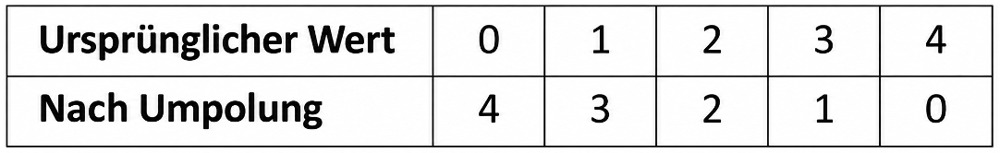{fig-align="left" width="90%"}

<br>

**Berechnungsregel:** `neuer_wert = 4 - alter_wert`
:::

::: {.column width="50%"}
**2. Umpolung in R (Beispiel)**

```{r, echo=TRUE, eval=FALSE}
beispiel_daten <- beispiel_daten |>
  mutate(
    across(
      c(item_2, item_5),
      ~ 4 - .x
    )
  )
```

-   `across()` wählt die noch umzupolenden Items aus

-   `4 - .x` kehrt ihre Werte um; `NA` bleibt `NA`
:::
:::::

<br>

**Für unser MMQ:** Keine zusätzliche Umpolung in den Originaldaten.

::: notes
Wir wissen nun, wie wir Antworten numerisch kodieren und wie wir inverse Items bei Bedarf umpolen. Damit sind die wichtigsten Voraussetzungen für die Skalenberechnung geklärt.

Unsere MMQ-Originaldaten liegen bereits numerisch vor und wir nehmen keine zusätzliche Umpolung vor. Jetzt wollen wir aus den 18 vorhandenen Itemwerten einen gemeinsamen Skalenwert pro Person berechnen.
:::

------------------------------------------------------------------------

## Ein Mittelwert für jede Person

**Unsere 18 MMQ-Items liegen bereits numerisch vor**

<br>

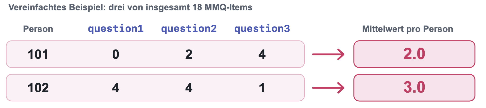{fig-align="center" width="90%"}

<br>

::::: columns
::: {.column width="49%"}
**`mean()`** bildet einen Mittelwert **über Personen** – beispielsweise für `question1`.
:::

::: {.column width="51%"}
**`rowMeans()`** bildet einen Mittelwert **über Items innerhalb jeder Person**.
:::
:::::

<br>

**Für unseren Skalenwert `mmq_mean` brauchen wir `rowMeans()`.**

::: notes
Wir haben bereits gesehen, weshalb mehrere Items zu einem Skalenwert zusammengefasst werden und welche Voraussetzungen dabei gelten.

Für unser gemeinsames Projekt liegen die 18 MMQ-Items question1 bis question18 numerisch auf einer Skala von 0 bis 4 vor.

Wie genau wollen wir nun mitteln? Nicht alle Personen innerhalb einer Itemspalte, sondern alle relevanten Items innerhalb einer Person.

mean() ist nützlich, wenn wir bspw. den Durchschnitt einer Itemspalte über alle Personen hinweg berechnen wollen.

Für unser Vorhaben brauchen wir dagegen pro Person einen eigenen Wert. Das leistet rowMeans().
:::

------------------------------------------------------------------------

## `mmq_mean` mit `rowMeans()` berechnen

**Wir ergänzen den MMQ-Mittelwert als neue Variable in unserem bestehenden `dat_full`**

<br>

```{r, echo=TRUE, eval=FALSE}
dat_full <- dat_full |>
  mutate(
    mmq_mean = rowMeans(across(question1:question18))
  )

# Alternative
dat_full <- dat_full |>
  mutate(
    mmq_mean = rowMeans(across(starts_with("question")))
  )
```

<br>

:::::: columns
::: {.column width="33%"}
**`across()`**\
Wählt die **18 Itemspalten** aus.
:::

::: {.column width="33%"}
**`rowMeans()`**\
Bildet einen **Mittelwert je Person**.
:::

::: {.column width="34%"}
**`mutate()`**\
Ergänzt **`mmq_mean`** in `dat_full`.
:::
::::::

<br>

**Ergebnis prüfen:** 159 × 36 → 159 × 37; Skalenwerte zwischen 0-4

**Danach:** Codebook um `mmq_mean` ergänzen

------------------------------------------------------------------------

## Dieselben Ratings - zwei Datenformate

**Für unsere spätere Mixed ANOVA ordnen wir** `pre1` **und `pre4` neu an**

<br>

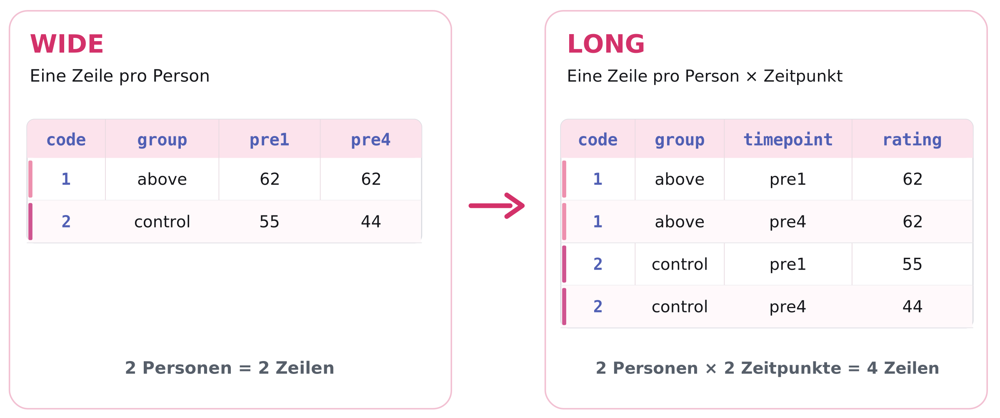{fig-align="center" width="90%"}

<br>

**Die ausgewählten Messwerte bleiben gleich, nur ihre Anordnung verändert sich.**

::: notes
Wir haben soeben aus 18 MMQ-Items einen Skalenwert pro Person berechnet.

Für unsere zweite Analyseanforderung brauchen wir etwas anderes: nicht einen zusammengefassten Wert, sondern die beiden einzelnen Ratings pre1 und pre4 jeder Person.

Das sind die beiden subjektiven Leistungseinschätzungen, die wir später über die Messzeitpunkte hinweg vergleichen.

Auf der linken Seite sehen wir den Wide-Datensatz: Eine Zeile entspricht hier einer Person. Ihre Messungen liegen in zwei verschiedenen Spalten.

Rechts sehen wir das Long-Format: Eine Zeile entspricht hier einer Person zu genau einem Messzeitpunkt. Dadurch erscheint code 1 zweimal, einmal mit pre1 und einmal mit pre4. Die Gruppenzugehörigkeit bleibt dabei natürlich dieselbe.

Wichtig ist, dass wir hier nur die ausgewählten Ratings betrachten. Die beiden vollständigen Datensätze enthalten natürlich viele weitere Variablen.
:::

------------------------------------------------------------------------

## Warum brauchen wir das Long-Format?

**Unsere Mixed ANOVA verbindet Gruppenunterschiede mit Messwiederholungen**

<br>

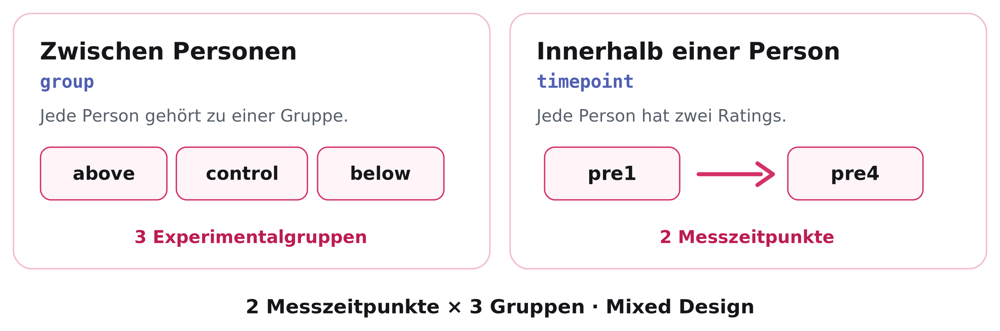{fig-align="center" width="85%"}

<br>

**Heute:** Wir bereiten mit `code`, `group`, `timepoint` und `rating` nur die Datenstruktur vor. Die **ANOVA** folgt in EH13.

::: notes
Die Mixed ANOVA besitzt einen Between-Subjects-Faktor und einen Within-Subjects-Faktor.

-   Zwischen den Personen unterscheiden wir drei experimentelle Gruppen: above, control und below. Jede Person gehört genau einer dieser Gruppen an.

-   Innerhalb derselben Person haben wir verschiedene Ratings, von denen für die Mixed ANOVA pre1 und pre4 relevant sind.
:::

------------------------------------------------------------------------

## **Wide** → **Long: Animation**

**Wie genau findet die Transformation statt?**

<br>

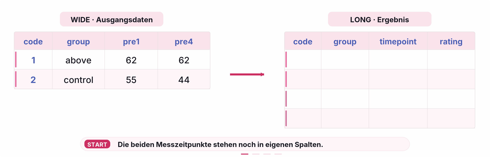{fig-align="center" width="65%"}

------------------------------------------------------------------------

## **Wide** → **Long mit `pivot_longer()`**

**Aus den Spalten `pre1` und `pre4` werden die Variablen `timepoint` und `rating`**

<br>

```{r, echo=TRUE, eval=FALSE}
dat_long <- dat_full |>
  pivot_longer(
    cols = c(pre1, pre4),
    names_to = "timepoint",
    values_to = "rating"
  )
```

<br>

:::::: columns
::: {.column width="33%"}
**`cols`**

Welche Spalten werden untereinander angeordnet?

`pre1`, `pre4`
:::

::: {.column width="33%"}
**`names_to`**

Wie heisst die neue Spalte mit den Messzeitpunkten?

`timepoint`
:::

::: {.column width="34%"}
**`values_to`**

Wie heisst die neue Spalte mit den Ratings?

`rating`
:::
::::::

<br>

**Wichtig:** `dat_long` entsteht **zusätzlich**. Unser vollständiger Wide-Datensatz `dat_full` bleibt erhalten.

::: notes
Über `cols` geben wir an, welche Spalten wir untereinander anordnen: pre1 und pre4.

Mit `names_to` bestimmen wir den Namen der neuen Variable, in der die bisherigen Spaltennamen stehen.

Mit `values_to` benennen wir die gemeinsame Wertespalte rating.

Die Informationen zu Person und Gruppe werden für beide Messungen übernommen.

Mit dem Zuweisungspfeil erstellen wir ein neues Objekt namens dat_long. Da dieses einen anderen Objektnamen hat, wird dat_full nicht überschrieben, sondern ein zusätzlicher Datensatz erstellt.

Die anderen Rating-Spalten pre2, pre3 und post bleiben im vollständigen Wide-Datensatz erhalten, werden aber in dieser Long-Version nicht benötigt.
:::

------------------------------------------------------------------------

## Was verändert sich beim Umformen?

**Wir haben weiterhin dieselben Personen - aber zwei Messzeilen pro Person**

<br>

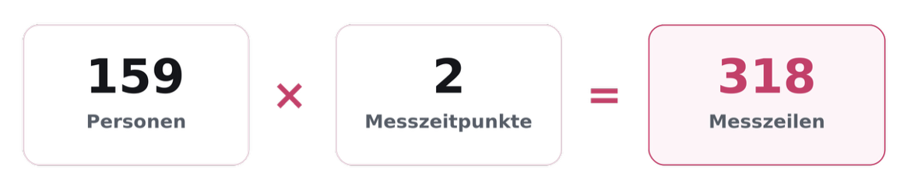{fig-align="center" width="65%"}

<br>

**Wichtig:** Derselbe `code` kommt nun zweimal vor - das ist beabsichtigt!

::: notes
Jede der 159 Personen liefert genau zwei Ratings. Deshalb erhalten wir 318 Zeilen, aber weiterhin 159 unterschiedliche Personen.
:::

------------------------------------------------------------------------

## Und zurück? `pivot_wider()`

**Freiwillige Vertiefung: Die Transformation lässt sich auch wieder umkehren**

<br>

```{r, echo=TRUE, eval=FALSE}
dat_wide_check <- dat_long |>
  pivot_wider(
    names_from = timepoint,
    values_from = rating
  )
```

<br>

::::: columns
::: {.column width="50%"}
**`names_from`**

Die Werte aus `timepoint` werden wieder zu den Spalten `pre1` und `pre4`.
:::

::: {.column width="50%"}
**`values_from`**

Die Werte aus `rating` füllen diese beiden Spalten.
:::
:::::

::: notes
Die Gegenfunktion zu pivot_longer heisst pivot_wider.

Aus den beiden Werten der Variable timepoint erzeugt sie wieder zwei Spalten. Die Ratingwerte werden den jeweiligen Spalten zugewiesen.
:::

------------------------------------------------------------------------

## Zwei Datensätze für die Analyse

**Wir vervollständigen unser bestehendes `processing.qmd` und speichern beide Ergebnisse**

<br>

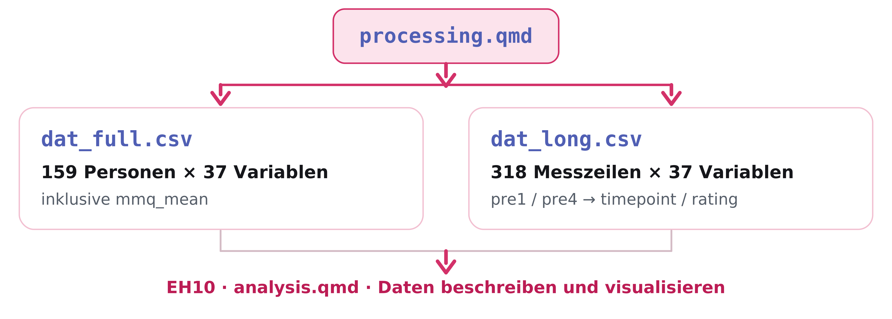{fig-align="center" width="65%"}

<br>

**Speicherort: `data/processed/`**

Die beiden Dateien werden ganz am Ende des Processing-Skripts gespeichert.

------------------------------------------------------------------------

## Nun: Hands-on 5A

**Arbeitsort: euer bestehendes `code/processing.qmd` im Forschungsprojekt**

<br>

1.  **`mmq_mean` ergänzen:** Mittelwert aus `question1` bis `question18` pro Person.
2.  **`dat_long` erstellen:** Nur `pre1` und `pre4` verwenden.
3.  **Kurz kontrollieren:** 159 × 37 (Wide), 318 × 37 (Long).
4.  **Speichern, rendern, dokumentieren:** Beide CSV-Dateien nach `data/processed/`; Codebook um `mmq_mean` ergänzen.

<br>

Für den Long-Datensatz muss kein Codebook erstellt werden!

------------------------------------------------------------------------

## Hausübungen & Ausblick

<br>

-   **Optional:** Umfrage Muddiest Points II bis Sonntag, 15.11.26 (ILIAS Woche 9)

-   **R Übung 1:** bis Mittwoch, 18.11.26
