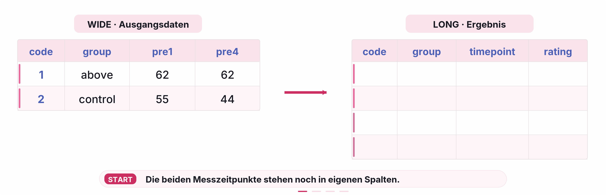

```{r, include = FALSE}
library(tidyverse)

dat_full <- readr::read_delim("raw/dat_full.csv")

# Aufbereitungsschritte
dat_full <- dat_full |>
  mutate(
    across(
      c(pre1, pre2, pre3, pre4, post),
      ~ .x * 10
    )
  )

dat_full <- dat_full |>
  rename(
    group = group_all,
    cvstm_sum = csvtm_sum)
```

Bei Bedarf finden sich hier nochmal die Slides zur EH9:

::: {=html}
<iframe src="../01_slides/EH_9.html" width="100%" height="500" style="border:0; display:block; margin: 0 0 2rem 0;">

</iframe>
:::

Die Folien der EH10 werden kurz vor dem Termin hochgeschalten.

# Teil 1: Die Datenaufbereitung abschliessen

*Bearbeitung nach EH9*

## 🧭 Wo befinden wir uns?

**Projektphase: AUFBEREITEN → ANALYSIEREN**

In Hands-on 2 und 3 habt ihr aus sieben Rohdatensätzen den gemeinsamen `dat_full` erstellt und die benötigten Variablen transformiert.

In EH7 und EH8 habt ihr die Datenbearbeitung und den Umgang mit Datenproblemen an separaten Übungsdaten geübt.

Jetzt kehren wir zum **gemeinsamen Forschungsprojekt** zurück. Für unsere späteren statistischen Analysen fehlen noch zwei Ergebnisse:

1.  `mmq_mean`: ein MMQ-Skalenwert aus 18 Items für jede Person.

2.  `dat_long`: ein zusätzlicher Datensatz, in dem `pre1` und `pre4` untereinanderstehen.

Heute ergänzen wir diese beiden Schritte im bestehenden `processing.qmd`. In EH10 beginnen wir dann mit der Beschreibung und Visualisierung der aufbereiteten Daten in `analysis.qmd`.

::: callout-important
**Arbeitsort: Euer vorhandenes Grinschgl-R-Projekt → `code/processing.qmd`.**

-   Erstellt **weder ein neues R-Projekt noch ein zweites Processing-Skript**.
-   Verändert die Dateien unter `data/raw/` nicht.
-   Die Übungsseite hier ist eure **Anleitung**. Den eigentlichen R-Code ergänzt ihr in **eurem eigenen Processing-Dokument**.
:::

## 🎯 Lernziele und Zeitplan

Nach Teil 1 könnt ihr einen Mittelwert über mehrere Items **pro Person** berechnen, `pivot_longer()` auf die beiden benötigten Ratingvariablen anwenden, die entstandenen Datensätze kontrollieren und beide Ergebnisse reproduzierbar speichern.

| Aufgabe | Was macht ihr?                                         |   Richtzeit |
|:---------------------|:----------------------------|---------------------:|
| **A0**  | Bisheriges Processing öffnen und Arbeitsstelle finden  |  ca. 2 Min. |
| **A1**  | `mmq_mean` berechnen                                   |  ca. 5 Min. |
| **A2**  | `dat_long` erzeugen                                    |  ca. 5 Min. |
| **A3**  | Wide und Long kontrollieren                            |  ca. 5 Min. |
| **A4**  | Beide Dateien speichern, Codebook ergänzen und rendern | ca. 10 Min. |

Die Zeiten dienen zur Orientierung. Falls ihr nicht fertig werdet, könnt ihr am bestehenden Skript weiterarbeiten. Die **aufklappbaren Tipps** helfen euch bei einem ersten Problem; die **Musterlösungen** sind zur Selbstkontrolle gedacht.

## A0: Ausgangszustand und Einfügeort bestimmen

### 🧭 A0.1: Wo ergänzen wir die beiden neuen Schritte?

Öffnet euer R-Projekt und darin `code/processing.qmd`. Sucht die bisherigen Verarbeitungsschritte und den Abschnitt, in dem `dat_full.csv` gespeichert wird.

**Überlegt zuerst:** Was muss vor dem Speichern passieren, damit in der CSV-Datei tatsächlich der neue MMQ-Skalenwert enthalten ist?

Bis zum heutigen Arbeitsschritt sollte euer `dat_full` **159 Personen × 36 Variablen** enthalten. Insbesondere sollten `group` bereits so heissen und die Ratings `pre1`, `pre2`, `pre3`, `pre4` und `post` schon auf **0–100** umgerechnet sein.

::: {.callout-tip collapse="true" title="Tipp A0.1: Die richtige Reihenfolge"}
Die neuen Schritte gehören **nach** die bisherigen Umbenennungen und Rating-Transformationen, aber **vor** das endgültige Speichern. Den vorhandenen Speicherschritt für `dat_full.csv` bei Bedarf nach unten verschieben – **nicht ein zweites Mal hinzufügen**.

Wenn ihr im Environment bereits transformierte Ratings habt, führt nicht einfach den alten `× 10`-Code erneut auf diesem Objekt aus. Für einen sauberen Durchlauf startet ihr wieder bei den unveränderten Rohdaten und führt die Verarbeitungsschritte in der richtigen Reihenfolge aus.
:::

:::: {.content-visible when-meta="show_solutions"}
::: {.callout-note collapse="true" title="Musterlösung A0.1"}
Die Reihenfolge in `processing.qmd` lautet am Schluss:

``` text
Rohdaten importieren und zusammenführen
  ↓
Bisherige Umbenennungen und Ratings × 10
  ↓
mmq_mean berechnen                  ← HEUTE
  ↓
dat_long mit pre1 und pre4 erzeugen ← HEUTE
  ↓
Ergebnisse prüfen
  ↓
dat_full.csv und dat_long.csv speichern
```

Der vorhandene Speicherschritt für `dat_full` gehört **hinter** die Berechnung von `mmq_mean`.
:::
::::

## A1: Den MMQ-Skalenwert berechnen

### 🧭 A1.1: Aus 18 Items wird ein Wert pro Person

In den Originaldaten liegen die MMQ-Items `question1` bis `question18` bereits **numerisch auf einer Skala von 0 bis 4** vor. Eine zusätzliche Textkodierung oder Umpolung ist für diesen gemeinsamen Originaldatensatz nicht vorgesehen.

**Eure Aufgabe:** Ergänzt in `processing.qmd` eine Pipeline, die aus den 18 MMQ-Items für jede Person einen Mittelwert bildet und ihn als neue Variable `mmq_mean` in `dat_full` dauerhaft speichert.

::: {.callout-tip collapse="true" title="Tipp A1.1"}
Verwendet die Funktionen `mutate()`, `across()` und `rowMeans()`. Die 18 Items bleiben als einzelne Spalten im Datensatz erhalten.

`across(question1:question18)` wählt die nebeneinanderliegenden MMQ-Itemspalten aus. `rowMeans()` mittelt **innerhalb jeder Zeile**, und `mutate()` ergänzt das Ergebnis als neue Variable. Anders als `mean()` berechnet `rowMeans()` hier **nicht einen einzigen Mittelwert über alle Personen**.
:::

:::: {.content-visible when-meta="show_solutions"}
::: {.callout-note collapse="true" title="Musterlösung A1.1"}
Ergänzt einmalig an der passenden Stelle eures vorhandenen Processing-Skripts:

```{r}
dat_full <- dat_full |>
  mutate(
    mmq_mean = rowMeans(across(question1:question18))
  )
```

Der neue Wide-Datensatz besitzt jetzt 159 Zeilen und 37 Spalten. Es wurde keine Person entfernt und kein MMQ-Item überschrieben.

Die neue Variable steht standardmässig immer an letzter Stelle der Spalten. Wenn diese von ihrer Reihenfolge her verschoben werden soll (z.B . direkt hinter `question18`), kennt ihr mittlerweile eine Funktion, um deren Position direkt zu bestimmen.
:::
::::

### 🧭 A1.2: Einen konkreten Skalenwert nachvollziehen

Prüft mit einem kurzen R-Befehl den Skalenwert für die Person mit `code == 1`.

**Kontrollfrage:** Bei dieser Person ergeben die 18 MMQ-Antworten zusammen 47 Punkte. Welchen Wert sollte `mmq_mean` daher ungefähr besitzen?

::: {.callout-tip collapse="true" title="Tipp A1.2"}
Berechnet `47 / 18`. Den gespeicherten Wert könnt ihr beispielsweise mit `filter()` und `select()` ansehen. Für diese Kontrolle benötigt ihr **keine zusätzliche dauerhafte Variable**.
:::

:::: {.content-visible when-meta="show_solutions"}
::: {.callout-note collapse="true" title="Musterlösung A1.2"}
```{r}
47 / 18

dat_full |>
  filter(code == 1) |>
  select(code, mmq_mean)
```

Für diese Person ergibt sich `mmq_mean≈ 2.61`.

Da die Items Werte von 0 bis 4 besitzen, muss auch der Mittelwert innerhalb von 0 bis 4 liegen.
:::
::::

## A2: Einen Long-Datensatz erzeugen

{fig-align="center" width="65%"}

### 🧭 A2.1: `pre1` und `pre4` untereinander anordnen

Für die spätere Mixed ANOVA benötigen wir die subjektiven Leistungseinschätzungen zu zwei Messzeitpunkten (`pre1` und `pre4`) im Long-Format.

**Eure Aufgabe:** Erzeugt aus dem bereits erweiterten `dat_full` mit `pivot_longer()` ein neues Objekt namens `dat_long`. Dabei wird der Wide-Datensatz nicht überschrieben!

-   `cols`: Nur die beiden Ratingvariablen `pre1` und `pre4` umformen.

-   `names_to`: Die neue Zeitvariable soll `timepoint` heissen.

-   `values_to`: Die neue Wertespalte soll `rating` heissen.

:::: {.content-visible when-meta="show_solutions"}
::: {.callout-note collapse="true" title="Musterlösung A2.1"}
```{r}
dat_long <- dat_full |>
  pivot_longer(
    cols = c(pre1, pre4),
    names_to = "timepoint",
    values_to = "rating"
  )
```

`code`, `group`, `mmq_mean` und alle anderen nicht umgeformten Variablen bleiben erhalten. Sie werden für die zwei Messungen derselben Person in den Long-Zeilen wiederholt.
:::
::::

## A3: Ist das Ergebnis wie erwartet?

### 🧭 A3.1: Wide und Long kurz kontrollieren

Überprüft anhand geeigneter R-Befehle die vier Kontrollfragen:

| Kontrollfrage | Erwartetes Ergebnis für unsere Originaldaten |
|:--------------------------------|:-----------------------------------|
| Wie gross ist `dat_full`? | **159 Zeilen × 37 Spalten** |
| Wie gross ist `dat_long`? | **318 Zeilen × 37 Spalten** |
| Wie viele verschiedene Personen enthält `dat_long`? | **159** |
| Wie oft kommen `pre1` und `pre4` in `timepoint` vor? | **je 159-mal** |

Lasst euch ausserdem die ersten **vier** Zeilen mit den Variablen `code`, `group`, `timepoint` und `rating` anzeigen. Könnt ihr die vier Zeilen den ursprünglichen `pre1`- und `pre4`-Werten zuordnen?

::: {.callout-tip collapse="true" title="Tipp A3.1"}
Ihr kennt `dim()`, `table()`, `head()` und `select()` bereits. Mit `n_distinct()` zählt ihr verschiedene Personen-IDs.

Dieselbe Personen-ID taucht im Long-Format **zweimal** auf – einmal pro Messzeitpunkt. Das ist hier **gewollt** und kein Duplikatfehler.
:::

::: {.content-visible when-meta="show_solutions"}
```{r}
dim(dat_full)                         
dim(dat_long)                         
n_distinct(dat_long$code)             
table(dat_long$timepoint)             

dat_long |>
  select(code, group, timepoint, rating) |>
  head(4)
```

**Warum 37 Spalten in beiden Datensätzen?** `pivot_longer()` ersetzt hier die beiden Spalten `pre1` und `pre4` durch zwei neue Spalten (`timepoint`, `rating`); alle übrigen Spalten bleiben enthalten.
:::

## A4: Speichern, dokumentieren und reproduzieren

### 🧭 A4.1: Beide Dateien an der richtigen Stelle speichern

Kontrolliert den bestehenden Speicherschritt für `dat_full.csv`: Er muss nach der Berechnung von `mmq_mean` stehen.

Ergänzt darunter einen zweiten Speicherschritt für `dat_long.csv`.

Beide Dateien gehören in `data/processed/`.

::: {.callout-tip collapse="true" title="Tipp A4.1"}
Das Objekt `dat_full` wird unter dem Dateinamen `dat_full.csv` gespeichert, `dat_long` unter `dat_long.csv`. Der Speicherort wird relativ zur **Projektwurzel** angegeben. Verschiebt einen vorhandenen Speicherschritt, statt ihn zu duplizieren.
:::

:::: {.callout-tip collapse="true" title="Tipp A4.1"}
::: {.callout-note collapse="true" title="Musterlösung A4.1"}
Diese beiden Befehle stehen am Ende der Processing-Pipeline, nachdem beide Datenobjekte erstellt und geprüft wurden:

```{r, echo=TRUE, eval=FALSE}
readr::write_csv(
  dat_full,
  here::here("data", "processed", "dat_full.csv")
)

readr::write_csv(
  dat_long,
  here::here("data", "processed", "dat_long.csv")
)
```

Falls der erste Befehl bereits im Skript steht, **verwendet ihn weiter** und achtet lediglich auf seine richtige Position. Ergänzt `dat_long.csv` als zweite Ausgabe.
:::
::::

### 🧭 A4.2: Codebook aktualisieren und vollständig rendern

Öffnet euer Codebook für `dat_full` und ergänzt die neu berechnete Variable `mmq_mean`.

Dokumentiert mindestens nachvollziehbar, aus welchen Items der Wert berechnet wurde, wie er berechnet wurde und welcher theoretische Wertebereich gilt.

**Danach:** Speichert euer `processing.qmd` und rendert es **vollständig**. Kontrolliert anschliessend, ob beide CSV-Dateien unter `data/processed/` vorhanden und aktuell sind.

::: {.callout-tip collapse="true" title="Tipp A4.2"}
`mmq_mean` gehört als neue Variable ins **Codebook des Wide-Datensatzes**. Für `dat_long` erstellt ihr **kein neues Codebook**.

Falls die gespeicherte `dat_full.csv` noch 36 Variablen hat, steht das Speichern vermutlich **vor** der neuen Berechnung. Falls die Ratings plötzlich ausserhalb von 0–100 liegen, prüft, ob ihr die `× 10`-Transformation mehrfach auf bereits veränderte Werte angewendet habt.
:::

## ✅ Checkpoint nach EH9

Euer `processing.qmd` erzeugt jetzt **reproduzierbar zwei aufbereitete Dateien** aus den ursprünglichen sieben Rohdatensätzen:

| Datei | Inhalt | Verwendung in den nächsten Einheiten |
|:-----------------------|:-----------------------|:-----------------------|
| `data/processed/dat_full.csv` | 159 Personen × 37 Variablen, neu mit `mmq_mean` | Gruppenvergleiche und weitere Analysen |
| `data/processed/dat_long.csv` | 318 Messzeilen × 37 Variablen, neu mit `timepoint` und `rating` | Mixed ANOVA mit `pre1` und `pre4` |

**Für EH10:** Ihr müsst **keine neuen Rohdaten importieren oder erneut transformieren**. Im `analysis.qmd` arbeitet ihr mit den beiden gespeicherten, aufbereiteten Dateien weiter.

## ⭐ Freiwillige Vertiefung: Zurück ins Wide-Format

Zum Verständnis könnt ihr `dat_long` probeweise wieder in ein Wide-Format zurückverwandeln. Verwendet dazu `pivot_wider()` und speichert das Ergebnis **nur temporär** als `dat_wide_check` – keine dritte Datei im Projekt.

Überlegt: Aus welcher Variable entstehen wieder die Spalten `pre1` und `pre4`, und woher kommen die dazugehörigen Zahlenwerte?

::: {.callout-tip collapse="true" title="Tipp zur Vertiefung"}
Bei `pivot_wider()` gibt `names_from` die Spalte mit den **künftigen Spaltennamen** und `values_from` die Spalte mit den **einzutragenden Messwerten** an.
:::

:::: {.content-visible when-meta="show_solutions"}
::: {.callout-note collapse="true" title="Musterlösung zur Vertiefung"}
```{r}
dat_wide_check <- dat_long |>
  pivot_wider(
    names_from = timepoint,
    values_from = rating
  )

dat_wide_check |>
  select(code, pre1, pre4) |>
  head(2)
```

Die Werte von `pre1` und `pre4` stehen wieder nebeneinander.
:::
::::
